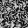
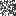
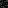
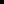

# Sunshine water texture — authored mip chain

These are original, small, **artist-editable grayscale PNG sources** used by
AnimalTown's GameCube water preview. They do not contain game assets extracted
from Super Mario Sunshine.

The individual PNGs are **not** ordinary reductions of a high-resolution
texture. Their distinct content is the key visual effect: when a surface
minifies with viewing angle and distance, GX's hardware texture sampler
selects a different authored level, faking a reflection/brightness band.

| 64px: near clear | 32px: scrolling caustics | 16px: brightest reflection | 8px: fade | 4px: far clear |
| --- | --- | --- | --- | --- |
|  |  |  |  |  |

## Editing

1. Edit *only* the source image for the distance range you want to change.
   Leave L0 and L4 completely black (no glints). L1 should contain thin
   irregular connected caustics, L2 broader and brighter irregular
   glints, L3 very subdued remnants.
2. Keep each image **opaque 8-bit grayscale** (RGB channels equal, alpha 255).
   The cooker derives GX alpha from the chosen luminance at each mip:
   highlights are cut out by the GPU's 0.68 alpha threshold. Do not
   pre-multiply or store transparency in the source PNG.
3. Do **not** use an image editor's automatic mipmap generation, nor resize
   the 64px blank image to fill the chain.
4. Run `dotnet run --project tools/AnimalTown.Tools -c Release -- sunshine-water .`
   to generate `out/disc/sunshine-water.dndtex`. The normal ISO build
   runs this cook automatically and checks the native texture header and
   art distribution.

## GPU path

- Format: **GX IA8**, native 4×4 tiles, alpha byte before intensity byte.
- DNTX v2 package: 5 levels, 64+32+16+8+4, **10,912 native bytes**.
- Both TEXMAP0/TEXMAP1 bind the *same texture*. Independent UV matrices
  scroll the two samples and add their color contributions in TEV.
- Texture minification: GX trilinear (LinearMipmapLinear), min LOD 0,
  max LOD 4, bias +0.65. Filter is specified both on the texture resource
  and the active material samplers.
- Alpha cutoff: >= 0.68 after TEX0 * raster alpha. The local two-sine
  wave overlay forces both samplers to L1 for near-camera ripples.
- The sandy floor is a separate reused/offset mesh pass underneath all
  transparent water. It uses the existing cliff-soil texture.

See [technical implementation](../../../../docs/sunshine-water-comparison.md)
and [Sunshine's original visual technique breakdown](https://blog.mecheye.net/2018/03/deconstructing-the-water-effect-in-super-mario-sunshine/).

The current published DolphinDotNet SDK does not expose the original game's
combined double-sided alpha test or full two-sample TEV alpha computation, so
this is a visually targeted **GX-compatible approximation**, not an extracted
retail material.
