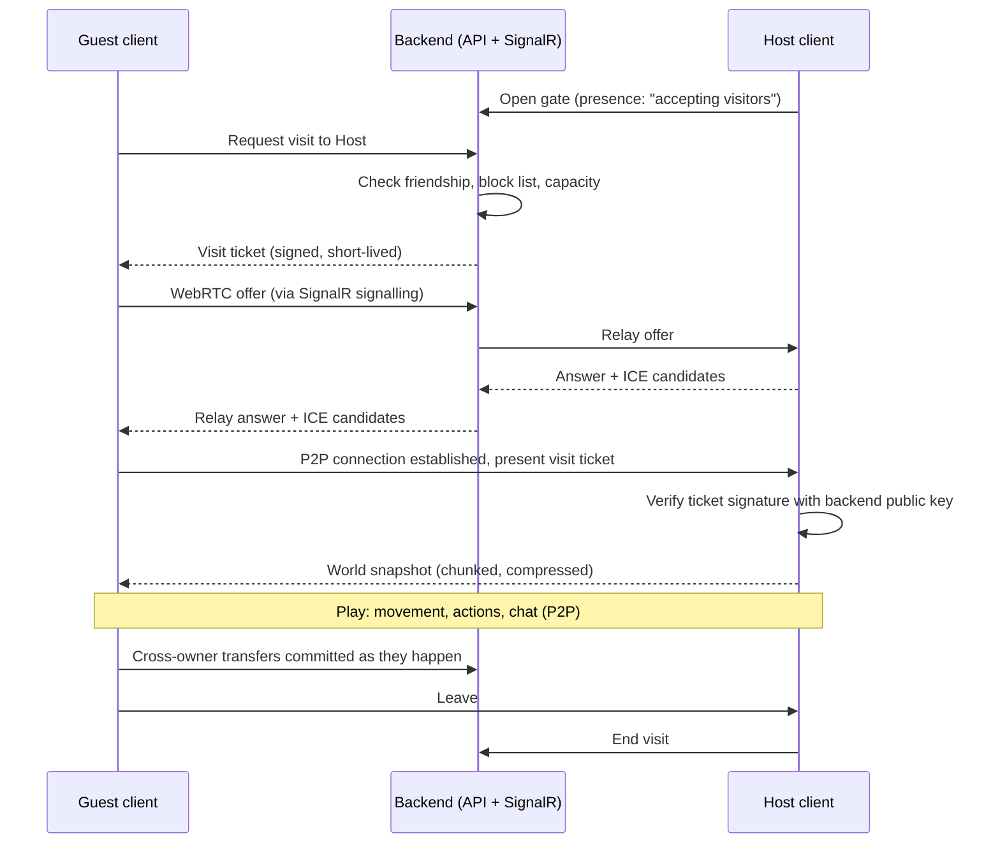
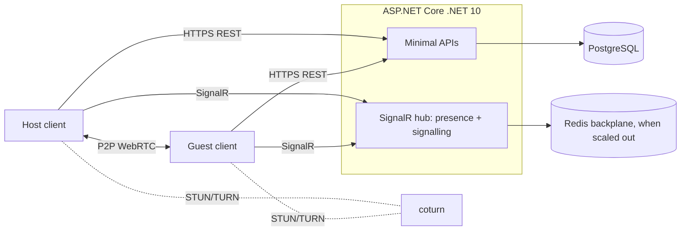

# Project Meadowroll: Game Design Document

| | |
|---|---|
| **Working title** | Project Meadowroll |
| **Document status** | Draft v0.1 |
| **Date** | 2026-11-02 |
| **Genre** | Real-time life sim / social sim |
| **Spiritual predecessor** | *Animal Crossing* (GameCube), with presentation ideas from *Animal Crossing: New Leaf* (3DS) |
| **Players** | 1 local, up to 4 per town online (1 host + 3 guests) |

> **Naming note:** names that belong to Nintendo's games (shopkeeper names, the currency, "gyroids") are used in this document only as references for the mechanic. The shipping game needs original names and characters; placeholders are marked *(working name)*. See §18.

---

## 1. Vision

A cosy, real-time village life game in which the player is an animal who moves into a small town, takes on a loan for a home, and gradually becomes part of the community through odd jobs, favours for neighbours, and slowly building up a house and a garden of their own. The game keeps the slow, gentle core loop of the GameCube original and adds online visits, so friends can drop by, help out, pitch a tent, and shop at each other's gyroid-run stalls.

### 1.1 Design pillars

1. **Faithful core loop.** Pockets, money, shopping, the loan, odd jobs, requests and lost items behave the way GameCube players remember.
2. **The world rolls.** The curved, rolling-log horizon is the game's visual signature.
3. **Your plot is yours.** A house and a garden that grow together. Decorations live inside your garden and nowhere else, so towns stay tidy and shared spaces stay shared.
4. **Friends are guests.** Visiting is about helping, chatting and trading, not taking over. Guests get a tent, not a second house.
5. **One voice for everything.** Players speak through the same speech-bubble style the villagers use.

---

## 2. Scope and assumptions

| Area | Assumption (to confirm) |
|---|---|
| Engine | Unity 6 LTS (C#), chosen so client and backend can share contract types. Nothing below depends on Unity specifically except the shader notes. |
| Platform | PC first (keyboard/mouse and controller), with a controller-friendly UI from day one. |
| Backend | ASP.NET Core on .NET 10 LTS, PostgreSQL, SignalR. |
| Networking | Peer-to-peer (WebRTC data channels), town owner is the host. The backend only does persistence, presence, signalling and economy commits. |
| Offline | Single-player works offline with a local save; online features need a connection. |

---

## 3. Characters and assets

### 3.1 Available assets

| Asset | Count | Use |
|---|---|---|
| Villager models (animals) | 6 | Town residents **and** the player's character (see 3.2) |
| House exteriors | 5 | Selectable exterior styles for player houses (see §10) |

### 3.2 The player is a villager

The player picks one of the 6 species models at character creation, then customises:

- **Fur palette** (a set of curated colour variants per species), **eye style**, **name**, **catchphrase** (used by the babble voice and in chat, see §14), and **voice pitch**.
- **Clothing** is applied as texture swaps or overlays, exactly as for villagers.

Because the same rigs serve both villagers and players, **all six models should share one skeleton** (or at least compatible bone names and proportions) so animations, held tools and clothing work on every species. This is the single biggest asset requirement in the document; see §18.

### 3.3 Town residents

Each town starts with 6 resident villagers, one per species model. Palette variants make two towns feel different even though they use the same 6 models. Each villager has:

- a personality type (*Lazy, Energetic, Grumpy, Kind, Cheerful, Posh*), which drives dialogue tone, schedule and request types,
- a name, catchphrase, favourite colour and item style (for gift reactions),
- a friendship value per player (0–255), stored in the host town's data.

### 3.4 Asset gap list

These are needed by the design but not in the current asset set:

| Asset | Needed for |
|---|---|
| Shopkeeper NPC (non-villager model, e.g. a badger) | Store, loan, jobs, house/garden expansions |
| Clerk NPC for post office / town hall | Savings, loan repayment, Lost & Found |
| Gyroid models (start with ~8 shapes) | Player shops, collectibles |
| Tent model + fixed interior | Guest housing (§15.4) |
| House expansion attachments (annex, upper floor, porch) | Visible house growth on the 5 exteriors (§9) |
| Fence, mailbox, path tile sets | House/garden customisation |
| Shop stall / display table | Player shops |
| Tools (net, rod, shovel, axe, watering can, slingshot) | Core activities |
| Furniture starter set | Inventory, store stock, placement |
| Store buildings (small → large) | Store upgrades |

---

## 4. World presentation: the rolling world

### 4.1 Look

The ground curves away from the camera as if the town were painted on a large rolling log (the "toilet-paper roll" effect from the DS and 3DS games). As the player walks north or south, the world appears to roll over the horizon. Walking east or west scrolls normally.

- The camera has a **fixed heading** (always looking north) at a fixed pitch, and follows the player.
- Objects rise over the horizon as you approach, and sink behind it as you leave.
- The sky is a gradient band behind the horizon, tinted by time of day and weather.

### 4.2 Technical approach

Gameplay runs entirely on a **flat logical grid**; only rendering is bent. Every world-space vertex is pushed down in proportion to the square of its north–south distance from the camera:

```hlsl
// Shared include, called from every world shader (lit, unlit, shadow caster).
// Bends geometry downward with north/south distance from the camera,
// producing the "rolling log" horizon. Camera heading is fixed (north),
// so plain world Z is the forward axis and no per-vertex normalize is needed.
float _RollCurvature; // set globally, ~0.002–0.004 per metre; tune by eye

float3 ApplyRollingWorld(float3 positionWS)
{
    float d = positionWS.z - _WorldSpaceCameraPos.z;
    positionWS.y -= _RollCurvature * d * d;
    return positionWS;
}
```

Implementation rules:

1. **Every** pass that writes depth or colour applies the bend, including shadow casters and particles, or shadows and effects visibly detach from their objects.
2. Renderer bounds are expanded vertically by the maximum bend at the far clip distance, so frustum culling doesn't drop objects that are only visible because they were bent into view.
3. **Picking** (cursor or touch selection of tiles and items) can't use a plain physics raycast against flat colliders. Instead, intersect the screen ray with the bent ground analytically (`y = -k·d²` is a quadratic in the ray parameter) and convert the hit back to a flat grid cell.
4. Draw distance is about 2 acres north and 1 acre south of the player; beyond that, the curve hides everything.

---

## 5. Town layout and map

### 5.1 Grid

| Unit | Size |
|---|---|
| Tile | 1 × 1 m (all placement, digging, planting snaps to tiles) |
| Acre | 16 × 16 tiles |
| Town | 5 × 4 acres of land plus a beach/ocean row to the south (80 × 64 land tiles) |

The town generator places, per new town: a river with 2–3 bridges, one cliff tier, a beach, a plaza, the store, a post office / town hall (savings, loan repayment, Lost & Found), the gate to visit other towns, 6 villager houses, and a **campsite area** where guest tents can go (§15.4).

### 5.2 Map screen (New Leaf style)

The map is a full-screen overlay (button press) showing the whole town as an illustrated top-down drawing, not a raw minimap.

- Generated at town load (and refreshed on changes) by rendering the logical grid into a stylised texture: soft painted terrain colours, river and beach shapes, trees as dots, cliffs as shaded edges.
- **Icons** for: the player's house and garden outline, villager houses (with villager names on hover/select), store, post office, gate, plaza, guest tents, and every player present (coloured by player).
- An acre grid with labels (A–E × 1–4) so players can tell each other where things are in chat ("meet at C-3").
- During house placement (§10.1) the map highlights valid plots.
- Online: guests see the host's town map, with their own tent highlighted.

---

## 6. Time and calendar

- Real-time clock, taken from the host device's local time. Day rollover at **06:00**.
- Rollover triggers: store restock, new villager requests, new lost items, weed/flower growth, sweeping ground items into Lost & Found (§12.3), resetting daily job limits.
- Seasons change tree and grass palettes. Events and holidays are out of scope for v1.
- **Online:** the host's clock is authoritative for the session; guests see the host's time.
- **Time travel** (changing the system clock) is tolerated offline. Whether it should be blocked for online-relevant actions is an open question (§18).

---

## 7. Items, inventory and money

Full parity with the GameCube game is the goal for this section.

### 7.1 Item model

Every item has an **ItemDef** in a shared, versioned catalog (same file shipped with the client and loaded by the backend):

| Field | Notes |
|---|---|
| `Id` | Stable string id, e.g. `furniture.chair.pine` |
| `Category` | Furniture, Clothing, Tool, Fruit, Flower/Sapling, Fish, Bug, Fossil, Shell, Letter, Gyroid, MoneyBag, Misc |
| `BuyPrice` | 0 if not sold in store |
| `SellPrice` | Default `floor(BuyPrice / 4)`, overridable (fish, bugs, fossils, fruit) |
| `Flags` | Placeable, OutdoorOk, Wearable, Equippable, Edible, Plantable, Buriable, Giftable, Sellable |
| `Footprint` | Cells occupied when placed (1×1, 2×1, 2×2…), rotatable in 90° steps |

Items **don't stack**, as in the original: one item per slot, including fruit. Tool durability is out of scope (tools don't break).

### 7.2 Pockets

- **15 item slots** plus the **wallet**.
- **Equipped slots** (don't use pockets): held tool, worn clothing, worn hat/accessory.
- The pockets screen shows slots as a grid, wallet amount, and equipped items on the character.

### 7.3 Item actions

Select an item in pockets to get a context menu. Available actions depend on flags and context:

| Action | Applies to | Context |
|---|---|---|
| Drop | Any | On a free town tile (see §11.3) |
| Place | Placeable | Indoors, or in own garden if OutdoorOk (§11) |
| Bury | Buriable | On a free dug-able tile, anywhere in town |
| Plant | Plantable | On a free tile, anywhere in town |
| Eat | Edible | Anywhere |
| Wear / Equip | Wearable / Equippable | Anywhere; swaps with current |
| Give | Giftable | When talking to a villager (or another player, §15.3) |
| Sell | Sellable | At the store counter |
| Open | Letter, present, MoneyBag | Anywhere; a money bag goes into the wallet if it fits |
| Read | Letter | Anywhere |
| Quit | All | Close menu |

Items can also be **grabbed and swapped** between slots and dragged onto the character to wear/equip.

### 7.4 Money

| Element | Rule |
|---|---|
| Currency | "Bells" *(working name)* |
| Wallet cap | 99,999 |
| Money bags | Items worth 1,000 / 10,000 / 50,000. Created when withdrawing beyond the wallet cap or found by shaking trees / digging. Open to add to wallet (only if it fits). |
| Savings | Post office account, no cap. Deposit/withdraw at the counter. A small monthly interest (0.5%) is credited at the first rollover of each month. |
| Debt | One shared debt balance (§9). Repaid at the post office or the store counter. |

---

## 8. Shopping

### 8.1 The store

Run by the Shopkeeper *(working name)*. The counter offers: **Buy**, **Sell**, **Talk** (jobs, §12.1), **Expansions** (§9), **Pay debt**.

- **Stock:** a fixed number of item slots on the floor, each with a price tag. Walk up and interact to buy. Restocked daily at rollover from category pools.
- **Selling:** put items from pockets on the counter, see the total, confirm. The shopkeeper won't buy non-sellable items.
- **Buying** needs a free pocket slot and enough money in the wallet (no paying from savings).
- **Store upgrades:** the store grows (small shop → corner store → department store) when the town's lifetime spending at the store passes thresholds, adding stock slots and categories.
- **Catalog:** every item a player has ever owned is added to their catalog and can be ordered at the counter for delivery to their mailbox the next day.

### 8.2 Mail and delivery

Each player house has a mailbox with 10 slots. Catalog orders, villager letters and gifts, and shop sales proceeds receipts arrive here. If the mailbox is full, the post office holds overflow.

---

## 9. The loan, house expansion and garden expansion

### 9.1 Arrival

1. The player arrives in town (intro cutscene, character creation before it).
2. The shopkeeper offers a starter house: price 24,000, of which the player can't pay anything.
3. The player chooses where the house will stand (§10.1).
4. The player works a **part-time job** for the shopkeeper (§12.1) worth 6,000, leaving an **18,000 loan**.

### 9.2 Loan rules (GameCube style)

- No interest, no deadline, no penalty. Any amount can be repaid at any time.
- **One expansion at a time:** a new house *or* garden expansion can only be ordered when debt is 0. The new expansion's price becomes the new debt.
- Construction happens overnight: the expansion appears after the next rollover.

### 9.3 House expansion tiers

| Tier | Change | Price (= new debt) | Interior |
|---|---|---|---|
| 0 | Starter house | 18,000 (after job) | 1 room, 4×4 |
| 1 | Bigger main room | 120,000 | 6×6 |
| 2 | Main room enlarged again | 320,000 | 8×8 |
| 3 | Upper floor | 650,000 | + 6×6 upstairs |
| 4 | Basement | 980,000 | + 8×8 basement |
| 5 | Side annex | 1,600,000 | + 6×6 annex |

Exterior: tiers 3–5 add **attachments** (upper floor, basement hatch, annex) on top of the chosen exterior style, so each of the 5 house models needs matching attachment variants (see §3.4). Fallback if attachments aren't feasible: scale the house model slightly per tier and show growth only indoors.

### 9.4 Garden expansion tiers

The garden is the fenced plot around the house. It uses the **same loan mechanic** as the house.

| Tier | Garden size (tiles, incl. house footprint) | Price (= new debt) | Requires house tier |
|---|---|---|---|
| 0 | 7 × 5 | included | — |
| 1 | 9 × 7 | 40,000 | ≥ 1 |
| 2 | 11 × 9 | 150,000 | ≥ 2 |
| 3 | 13 × 11 | 400,000 | ≥ 3 |
| 4 | 15 × 13 | 900,000 | ≥ 4 |

The "requires house tier" column interleaves house and garden growth so neither races ahead. Prices are first-pass values for balancing.

---

## 10. House positioning and exterior customisation

### 10.1 Choosing a location (New Leaf style)

The player walks around town carrying a **plot marker**. A ghost of the house and the **maximum garden footprint (tier 4, 15 × 13)** is shown at the marker:

- Green when valid, red when not.
- **Valid** means: the full maximum garden footprint is on land, flat (no cliff edges inside it), not overlapping any building, other garden, the plaza, the river, bridges, the beach, or the campsite area.
- Reserving the maximum footprint up front means garden expansions can never be blocked later. Trees and flowers inside the reserved area are allowed and stay; the player can clear them.
- The map screen highlights valid regions while placing.

**Relocation:** later, the shopkeeper can move the house for a fee (e.g. 50,000, paid up front, not a loan). The house, its interior, and all garden contents move together; the same validity rules apply at the new spot.

### 10.2 Customisation

Bought from the shopkeeper's "Exteriors" catalog and applied overnight:

| Option | Choices |
|---|---|
| Exterior style | 5 house models |
| Roof colour | Palette (8–12 swatches) |
| Wall colour / material | Palette + 3–4 materials per style |
| Door | 4–6 styles |
| Fence | 4–6 styles; traces the current garden border and grows with it |
| Mailbox | 4–6 styles |
| Garden path | Tile sets the player paints onto garden tiles |

---

## 11. Gardens and item placement

### 11.1 The rule

**Placed items (furniture, decorations, gyroids, shop stalls) can only be placed inside the player's own garden, or inside their own house.** Placing is not possible anywhere else in town, and not in anyone else's garden.

### 11.2 Placement validation

The client validates for feedback; the host re-validates (online); the backend re-validates on save.

```csharp
// Shared (client + backend). A placement is valid only if every footprint
// cell is inside this player's garden, on buildable terrain, and unoccupied.
public static bool CanPlaceOutdoors(Garden garden, ItemDef def, Int2 origin, int rotation) =>
    def.Flags.HasFlag(ItemFlags.Placeable | ItemFlags.OutdoorOk) &&
    def.Footprint(rotation).All(offset =>
    {
        var cell = origin + offset;
        return garden.Contains(cell) && garden.IsBuildable(cell) && !garden.IsOccupied(cell);
    });
```

`IsOccupied` includes the house, the mailbox, fences and other placed items. Indoor placement uses the same check against the room grid instead of the garden.

### 11.3 What's not "placing"

To keep the classic loop intact, these remain allowed anywhere in town:

| Action | Where | Notes |
|---|---|---|
| Plant flowers / saplings / fruit | Any free plantable tile | Core town-building activity |
| Bury | Any free dug-able tile | Gifts, time capsules, fossils |
| Drop | Any free tile | Dropped items are swept into Lost & Found at rollover if still on the ground outside a garden (§12.3) |

### 11.4 Garden shrinking

Gardens never shrink. If relocation leaves items that don't fit (only possible if the reserved footprint rules change in a patch), they're sent to the player's mailbox / post office.

---

## 12. Jobs

### 12.1 Shopkeeper jobs

**Part-time job (tutorial, once):** a scripted sequence that teaches the core actions, each step paying off part of the house price:

1. Put on the work uniform (equip clothing).
2. Plant flower seeds in front of the store (plant).
3. Deliver an order to a villager (pockets, talking, giving).
4. Pick up a parcel from a villager and return it (receiving items).
5. Write a letter to a villager (mail).
6. Introduce yourself to every villager (map, exploration).

**Odd jobs (daily, repeatable):** after the tutorial, the shopkeeper offers up to 2 small jobs a day for a few hundred to a few thousand bells:

- Deliver a catalog order to a villager.
- Fetch a specific fruit / fish / bug for a customer.
- Weed a section of town (weeds become collectible items).
- Water the plaza flowers.

Jobs show up in a simple **Job list** page in the pockets menu (title, giver, reward, deadline).

### 12.2 Villager requests

Villagers ask the player for favours when talked to (one open request per villager, max 3 open at a time per player):

| Type | Example | Reward |
|---|---|---|
| Fetch | "Could you find me a peach?" | Money or item, friendship |
| Deliver | "Please bring this to Rook." | Item, friendship with both |
| Trade | "I'd swap my lamp for your shirt." | The swapped item |
| Catch | "I'd love to see a sea bass." | Money, friendship |
| Letter | "Write to me sometime!" | Letter reply, sometimes a gift |
| Return | "I lent Juno a book, could you get it back?" | Item, friendship |

Requests expire at rollover unless their dialogue says otherwise. Failing or ignoring a request costs a small amount of friendship. Personality drives request mix (Grumpy asks for rare fish, Posh asks for trades, etc.).

### 12.3 Lost and found

Two linked mechanics:

**A. Lost items (quest)**

- Each rollover there's a chance that a villager loses an item. It appears somewhere in town as a sparkling object with a generic name ("Someone's umbrella").
- Picking it up gives the option to ask around: villagers either say "not mine" or give a hint ("Isn't that the kind of thing Pip likes?").
- Returning it to the owner gives friendship and a reward. After 3 days the owner gives up; the item becomes an ordinary item the player keeps (no reward).

**B. Lost & Found box (post office / town hall)**

- At rollover, any item lying on the ground **outside** a garden is moved into the town's Lost & Found box, tagged with whoever dropped it (when known).
- Any player in the town (including guests) can browse the box and take items.
- For the first 3 days, only the player who dropped an item can take it; after that, anyone can. Unclaimed items are recycled after 7 days.
- This also gives online guests a clean way to recover things they dropped in a friend's town.

---

## 13. Gyroids and player-operated shops

### 13.1 Gyroids

Gyroids are small clay figurines found by digging (cracked-ground spots, 0–2 per day) and occasionally given by villagers. Each has a shape and a sound; placed gyroids wobble and make their sound in time with nearby music. They are placeable items (indoors and in the garden).

### 13.2 Gyroid shops

A player can open a small shop **in their own garden**:

1. Place a **shop stall** (placeable item bought from the store) in the garden.
2. Put up to 4 items from pockets onto the stall and set a price for each (1 – 999,999).
3. Place a **gyroid** on a tile adjacent to the stall. The gyroid is the shop clerk; without one, the stall is just decoration.

Behaviour:

- When another player (an online guest) interacts with the stall, the gyroid "talks" (wobble + sound + a speech bubble in the standard style, §14) and shows the listing with prices.
- The owner doesn't have to be at the stall: they can be elsewhere in town or inside their house. That's the gyroid's job. They do have to be online, since their client hosts the town (§15).
- **Purchase:** the buyer confirms, the backend commits the trade atomically (§16.6), the item goes to the buyer, and the money goes to the seller's **savings** (so the wallet cap is never an issue). The seller gets a "sold!" notification and a receipt in their mailbox.
- The owner can't buy from their own stall.
- Listing changes (add, remove, reprice) are only possible by the owner, at the stall.

Stretch goal (not v1): asynchronous "Gyroid catalog" where friends can browse and buy from a shop while the owner is offline.

---

## 14. Dialogue and chat bubbles

### 14.1 Shared speech-bubble style

Villagers, NPCs, gyroids and players all speak through one bubble component:

- Rounded speech balloon with a small tail pointing at the speaker.
- **Name tab** on the top-left edge, coloured per speaker (villagers: their favourite colour; players: chosen in settings).
- Text appears letter by letter with a **babble voice**: each letter plays a short syllable sound pitched per speaker. Players choose their voice pitch at character creation.
- Emphasis words can wobble or change colour (markup in dialogue files, e.g. `{wobble}hello{/}`).
- Catchphrases are appended to some lines, as villagers do.

### 14.2 Villager and NPC dialogue

Screen-anchored (bottom of the screen) while in a conversation; advances on button press; supports choice menus.

### 14.3 Player chat

Player chat uses the **same bubble visuals** but anchored **in the world above the speaker's head**, and never blocks gameplay:

| Aspect | Rule |
|---|---|
| Input | Chat key / button opens a text field (max 80 characters). Controller: on-screen keyboard plus a **quick-phrase wheel** (greetings, "follow me", "thanks!", acre callouts). |
| Display | Bubble above the speaker, letter-by-letter with the speaker's babble voice. Long messages split into pages that auto-advance at reading speed. |
| Overlap | Bubbles from several players stack vertically and fade by age. |
| History | A chat log panel shows the last 50 messages for the session. |
| Emotes | `/wave`, `/laugh`, `/sigh` etc. play a character animation and a small symbol over the head, like villager emotions. |
| Scope | Everyone in the same town. No cross-town chat in v1. |

### 14.4 Safety

Chat is peer-to-peer, so moderation is client-side plus reporting:

- **Word filter** on both sending and receiving clients (filter list shipped and updated from the backend).
- **Mute** (per session) and **block** (persistent, stored on the backend; blocked players can't visit or be visited).
- **Report**: sends the last 50 chat lines of the session to the backend for review. Players with upheld reports get a chat restriction flag on their profile, which all clients honour (their chat input is disabled and incoming messages from them are dropped).
- A **chat off** setting (quick phrases only) for younger players or anyone who wants it.

---

## 15. Online play

### 15.1 Model

- **Visiting only.** A player opens their gate; friends can then travel to their town. Only mutual friends can visit.
- **Host = town owner.** The owner's client runs the town simulation; up to 3 guests join.
- The owner must be online and in their town for visits to happen.

### 15.2 Session flow



### 15.3 What guests can do

| Allowed | Not allowed |
|---|---|
| Walk, run, talk to villagers | Place furniture / decorations anywhere |
| Take requests from the host's villagers and odd jobs from the host's shopkeeper (rewards go to the guest) | Expand or customise anything |
| Shop at the host's store (stock is shared with the host) | Cut down trees (host setting, default off) |
| Buy from the host's gyroid shop | Enter the host's house when the host has locked it (host setting) |
| Plant, bury, drop, pick up, shake trees, fish, catch bugs | Take items from the host's garden |
| Give items to the host or other guests | |
| Pitch a tent (§15.4) | |
| Chat and emote | |

Guest job rewards are capped per guest per host town per day (e.g. 3 jobs) to keep friendly farming from breaking the economy.

### 15.4 Guest tents

- On a guest's first visit, the guest can pitch a **tent** in the host's town: **one per guest per host town**, max 3 tents per town.
- Placement uses the same plot marker as house placement (§10.1), but with a fixed **3 × 3** footprint and only inside the town's **campsite area** or on free land outside any reserved garden footprint.
- The tent is **not expandable and not customisable**. It has a fixed single-room interior with a sleeping bag and lantern; the guest can't place items in it and has no garden.
- The tent is the guest's **spawn point** on later visits and persists in the host's town data.
- The host can ask a tent to be removed from a menu at the town hall; it disappears at the next rollover. Unfriending or blocking removes it too.

### 15.5 Networking details

**Transport.** WebRTC data channels (Unity WebRTC package):

- `reliable-ordered` channel for actions, world changes, chat.
- `unreliable-unordered` channel for movement.
- STUN for NAT traversal. For players behind symmetric NATs (roughly 10–20%), direct connections fail; a TURN relay is the only option. TURN only forwards encrypted packets, but it isn't strictly peer-to-peer, so it's a product decision (§18).

**Authority.** The host is authoritative for all town state (terrain, items, villagers, store stock, gyroid shop listings, tents). Guests send **intents** ("dig at tile 34,12"); the host validates and broadcasts the result. Guests predict only their own movement.

**Rates.** Host simulation at 30 Hz. Player movement at 15 Hz with 100 ms interpolation. Villager positions at 5 Hz (their AI only runs on the host).

**Message catalogue (v1):**

| Message | Channel | Direction |
|---|---|---|
| `Hello { visitTicket, clientVersion, catalogVersion }` | reliable | G → H |
| `WorldSnapshot { chunk, index, count }` | reliable | H → G |
| `PlayerState { pos, facing, anim, held, worn }` | unreliable | both |
| `Intent { kind, tile, slot, targetId }` | reliable | G → H |
| `WorldDelta { changes[] }` | reliable | H → all |
| `Dialogue { speakerId, lineId / text }` | reliable | H → G |
| `Chat { text }` / `Emote { id }` | reliable | any → all (host forwards) |
| `ShopEvent { listingId, result }` | reliable | H → all |
| `Leave { reason }` | reliable | any |

Version mismatch in `Hello` (client or item catalog) rejects the join with a clear message.

**Cross-owner transfers.** Anything that moves items or money **between two players' data** (giving an item, a guest picking up an item someone else dropped, guest job rewards, gyroid shop purchases) is committed through the backend at the moment it happens, with optimistic UI and rollback if the call fails. Movement of the host's own items inside their own town is not a backend call and is saved with the town (§16.5). This keeps duplication bugs and save-editing from leaking into other players' saves.

**Host leaves or disconnects.** No host migration. Guests are sent home through the gate with a short message. Nothing is lost, because every cross-owner transfer was already committed.

**Privacy.** Direct P2P exposes IP addresses between friends. A "relay only" privacy setting forces TURN for that player.

---

## 16. Backend (ASP.NET Core)

### 16.1 Responsibilities

| Does | Doesn't |
|---|---|
| Accounts and authentication | Run gameplay simulation |
| Persistent saves (towns, players, houses, gardens) | Carry gameplay traffic (except optional TURN relay, if chosen) |
| Friends, blocks, presence | |
| WebRTC signalling (SignalR) | |
| Visit tickets | |
| Atomic cross-owner transfers (gifts, rewards, shop purchases) | |
| Reports and chat restrictions | |

### 16.2 Architecture



### 16.3 Solution layout

```
src/
  Meadowroll.Contracts/        DTOs, message types, ItemDef catalog loader, placement rules
                               (netstandard2.1 so Unity can reference it)
  Meadowroll.Domain/           Entities, economy rules
  Meadowroll.Infrastructure/   EF Core DbContext, migrations, repositories
  Meadowroll.Api/              Minimal API endpoints, SignalR hub, auth, rate limiting
tests/
  Meadowroll.Api.Tests/        Integration tests (Testcontainers + PostgreSQL)
```

Sharing `Meadowroll.Contracts` means the placement rule in §11.2 and the item catalog are the exact same code on client and server.

### 16.4 Data model

Economy-critical data is relational; a town's large, owner-only layout is a versioned JSON document.

| Entity | Key fields | Storage |
|---|---|---|
| `Player` | Id, DisplayName, Species, Palette, VoicePitch, ChatRestricted | Relational |
| `Friendship` | PlayerA, PlayerB, Status (pending/accepted) | Relational |
| `Block` | BlockerId, BlockedId | Relational |
| `Wallet` | PlayerId, Balance (`long`, ≤ 99,999) | Relational |
| `Savings` | PlayerId, Balance (`long`) | Relational |
| `InventorySlot` | PlayerId, SlotIndex (0–14), ItemDefId | Relational |
| `Equipped` | PlayerId, Tool, Clothing, Hat | Relational |
| `Debt` | PlayerId, Balance, PendingExpansion (house/garden tier) | Relational |
| `House` | PlayerId, TownId, Origin, ExteriorStyle, Colours, Tier, Interior (JSON) | Relational + JSON column |
| `Garden` | PlayerId, Tier, ReservedRect, PlacedItems (JSON) | Relational + JSON column |
| `Town` | Id, OwnerId, Seed, Version, World (JSONB: terrain, trees, flowers, ground items, villagers, store stock) | JSONB document |
| `Tent` | TownId, GuestId, Origin | Relational |
| `ShopListing` | Id, SellerId, StallId, ItemDefId, Price, SoldAt, BuyerId | Relational |
| `Grant` | Id, PlayerId, ItemDefId, Source, ClaimedAt | Relational (pending item deliveries) |
| `LostAndFoundEntry` | TownId, ItemDefId, DroppedBy, DroppedAt | Relational |
| `VisitSession` | Id, HostId, GuestId, StartedAt, EndedAt | Relational |
| `Report` | ReporterId, ReportedId, ChatLog (JSON), Status | Relational |

Item deliveries to a player (gifts, purchases, rewards) are written as **Grants**. The client claims a grant into a free pocket slot; unclaimed grants are delivered to the mailbox at the next session. This handles "pockets full" without failing the trade.

### 16.5 Saving and sync

- **Owner-only data** (town document, house interior, garden placements) is saved by the owner's client: on rollover, on leaving the town, on manual save, and every 5 minutes. Saves are `PUT` with `If-Match: <version>` (optimistic concurrency); a 412 means another device saved in between.
- The backend validates every save: item ids exist in the catalog, garden placements pass `CanPlaceOutdoors`, tents stay within their footprint, sizes are within limits.
- **Offline play** saves locally. On reconnect, the client uploads if its base version still matches the server; otherwise the player picks "keep this device" or "keep cloud".
- Inventory, wallet, savings and debt changes from single-player actions (shop buys, sells, deposits, repayments) are sent as small operations, queued while offline and replayed on reconnect.

### 16.6 Example: gyroid shop purchase

Each step is a conditional `UPDATE`, so two buyers can't both buy the same listing and a buyer can't go below zero. Returning without committing rolls the transaction back. A retried request from the winning buyer is recognised and answered with success.

```csharp
shops.MapPost("/listings/{listingId:guid}/purchase", async (
    Guid listingId, ClaimsPrincipal user, GameDb db, CancellationToken ct) =>
{
    var buyerId = user.GetPlayerId();
    var listing = await db.ShopListings.AsNoTracking()
        .SingleOrDefaultAsync(l => l.Id == listingId, ct);

    if (listing is null) return Results.NotFound();
    if (listing.BuyerId == buyerId) return Results.Ok();          // retried request that already succeeded
    if (listing.SoldAt is not null) return Results.Conflict("sold-out");
    if (listing.SellerId == buyerId) return Results.BadRequest("own-listing");

    // The buyer must currently be visiting the seller's town.
    var visiting = await db.VisitSessions.AnyAsync(
        v => v.GuestId == buyerId && v.HostId == listing.SellerId && v.EndedAt == null, ct);
    if (!visiting) return Results.Forbid();

    await using var tx = await db.Database.BeginTransactionAsync(ct);

    var claimed = await db.ShopListings
        .Where(l => l.Id == listingId && l.SoldAt == null)
        .ExecuteUpdateAsync(s => s
            .SetProperty(l => l.SoldAt, DateTimeOffset.UtcNow)
            .SetProperty(l => l.BuyerId, buyerId), ct);

    var debited = await db.Wallets
        .Where(w => w.PlayerId == buyerId && w.Balance >= listing.Price)
        .ExecuteUpdateAsync(s => s.SetProperty(w => w.Balance, w => w.Balance - listing.Price), ct);

    if (claimed == 0) return Results.Conflict("sold-out");
    if (debited == 0) return Results.Conflict("insufficient-funds");

    var credited = await db.Savings
        .Where(a => a.PlayerId == listing.SellerId)
        .ExecuteUpdateAsync(s => s.SetProperty(a => a.Balance, a => a.Balance + listing.Price), ct);
    if (credited != 1) throw new InvalidOperationException("Seller savings account missing.");

    db.Grants.Add(new Grant(buyerId, listing.ItemDefId, source: $"shop:{listingId}"));
    await db.SaveChangesAsync(ct);
    await tx.CommitAsync(ct);
    return Results.Ok();
});
```

Notes: `Price` is validated (1 – 999,999) when the listing is created. Wallets and savings rows are created at player registration, which is why a missing seller row is treated as a server error. Rate limiting and authorisation are applied on the `shops` route group.

### 16.7 API surface (v1)

| Method & route | Purpose |
|---|---|
| `POST /auth/token` | Exchange platform login for a JWT |
| `GET /me` · `PUT /me` | Profile (species, palette, voice) |
| `GET /friends` · `POST /friends/{id}` · `DELETE /friends/{id}` | Friends |
| `POST /blocks/{id}` · `DELETE /blocks/{id}` | Blocking |
| `GET /towns/{id}` · `PUT /towns/{id}` | Town document (ETag / If-Match) |
| `PUT /houses/me` · `PUT /gardens/me` | House and garden state |
| `GET /inventory` · `POST /inventory/ops` | Pockets, wallet, savings, debt operations (buy, sell, deposit, repay…) |
| `POST /expansions` | Order house or garden expansion (requires debt = 0) |
| `GET /grants` · `POST /grants/{id}/claim` | Pending item deliveries |
| `POST /transfers/gift` | Player-to-player item gift during a visit |
| `POST /transfers/reward` | Host reports a guest's job reward (capped per day) |
| `POST /shops/listings` · `DELETE /shops/listings/{id}` | Manage own listings |
| `POST /shops/listings/{id}/purchase` | Buy (§16.6) |
| `POST /visits` · `POST /visits/{id}/end` | Visit ticket, end session |
| `PUT /tents/{townId}` · `DELETE /tents/{townId}/{guestId}` | Tent placement / removal |
| `GET /lost-and-found/{townId}` · `POST .../{entryId}/claim` | Lost & Found |
| `POST /reports` | Chat / behaviour report |

**SignalR hub `/hubs/social`:** `PresenceChanged`, `GateOpened` / `GateClosed`, `VisitRequested`, `SignalOffer`, `SignalAnswer`, `SignalIce`, `SaleCompleted`. The hub only relays signalling between players who are mutual friends with an active visit ticket.

### 16.8 Security

- JWT bearer auth on every endpoint; every write checks ownership (you can only `PUT` your own town, house, garden).
- Visit tickets are short-lived (2 minutes to connect), signed by the backend, and verified by the host with the backend's public key, so a guest can't join without the backend's approval.
- ASP.NET Core rate limiting per player on transfer, purchase and report endpoints.
- All money values are `long`; all amounts and prices are range-checked server-side.
- Item catalog is server-side; unknown item ids are rejected.
- Daily caps on guest rewards per host town.
- TLS everywhere; WebRTC data channels are DTLS-encrypted.

---

## 17. Roadmap

| Milestone | Content |
|---|---|
| M0 Vertical slice | Rolling-world rendering, player movement, one acre, pockets, dropping/picking up |
| M1 Town & economy | Town generator, map screen, store, money, savings, loan, starter house, part-time job |
| M2 Social sim | Villager AI and dialogue, bubbles and babble voice, requests, lost items, Lost & Found |
| M3 Home | House expansions, interior placement, garden expansions, garden placement, exterior customisation, relocation |
| M4 Backend | Accounts, cloud saves, inventory ops, offline sync |
| M5 Online | Friends, gate, signalling, P2P visits, guest jobs, chat and safety |
| M6 Online extras | Tents, gyroid shops, Lost & Found for guests |
| M7 Polish | Seasons, balancing, accessibility, performance |

---

## 18. Open questions and risks

1. **Shared skeleton.** Do the 6 villager models share a rig? If not, retargeting animations, clothing and tools per species multiplies animation and outfitting work by six.
2. **House growth visuals.** Can each of the 5 exteriors get expansion attachments (upper floor, annex)? If not, use the scaling fallback in §9.3.
3. **Town population.** Is one resident per species model enough, or should palette variants allow more than 6 villagers (and villagers moving in/out)?
4. **TURN relay.** Strictly P2P means 10–20% of players can't connect to each other. Ship a relay (encrypted, but not P2P) or accept the gap?
5. **Time travel online.** Block online features after a large clock jump, or allow it as in the original?
6. **Trust in owner saves.** An owner who edits their local save can create items in their own town and then sell or gift them to friends. Accepted for v1 (friends-only economy); revisit if a broader trading feature is added.
7. **Async gyroid catalog** (shopping while the owner is offline): strong feature, but it turns the backend into a gameplay service. Deferred.
8. **Naming and IP.** Characters, currency, "gyroids" and the shopkeeper need original names and designs before anything is shown publicly; the game can't use Nintendo's characters or trademarks.
9. **Chat for minors.** Depending on the target audience and regions, chat may need to be off by default or limited to quick phrases.
