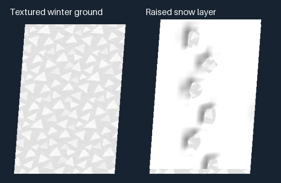

# Snow indents from the shadow map

Regular winter grass gets a solid white layer
about 20 cm above the original tile. That includes level grass on upper
terraces. Roads, water, white building pads, ramps, cliff lips and interiors
use their usual surfaces. Select **Winter** in **Season preview** to see the
effect year-round in a console build.

The renderer draws the original floor, then draws the same indexed grass
meshes again with a radial offset from the curved world's axis. The raised
pass uses vertex alpha to select eligible triangles, so a shared grass tint
can't cover building pads. GX shades the white top from two offset green
samples and drops pixels where the center sample reaches three-quarters
compression. The opening shows the textured floor at its original height.
The rim is shaded on the raised surface. The prototype stamps fixed
flat-bottomed depressions every eight metres and does not write footsteps
or change collision. The image comes from a standalone GameCube scene
using the production GX code and Animal Town's ground texture.

The overlay adds one submission of visible grass meshes each winter frame.
It runs eight TEV stages with an RGB565 page and samples the same texture
for the rim, cutout, cast shadows and lamps. When traffic paths are present,
a ninth stage reuses their existing I4 mask to open the snow over every
nonzero path-opacity level. It uses a sixth texgen and adds no path texture
copy. Path traffic can change without rebaking the snow geometry. Flat tiles
retain the ordinary ground pass underneath. The raised pass reuses the
RGB565 storage counted below and adds no second mesh cache. Winter baking can split a mixed grass and building-pad
strip at the tile boundary. Full-game GPU frame time remains unmeasured.

The original [flat relief comparison](comparison.png) predates the raised
layer and shows both page resolutions. Its CPU preview can be regenerated
with `python3 docs/concepts/snow-indents/preview.py` from the repository root
with Pillow installed.

## What the renderer supports today

[The shadow cache](../../../tools/native-shadow-union.h) packs 4-bit cast
shadow coverage into intensity and 4-bit baked lamp strength into alpha.
[The GX hook](../../../tools/native-shadow-union-gx.inc) reads both. The
independent model point-light path can still light objects when a receiver
forgoes the baked lamp pool. Detailed pages have 30 interior texels across
8 m, or one texel every 27 cm, with a one-texel gutter at each edge. The
outdoor fallback field runs at 1 texel per metre. The detailed cache is
allocated around shadow casters, so snow away from those casters needs
explicit residency within the existing page budget.

## A. Bake directional relief into IA4 alpha

Rasterize a world-space depression profile wherever snow is compressed.
On the CPU, sample its slope in the chosen light direction and pack the
signed brightness change into the existing alpha nibble, with code 8
representing flat snow. Leave the shadow intensity nibble unchanged. In
the winter snow receiver, decode alpha around that exact neutral value
and apply the signed brightness before the cast-shadow tint. Use a
neutral-alpha texel for an empty snow page.

This keeps the existing one-byte texel and uses a single relief sample.
A snow receiver using this encoding gives up the baked lamp pool. Because
snow and adjacent ground can share a page, the cheap design uses the
snow interpretation for the entire eligible winter page. Draw snow
relief only on snowy surfaces, and suppress baked lamp reads on all draws
bound to those pages unless a separate lamp source is added. Keep the
existing encoding for interiors and other ordinary pages. Rebuild the
snow channel when marks or the baked light direction change. Fast light
direction changes would create page update work, so use a fixed direction
for the first test.

## B. Store depth in RGB565 and derive relief in GX

Pack cast shadow in red (5 bits), snow depth in green (6 bits, zero is
flat), and the baked lamp pool in blue (5 bits). Read red and blue via
TEV texture swaps. Sample green on either side of the pixel along the
world-space light direction, subtract the samples and use the signed
difference to brighten one wall and shade the opposite wall before
compositing cast shadows and lamps.

Two offset texgens can share the same texture binding. Keep each offset
component within half a texel so bilinear filtering at page edges stays
within the existing gutter. Generate gutter texels from the same
world-space marks as the interior. A future version can move the light direction with the time of
day. Replacing the published IA4 copies would reduce the additional storage to
192 KiB, with corresponding changes to the other shadow receivers.

## What to verify in game

- Gate the effect to snow-covered outdoor ground using the same season
  selection as the floor. Check roads, water, cliff faces, interiors and
  non-winter seasons. Verify that an opening exposes the original height.
- Keep the snow field independent of cloud and actor composition so
  moving shadows do not erase marks. Test a mark spanning a page edge,
  eviction and reload, and a transition between detailed and fallback
  pages. Account for displaced shadow pages if snow requests compete
  for slots.
- Test broad indentations first. The preview shows softened, stylized
  footprints at 27 cm per texel. A crisp tread would require finer
  coverage. Check overlap under cast shadows and near a streetlamp,
  then measure upload and TEV costs in Dolphin and on hardware.

## Whole-town memory test

The [native lifecycle fixture](../../../tests/native-shadow-lifecycle.c)
exercises a synthetic 128×120 town with every tile eligible for snow. It
checks all 15,360 cells in the fallback texture, then drives the normal
page allocator with two sets of caster placements. All 240 town regions
are sampled at detailed resolution over the two passes. Detail peaks at
156 simultaneous pages. Each scan checks the packed depth, cast-shadow
and lamp channels, including detailed page gutters.

| Shadow memory | Bytes | KiB |
| --- | ---: | ---: |
| IA4 baseline | 522,016 | 509.78 |
| Additional RGB565 detailed slots, including spare slots | 327,680 | 320 |
| Additional RGB565 fallback | 65,536 | 64 |
| Experimental charged allocation | 915,232 | 893.78 |
| Static snow depth templates | 1,088 | 1.06 |
| Experimental total including templates | 916,320 | 894.84 |

The x86-64 host fixture and the standalone GameCube PowerPC fixture in
Dolphin both passed. The shadow buffer was the same size at cold start,
at peak detail residency and after page replacement. Shutdown returned
the allocation counter to zero. Dolphin's GDB stub confirmed fixture
completion and the byte counts in guest memory. The fixture uses the
production shadow code and a test allocator. It measures the charged
buffer and static templates, excluding allocator bookkeeping, other
game systems and GX texture cache. Dolphin ran with the Null graphics
backend. A full-game MEM1 profile and visual acceptance still require
an Animal Town build.
