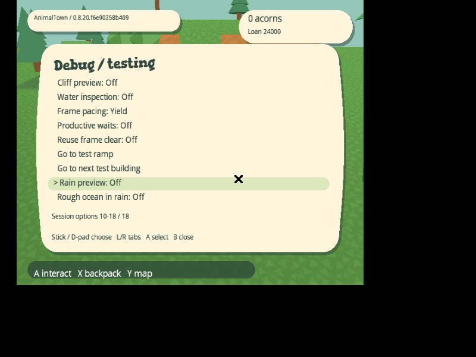
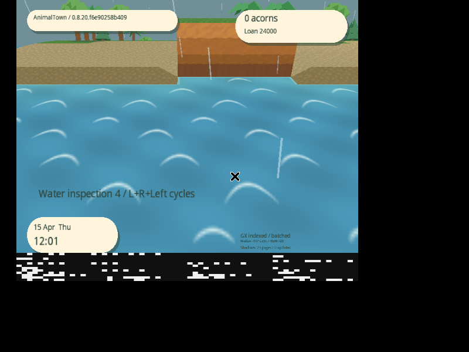
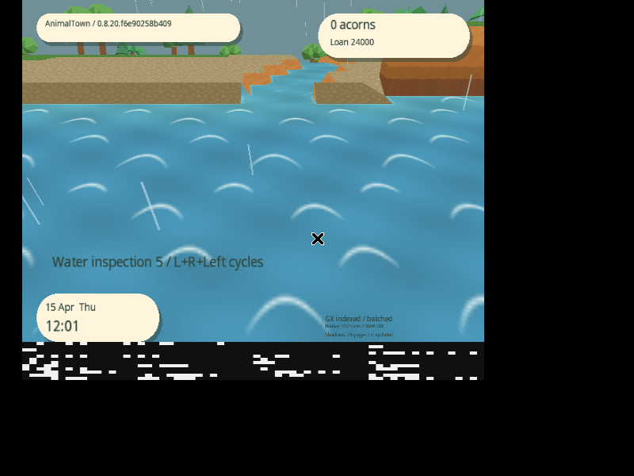

# Debug rain and ocean preview

Ocean, coast-water halves, inland rivers/ponds and water under bridges share
`WaterTerrain.RiverHeight` (-0.50 m relative to the local terrain support).
The former ocean offset (-0.06 m) and artificial 0.44 m river-mouth wall are
removed. Beach toes follow the same water plane; coastal land remains raised.
Player/NPC support interpolates the same two beach triangles as rendering,
including diagonal shore corners, so actors follow the lowered shoreline.
Water footprints and player/villager traversal rules are unchanged. Stored
terrain/elevation layouts are not regenerated or migrated.

Open **START → Settings → Debug / testing**. The last two session options are:

- **Rain preview:** off by default. Enables outdoor depth-tested rain streaks
  and a muted sky background; interiors and fully opaque door fades suppress it.
- **Rough ocean in rain:** off by default. Enables faster stylized whitecaps
  only while Rain preview is on outdoors. Rivers/ponds stay on their calm
  material. Turning rain off immediately restores calm ocean animation.

Neither setting is saved or enabled by the calendar. Existing cloud-cover
controls remain independent. There is no automatic weather simulation, rain
sound, wetness gameplay or changed collision.

## Rendering and performance

The GameCube GX pipeline has no programmable vertex shader. This preview uses
Wind Waker-inspired moving whitecaps and crossing texture flow on the fixed
water plane; it does not simulate physically rising/falling wave geometry.
It adds one shared 64×64 I8 mask (4 KiB) and one two-texture TEV material that
borrows the existing base texture. Normal water and river shading stay intact.
Ocean and inland surfaces receive separate immutable archive kinds; toggling
weather selects a material and never rebuilds/uploads terrain or water meshes.
The existing ARAM/MEM1 budgets and 256-view pool stay fixed.

Rain uses at most 64 world-anchored cells and 128 triangles, one shared mesh and
a fixed transform pool. It evaluates positions analytically from elapsed time,
so hidden/disabled intervals need no simulation or catch-up. Grid crossings
retain each world cell's phase. Viewport/horizon checks reject invisible streaks;
GX backface culling, clipping and depth testing remain active. Rain draws after
opaque world geometry, before the UI, with alpha blending and depth writes off.
Roofs, foliage and actors can occlude the streaks; indoor rooms receive no rain.
There are no per-frame particle/mesh allocations or texture uploads. The shared
rain mesh is created between frames on first enable. No rain selection/drawing
or storm UV animation runs while the corresponding preview is disabled.

Host checks cover shared water levels, bridges/coast orientations, save layout
preservation, opt-in/indoor rules, periodic whitecap packing, long-running rain
coordinates, world anchoring, retained-cell continuity, allocation-free drop
selection, and native binding of the new ocean archive kind.

## Reproducing the native check

Run in `animaltown-dolphin:latest` with `--shm-size=1g` and
`LIBGL_ALWAYS_SOFTWARE=1`, using a separate copy of a saved town card:

```sh
python3 docs/performance/debug_weather.py IMAGE.nkit.iso out/weather-final --stream-travel --profile-seconds 5 --season spring --dsp-hle
python3 docs/performance/analyze_debug_weather.py out/weather-final --capture CAPTURE.mkv
```

The scenario visits the actual saved/generated coast, river mouth and inland
river. It verifies both defaults visually, arms rough mode while dry, previews
rain with/without rough water, disables/restores rain, enters/exits a house and
checks the entire starting card digest. Marked stationary dry/storm intervals
exclude option changes and first-use mesh creation. Capture intervals are
identified by checksummed telemetry in their boundary screenshots. Lossless
capture archival must preserve every decoded RGB frame; the analyzer also accepts
the original AVI. Use `--defaults-only` for a subsequent fresh-session check.

## Validated delivery

Game source: `f6e90258b4097bd2d0089f422c96c44b23e631d0`.
[Release 0.8.20.f6e90258b409](https://github.com/capz/AnimalTown/releases/tag/v0.8.20.f6e90258b409).
[Machine-readable validation](performance/2026-11-09-debug-weather.json).

Clean CI and selected local checks pass 2,511,635 gameplay/render/texture checks,
325,110 rendering-service checks, backend integration and native fixtures.
The archive fixture covers the ocean kind, rejects invalid kinds and performs
10,000 exact rebinds; address/undefined-behavior sanitizer checks pass. Shore
fixtures cover cardinal and diagonal joins, shared corner heights, piecewise
triangle support, water traversal rejection and projected shadows at wet toes.

The full bootable ISO is 1,459,978,240 bytes, SHA-256
`967b624a11f5b33ff1275095cb269ad1df8fe01171c96b8e5f0ef37ebc2eb207`.
The direct NKit ISO is 88,520,704 bytes, SHA-256
`a04b9689ee7d91a13b01cd770f6220970aa34f75603e49377165f983a7ea1bd8`.
GitHub asset metadata, downloaded checksums and clean same-commit console/backend
manifests agree. The NKit audit verifies exact full-image roundtrip and unchanged
DOL/apploader/disc files. The ISO files have no ZIP wrappers.

The final image boots directly in Dolphin. Both menu defaults are Off after
starting from the preceding run's unchanged card. Native debug labels change
through all six exercised toggles. The captures confirm calm water while dry,
rain with calm/rough ocean water, calm inland rivers during rough-ocean rain,
a level river mouth, calm restoration after rain stops, indoor suppression and
exterior restoration after leaving the cottage. The entire starting card remains
byte-for-byte unchanged. The image-level whitecap check compares the rough and
calm rainy coast so rain itself cannot substitute for the ocean effect.





[Dry coast](performance/weather-dry.png) and
[indoor suppression](performance/weather-interior.png).

The marked dry interval has 152 consecutive measured frames; rough rain has 140.
Both have zero terrain construction stages, loading/missing/recovery frames,
mesh creations/updates/releases, texture operations and garbage collections.
Terrain preparation is 0.2 ms at median/p95/maximum in both. The rain mesh's
first-use construction occurs before the steady-state markers. Overall managed
allocation counters are 526 / 490 respectively, including the existing UI and
profiler; these are not a claim of zero total frame allocations.

Both coast conditions report 33.3 ms median/p95/maximum frame intervals. The
previous pre-weather coast capture (`ba85070`, frames 529–679) also reports
33.3 ms. These single instrumented coast samples verify reuse and do not
establish 60 FPS or isolate every cost. The full final capture is archived
losslessly, with all decoded RGB frame hashes verified.
Physical GameCube testing remains outstanding.
