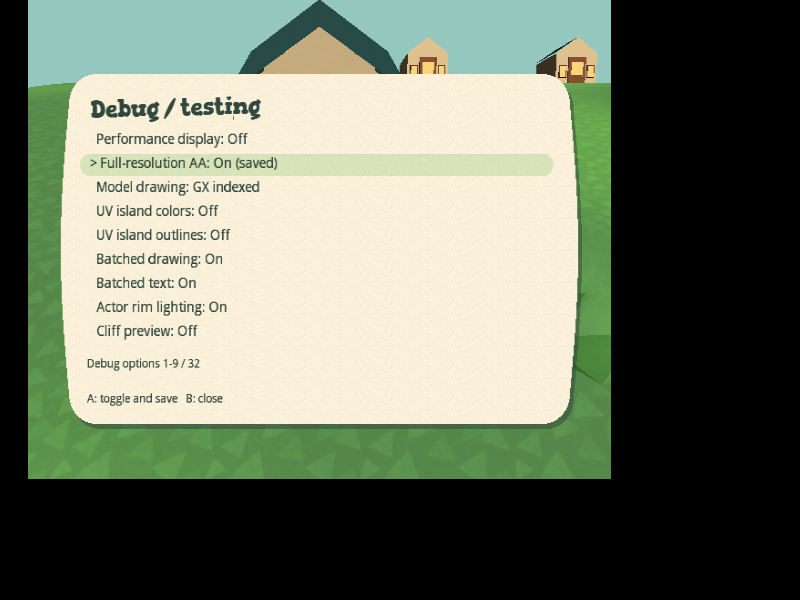

# Full-resolution antialiasing

Debug / testing has **Full-resolution AA: Off (saved)** directly below Performance
display. A toggles and saves it to Slot A. It defaults off, and older dev-config
records migrate with AA off. It is independent of God mode, which remains session
only. A card error leaves the live choice active and labels it **not saved**.
Holding X at startup bypasses saved video options, including AA, for recovery.

AA uses the SDK's native three-sample RGB565/Z16 mode with two overlapping EFB
passes. It retains 640×480 resolution, including the HUD. It does not enable
emulator host MSAA. Enabling AA selects 640×480 while retaining scan/aspect;
turn AA off to select 576p. Destination alpha is unavailable in this hardware mode.

Hypercube's FrameRenderer replays prepared drawing. Simulation, animation,
visibility, shadow masks, rain and texture residency prepare once per frame.
World/HUD drawing repeats, with bounded batch cursors reset for each part.
Splash, title, loading, profile picker and onboarding also support all parts.

The two 640×480 scanout buffers remain 1,200 KiB, and switches between ordinary
640×480 and full AA reuse that pair. Texture and shadow-map budgets are unchanged.
Scene submission and geometry processing repeat, so leave AA off when performance
matters more than edge quality. Real GameCube performance still needs measurement.

Dev config version 4 uses byte 34 of the existing 40-byte checksummed record;
versions 1–3 remain readable. Town save data is not written by this preference.

For a disposable existing-town card, run the emulator smoke helper with
`--full-resolution-aa --dsp-hle --component-cable --season spring`. It captures
Off/On, restarts the emulator with the saved preference, restores Off and checks
that the town save did not change. Host MSAA remains 1.

The implemented menu (Dolphin, host MSAA disabled; layout and persistence proof):

Validation used a real bootable test ISO: Off → On, emulator restart with On
restored at 640×480/two passes, then Off saved again. The complete town generation
and payload hashes were unchanged. Three-wall interiors also rendered with AA
enabled. SDK fixtures independently check all
480 rows, the band join, capture alignment, framebuffer canaries and buffer reuse.
