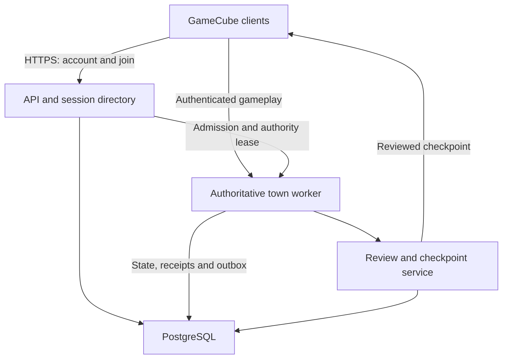
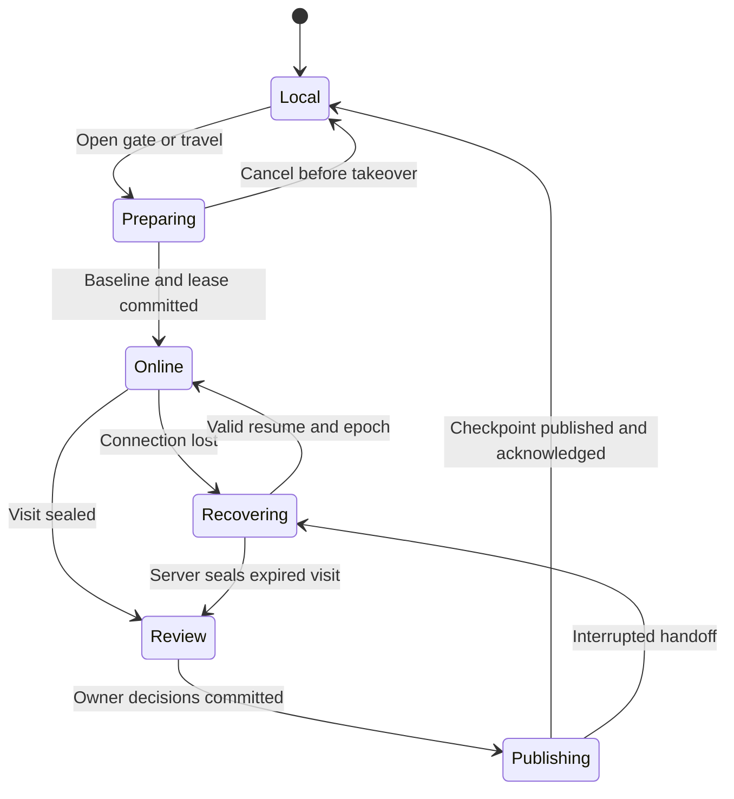

# AnimalTown networking: Codex implementation brief

Audit date: **24 November 2026**. Source baseline: AnimalTown
[`main` at `3ab4110e92bc`](https://github.com/capz/AnimalTown/tree/3ab4110e92bc634d1c76fba2977051dfbfd90d96).
[PR #148](https://github.com/capz/AnimalTown/pull/148) is merged. This is a
source audit and implementation proposal, not evidence that online play works.
The intended reader is a Codex agent implementing the complete networking work.
Read sections 1–9 for requirements and architecture, then sections 10–11 for
repository entry points, concrete contracts, execution rules and completion gates.

The useful foundation is already present: account authentication, social access
checks, transactional purchases, visitor item custody, local chat/letter input,
and recoverable memory-card saves. **The live multiplayer system, authority
handoff, and complete owner keep/undo lifecycle remain to be implemented.**

This document is the current networking plan. It supersedes the owner-console
authority, mandatory companion, Unity/WebRTC/SignalR transport, guest pickup,
and guest lost-property collection assumptions in the original
[game design](../design-doc.md) and [technical design](technical-design.md).
Unrelated gameplay and art specifications are unchanged by this plan.

## 1. Requirements and planning decisions

### Confirmed behavior

1. The server owns gameplay state during online play. The owner's local save
   owns solo play after a completed handoff.
2. When online changes synchronize back, the owning villager can keep or undo
   changes made by other players. Confirmed shop purchases stay permanent.
3. Visitors can add and modify eligible town objects. They cannot acquire town
   possessions to take home. Removed items go to the destination koban.
4. Only an active, human-controlled local resident can collect lost property.
   Visitors and NPCs cannot collect it.
5. Existing belongings brought from home, purchased items, and sealed travel
   parcels retain their established provenance. Destination-issued ordinary
   item rewards remain in destination custody. See [custody rules][S3].
6. Letter writing and chat retain their shared keyboard and input behavior.

### Recommended implementation defaults

These are engineering proposals, not additional user approvals:

| Decision | Proposed default | Reason / gate |
| --- | --- | --- |
| First internet topology | Public authoritative .NET session service | Gives the console an outbound connection to one authority; avoids making peer reachability a prerequisite for the first playable slice. |
| Human capacity | One owner plus three guests | Retains the existing product limit and three-seat reservation rule; four saved residents are not four live actors. |
| Owner departure | Short reconnect grace, then seal the visit and return guests safely | Preserves visiting-only scope. Always-open towns and host migration need separate product decisions. |
| Companion computer | Optional fallback | The pinned SDK already supports HTTPS. A companion is useful only if measured target transport/security limitations require it. |
| Transport selection | Measured GameCube/.NET interoperability spike | Source language alone does not establish compatibility with a desktop C# networking package. |
| NAT capability | Explicit follow-on connectivity milestone | Required for convenient hosting behind a player's router; retain authenticated relay fallback. It does not change server authority. |
| UI work | Approve mockups before implementation | Reuse the existing visual identity, panels, text, icons and controller hints. |

An unresolved decision must remain visible in its milestone. In particular,
first-time offline-town import, offline money provenance, and the precise
meaning of undoing a visitor donation need explicit policies before shipping
the corresponding feature; proposed policies appear below.

## 2. Indexed implementation backlog

**Foundation** means useful code exists but the online path is incomplete.
**Missing** means no implemented end-to-end feature was found in the audited
source. IDs are stable references for future PRs, tests and status updates.

| ID | Work item | Current state | Remaining deliverable | Primary area |
| --- | --- | --- | --- | --- |
| NET-01 | Architecture and policy contract | Older documents conflict | Adopt server authority; settle import, owner departure, review and hosting policies | Shared design |
| NET-02 | Stable town, resident and entity identities | Account IDs, profile slots and recovery IDs exist | Session-bound resident identities; slot generation; stable object lineage independent of compact array indices | Shared / server |
| NET-03 | Authority leases and membership | Gate lease and temporary visit reservation exist | Town/profile fencing epoch, signed or opaque verifiable admission ticket, activation, heartbeats, revocation and recovery | Server |
| NET-04 | Offline/online handoff | Mirrored card saves exist; cloud PUT is intentionally unsupported | Validated baseline import, branch identity, durable takeover and final checkpoint publication/acknowledgement | Both |
| NET-05 | Versioned gameplay protocol | SDK sockets only | Bounded binary codecs, negotiated limits, message catalogue, revision/sequence rules and cross-endian vectors | Shared |
| NET-06 | Secure console/server transport | IPv4/TCP/UDP/HTTPS in SDK; no game client | Exact compatible transport, authenticated connection setup, encryption, bounded queues, cancellation and target measurements | Both / native |
| NET-07 | NAT introduction and relay | Missing | Authorized rendezvous, candidate probes, bounded punch attempts, relay fallback and router/network matrix | Services / client |
| NET-08 | Headless authoritative town runtime | Shared rules and local simulation exist | Server tick, canonical clock, four participants, NPCs and command scheduling | Server / shared |
| NET-09 | Unified gameplay command boundary | Domain methods mutate local state directly | Offline executor plus online intent/result path; proximity, capability and revision validation for every mutation | Both |
| NET-10 | Durable journal and event delivery | Operation fingerprints/results deduplicate some HTTP requests | Ordered attributed events, before/after values, dependencies, transactional outbox and replay retention | Server / database |
| NET-11 | Snapshot, delta and reconnect | Save codecs exist | Consistent snapshot watermark, streamed components, ordered delta application, resume cursors and resnapshot | Both |
| NET-12 | Four human actors | One active player and one offline travel capsule | Separate human roster, movement reconciliation, remote interpolation, rooms/portals and measured rendering residency | Client / server |
| NET-13 | Visitor custody and provenance online | Add/move/remove and local-only claim rules implemented | Session identity binding, instance lineage, online tool/reward coverage and review reservations | Both |
| NET-14 | Owner keep/undo review | Unclaimed removal restoration only | Add/move/rotate/remove history, dependency groups, reversible preconditions, atomic decisions and resumable review | Both / database |
| NET-15 | Permanent commerce and safe return | Atomic shop purchases, escrow/grants and retries exist | Route through active authority; reconcile both shop APIs; preserve bought items and receipts across return/crash | Server / client |
| NET-16 | Online gameplay services | Offline jobs, tools, mail, growth and time exist | Per-participant conversations, shared claim races, server clock/randomness, complete mutation coverage | Both / shared |
| NET-17 | Chat and moderation | Local keyboard/speech; basic block/report tables | Authenticated remote messages, rate/length limits, mute/block enforcement and report evidence | Both |
| NET-18 | Presence, gate and visit extras | Friends, gate/reservation endpoints and tent table | Live availability, admission/capacity, gate close/kick, tent placement/removal and replication | Both |
| NET-19 | Connection and review screens | Reusable visual system and keyboard exist | Approved mockups for pairing/join/reconnect/review/conflicts; implement against real lifecycle states | Client |
| NET-20 | Deployment and operations | API container, health endpoint and request limits exist | Session worker deployment, lease recovery, metrics, backups, expiry/retention, quotas and protocol rollout | Server / operations |
| NET-21 | Multiplayer acceptance | Domain, PostgreSQL and offline recovery tests exist | Network faults, cross-process crashes, four clients, maximum saves, native memory and physical BBA qualification | Test / infrastructure |

### Evidence behind the status

- [Server routes and persistence][S1] implement registration, bearer sessions,
  friendship/block checks, five-minute gate leases and two-minute reservations.
  `Visit` returns `status="reserved"`; it does not start a gameplay session.
  Owner snapshot GET has an ETag; PUT explicitly returns
  `offline-import-not-yet-supported`.
- [Database schema][S2] stores operation IDs, request fingerprints and results.
  It has no ordered visitor-change journal, authority epoch or review decision
  records. The tent table is not a playable tent implementation.
- [Town item transactions][S4] lock participating accounts in a consistent order
  and commit saves plus receipts together. Whole-town revisions protect compact
  indices; visitor additions also check the source inventory revision.
  [Shop transactions][S5] already protect purchases and their money/item effects.
- [Custody implementation][S6] preserves exact unclaimed removal records with
  monotonic recovery IDs. Claiming consumes the current restore opportunity.
  It does not journal additions, moves or complete visits.
- [Client entry and update code][S7] still reports online transport unavailable.
  [Memory-card travel][S8] uses a single visitor capsule and two local cards.
  Existing card-derived visitor actors are NPCs, not network humans.
- [Local chat][S9] is implemented; remote delivery is explicitly excluded.
  [Existing integration tests][S10] include concurrent purchase/custody winners,
  restart persistence and stale revisions. This audit did not rerun those tests.

The older implementation-status document contains historical counts and feature
lists. Use the evidence above for networking status, rather than treating those
old counts as current validation results.

## 3. Target architecture



These are logical responsibilities. Initially they can share the existing .NET
service deployment, with a per-town single-writer queue and bounded worker
capacity. Keep modules separable; there is no need to begin with a microservice
fleet. PostgreSQL owns durable decisions. A database-backed lease and monotonic
epoch fence duplicate workers and stale processes.

The worker runs shared domain rules without graphics or console dependencies.
Clients send inputs and intentions, render accepted state, and predict only
their own movement/cosmetic feedback. The server determines inventory, shop
stock, item placement, NPCs, rewards, time progression and permission results.

Existing HTTP mutations must enter the same authority boundary. A shop call,
inventory request, rollover during GET, or administrative path must not mutate
the database behind an active worker's cached state. Route them through its
command queue or reject the conflicting mode. A second, independent HTTP write
path would otherwise undo the value of server authority.

### NET-02: identity model

Separate `AccountId`, persistent `TownId`, `ResidentId`, `ResidentGeneration`,
`SessionId`, `AuthorityEpoch`, `EntityId`, and `OperationId`. The server binds
these to an authenticated connection; requests do not choose their own role.
Town ownership and the reviewing villager are explicit, as are the active local
resident rights used by koban collection.

Keep four local save slots as a storage/UI detail. Deleting and recreating slot
2 must not resurrect the old resident's admission ticket or review rights.
Likewise, an array index is a lookup location, not an object identity: ground
and furniture arrays compact after removal.

Use compact handles plus a session generation on the wire and a bounded
side table for persistent entity identity/version/lineage. Measure that table
before changing save layouts. Do not add a GUID/string object to every ground
entry or replicate four complete town graphs. The existing item layout and
six-MiB managed heap are important constraints, not spare capacity.

## 4. Authority, persistence and synchronization

### NET-03 / NET-04: lifecycle



This describes the owner's town. Guests also need an idempotent departure and
home-profile settlement flow; they must be able to leave while the owner's
review remains pending. An unresolved server visit never authorizes a client
to overwrite the canonical online branch with a stale local save.

Recommended durable server records:

| Record | Essential fields |
| --- | --- |
| Town authority | town, worker owner, epoch, state, lease deadline, base checkpoint, committed event cursor, review-owner account/resident/generation |
| Participant | account, resident identity/generation, session, role, ticket expiry/consumption, reconnect credential, last acknowledged cursor |
| World event | operation ID/fingerprint, session/epoch, actor, sequence, entity versions, before/after values, dependencies, review class |
| Review batch/decision | immutable review ID, actor/session grouping, expected revision, decisions, compensation IDs, completion state |
| Handoff | source branch/checkpoint, final checkpoint/hash, publication token, card-ack state |
| Outbox | committed event reference, delivery status/attempt metadata; consumers deduplicate |

Migrate these explicitly. Existing `players` and split saves remain readable;
avoid a destructive replacement of existing account/town records.

Claim permission does not grant review permission. Selecting another local
resident cannot resolve the owner's pending groups. Deleting/replacing the
review-owner resident requires an explicit recovery or review-authority transfer
before removing that identity; never fall back to whichever slot is active.

### Baseline import is a trust decision

Account registration currently creates a server town. Existing offline towns
cannot simply be uploaded through the disabled PUT. Define how an account is
bound to an existing town and selected resident, and what happens when the
account already has a different town or a newer checkpoint.

Validate save schema, catalog, dimensions, component lengths, identity, item
rules, balances, custody and job invariants. However, **structural validity and
a client-authored action journal cannot prove that offline wealth was earned
honestly**. Preserve the local-authoritative solo game and choose an explicit
economy policy: accepted offline progression with bounded validation, or
server-verifiable provenance for value allowed into online commerce. This plan
does not silently create a new restriction on the user's existing town.

After the initial accepted baseline, retain checkpoint and branch identities,
operation receipts and a bounded offline journal where useful for reconciliation.
Do not describe that journal as tamper-proof. Conflicting offline branches need
explicit reconciliation; wall-clock timestamps do not decide which save wins.

### Takeover and return protocol

1. Prepare an explicit online transition using the existing recoverable save
   machinery. Preserve the last playable offline checkpoint. Establish durable
   local transition identity before acknowledging the server's takeover.
2. Server validates the baseline and acquires the town/profile lease atomically.
   Return the epoch, checkpoint identity and session admission data. Only then
   activate online gameplay. A reserved seat is insufficient authorization.
3. Durable commands commit before a success acknowledgement. If the response is
   lost, query or retry the same operation ID rather than guessing whether it ran.
4. Close admission, drain accepted commands, seal a final event cursor and settle
   guest return receipts. Persist pending review and all permanent purchases.
5. The owning villager keeps/undoes eligible edits. Server commits the resulting
   checkpoint and idempotent handoff receipt.
6. Client streams and verifies that exact checkpoint, publishes the complete
   manifest/records through `SaveRepository`, and verifies readback. Download
   completion alone is not a successful save.
7. Acknowledge the exact checkpoint/publication token. Server releases the
   relevant authority only after the recoverable handoff rules are satisfied.

Full/removed cards, crashes and lost acknowledgements leave resumable states.
Preserve temporary solo play and the existing explicit-save contract. Online
transition/review actions may have explicit save commits; passive reconnect
timers must not silently save unrelated offline progress. If the user continues
offline before an interrupted online branch can be reconciled, preserve it as a
separate branch and do not silently merge its economy later.

### NET-10: commit and publish

For each durable command, validate the authenticated actor and epoch, expected
entity/inventory versions and gameplay preconditions. Prepare affected state,
then atomically commit state changes, the operation result, journal event,
economic receipt where applicable, and outbox entry. Publish only committed
events. Keep existing deterministic lock ordering for cross-account operations.

A crash after commit but before reply/broadcast must leave one durable effect.
Outbox delivery and network delivery may repeat; clients deduplicate by epoch
and event sequence. Failed transactions publish no success delta. Receipt and
event retention must cover reconnect/review/handoff, with an explicit expiry
policy that cannot turn an old retry into a new purchase.

Keep operation identity and its semantic fingerprint stable across reconnect and
worker failover. The epoch fences new execution; it does not redefine a committed
operation. An authorized retry on a new connection/epoch retrieves its original
receipt. Exclude connection credentials, transport sequence and current worker
epoch from the semantic fingerprint. Durable event identity/order also survives
worker changes even though stale workers cannot append new events.

Movement need not cause a database write every tick. Separate ephemeral player
positions from durable world/economy operations, and define recoverable position
checkpoints without weakening the durable command acknowledgement guarantee.

## 5. Full visitor review without undoing purchases

### NET-14: journal classifications

| Change | Review behavior |
| --- | --- |
| Visitor adds or plants an item | Reviewable world addition with source item lineage and destination custody policy |
| Visitor moves/rotates an object | Reviewable placement mutation with complete previous transform/room/owner |
| Visitor removes an object | Reviewable removal linked to the exact koban item and original entity |
| Visitor changes another persistent town field | Must have an explicit reversible command and dependency policy before being enabled online |
| Shop purchase | Permanent: item grant, stock, buyer payment, seller proceeds and receipt stay committed |
| Owner or autonomous system change | Preserve independently; account for dependencies on pending visitor edits |
| Transient actor pose/chat | Pose and message themselves are not persistent town edits; their persistent consequences still need attribution and review |

Review is a new transaction against the current canonical state. Do not restore
the pre-visit save: doing that would erase purchases, owner progress and system
changes. Keep a complete audit trail and append compensating events for undo.

### Preserve the right to undo before conflicts occur

The existing koban restores only an unclaimed removal. To meet the broader user
requirement, protect **both item lineage and inverse preconditions** while a
visitor change is pending. Otherwise a local claim/sale could consume the item,
or a new object could occupy the old position, making exact undo impossible.

For example, if a visitor moves a chair from X to Y, a later attempt to place
something at X must resolve that pending change first, or join an explicitly
reversible dependency group. A conflict dialog discovered only at final sync
would provide conditional undo, not the promised ability to undo the edit.

Reserve original footprints, restore capacity and affected ownership/attachment
links, as well as custody item lineage. Before a local resident, visitor or
system action invalidates those reservations, require the owning villager to
resolve the relevant group. Do not silently mark it kept. Until resolved,
pending custody entries cannot be sold, consumed, exported or irreversibly
claimed; finalized koban property retains normal local-human-only collection.
Derived growth, job rewards and other persistent effects need the same rule.
An irreversible reward dependent on a pending edit stays a durable owed record
until the group is resolved, rather than removing the guest's ability to leave.
Keep finalizes the reward's permitted payout/custody disposition; Undo cancels
or recomputes the dependent obligation in the same batch. Later settlement after
a guest returns uses an idempotent account obligation or destination custody
entry. Destination item rewards never become visitor exports.

Movement already writes traffic and path state through `PlayerMovement` and
`TileTraffic`. Attribute or isolate each guest's persistent contribution until
review. Town-wide count normalization and nonlinear path classification must
not erase information needed to remove that contribution while retaining
owner/system activity. Do not log every rendering frame or simply subtract raw
counts after normalization; use bounded accumulated contributions and recompute
the affected derived state from its preserved baseline and accepted contributors.

Accept a visitor edit only if its journal and compensation reservations fit.
At the cap, deny further affected edits with an actionable result while keeping
chat, movement and safe departure available. Existing 512-entry custody capacity
is shared with ground objects; unlimited undo history cannot be assumed to fit.

### Dependency and compensation rules

- Build dependency groups from stable entities and reserved footprints. An
  addition followed by another guest's move and removal is one linked history.
  Preview the group affected by a selected undo; never silently broaden it.
- Validate the entire requested review batch on the server. Apply reverse
  dependencies atomically, append compensation receipts, and publish the new
  revision. Cyclic moves need batch validation, not arbitrary per-row retries.
- Preserve independent owner/system changes and permanent purchases. Purchased
  items must never be duplicated, confiscated or recreated from an old snapshot.
- **Proposed donation policy:** undoing a visitor's addition removes its world
  placement and puts the same item in destination koban custody. It does not
  refund/export the item to the visitor. This preserves possessions and the
  no-takeback rule; it is a layout undo rather than a reversal of the donation.
  Reserve that custody capacity when accepting the addition. If the item is
  already in custody after dependent edits, retain that same instance. A donated
  purchase still keeps its original shop payment/receipt permanently.
- Restoration uses the same object/receipt; it never mints a replacement for a
  claimed or sold object. Legacy recovery entries remain conditionally
  restorable and are not retroactively advertised as fully reversible sessions.
- Keep/undo selected groups and keep/undo all eligible changes are idempotent.
  Preserve choices and unresolved review across reconnects, server restart and
  card failure. Review metadata stays durable until the final handoff is safe.

The backend must expose before/after facts, actor, time, dependency grouping,
permanent purchase summaries and the proposed outcome. The client presents
those facts using an approved mockup; it does not compute the authoritative undo.

## 6. Protocol, transport and NAT

### NET-05: application protocol

Keep application messages independent of a library's packet classes. Implement
bounded, reflection-free readers/writers with explicit network byte order.
Use integers or validated quantized values for positions; reject non-finite
values, unknown enums, impossible coordinates and invalid counts before mutation.

Handshake fields include protocol version, compatible catalog/save/rules
versions, build identity, capability limits, admission credential, session and
epoch. Record the build hash for diagnosis; compatibility should follow explicit
protocol/rules negotiation rather than assume every different hash is invalid.

| Message family | Delivery / purpose |
| --- | --- |
| Hello / Welcome / Reject | Reliable control; validate membership, versions and limits before allocating a town |
| Input / PlayerState | Sequenced movement; stale samples discarded; server acknowledges inputs |
| WorldCommand / CommandResult | Reliable identified operations with expected versions and durable outcome |
| SnapshotManifest / Chunk / Complete | Reliable, low priority, explicit component bounds/hash/cursor |
| WorldDelta / AppliedCursor | Ordered committed events; gap detection and bounded replay |
| Chat / Emote / Dialogue | Reliable bounded text or IDs, server-stamped actor and membership |
| Heartbeat / Resume / Leave | Session liveness and recovery; never grants authority by itself |
| ReviewPage / ReviewDecision / CheckpointAck | Durable review and handoff identities; duplicate-safe |

Starting targets for the spike are a 30 Hz authoritative simulation, 15 Hz
movement updates, 5 Hz NPC snapshots and roughly 100 ms interpolation. Retain
them only if measured four-client behavior is satisfactory. Use separate
delivery priorities so snapshot transfer cannot hold up movement or critical
receipts. Never retry obsolete movement as if it were an economic command.

Start with an approximately 1,200-byte UDP datagram ceiling, including transport
and security overhead, and a 4 KiB bounded logical control-message ceiling.
These are proposed application limits, not measured performance claims. Snapshot
components can use small streamed chunks; a logical chunk is not one oversized
UDP datagram. Freeze fragment counts, receive windows, retransmit deadlines,
queue caps and congestion/backpressure behavior in the transport ADR.

### NET-06: exact console capability and selection gate

The current project pins DolphinDotNet `0.1.0-preview.376.1` and Hypercube
`0.1.0-preview.52.1`. The runtime NuGet source is SDK commit
`9dcc4b6d111b109860be294820d0b14b21b8eced`; the separate card-store gitlink is
not the runtime package pin. Its [networking contract][E1] and [HTTPS contract][E2]
establish:

- IPv4 TCP/UDP, bounded DNS and HTTP/1.1, and configured TLS 1.2 HTTPS.
- Automatic service-thread progress for async I/O. No manual SDK network pump
  is required. The game must still drain its bounded gameplay event queue at a
  defined update boundary.
- Allocation-free `TryReceiveFrom` / `TrySendTo` with caller-owned buffers.
  Async convenience calls allocate and should stay out of steady movement I/O.
- Twelve application sockets, 32 pending native operations, two active HTTP
  requests per `HttpClient` instance and four global TLS sessions; approximately 64 KiB native UDP
  staging outside the managed heap.
- A selected .NET API subset, not general desktop compatibility. Modern socket
  overloads, arbitrary `SslStream`, WebSocket and QUIC cannot be presumed.
- Explicit roots, fresh secret entropy and credible certificate time for HTTPS.
  Physical entropy/BBA qualification and full-scene TLS cost remain gates.

Distinguish interface initialization, DNS failure, unreachable service and lost
gameplay connection. `IsReady` reports a configured interface, not internet
reachability. Native configuration cannot be interrupted by `NetworkRuntime.Stop`;
Stop rejects during configuration and recovery after a native initialization
failure may require restarting the application. UI cancellation/retry must
respect that constraint while keeping the application responsive.

Evaluate one pinned native ENet implementation on both GameCube and .NET as an
initial candidate, alongside a LiteNetLib compatibility assessment. A managed
package that requires unsupported APIs needs a deliberate port, not a package
reference and hope. Build identical transport implementations or prove byte-level
compatibility: the common [ENet-CSharp project][E5] explicitly uses a modified
protocol and must not be assumed to interoperate with upstream ENet.

[LiteNetLib][E3] provides reliable/unreliable modes and NAT punching on its
supported .NET platforms. [ENet][E4] provides reliable UDP but leaves
authentication, discovery and encryption to integration. [RakNet][E6] has C#
bindings through SWIG, but its original upstream is archived. It is not the
default new dependency. GameNetworkingSockets is another reference candidate,
but its console footprint and native dependencies still require proof.

The chosen path must demonstrate authenticated encryption, replay resistance,
key establishment and server identity on the target. Use a supported vetted
security implementation; do not invent cryptography or mistake a shared
connection string/CRC for authentication. SDK HTTPS can bootstrap scoped
credentials but does not automatically secure raw UDP. No internet release
before that integration and entropy/time provisioning are qualified.

Include trust-bundle and certificate rotation in the operations contract. The
pinned SDK fails closed when reseeding is required after 4,096 DRBG generation
requests; that is not a count of connections. Dispose active HTTPS sessions
before reinitializing with fresh entropy, and cover this in long-session tests.

Measure cold connect, live traffic, stalled peer, snapshot, reconnect and
terrain/room transition together with the real renderer. Report managed and
native high-water marks, largest available allocation, packet/queue counts and
frame cost. Increasing the six-MiB heap is not the default solution.

### NET-07: NAT and relay

With the proposed public server, clients initiate outbound connections to its
known endpoint. Peer-to-peer hole punching is not needed for that first route.
This architectural simplification does not guarantee that every firewall allows
UDP. For a self-hosted .NET authoritative server behind a router, implement:

1. Authenticated rendezvous tied to a valid session and approved participants.
2. LAN/public candidate discovery and time-bounded connectivity checks.
3. Simultaneous punch attempts with a clear deadline and endpoint-rebinding rules.
4. Automatic authenticated relay fallback, including relay-only preference if
   address privacy becomes a requirement.
5. Quotas, expiry, rate limits, capacity/cost telemetry and abuse controls.

Direct traversal can fail, so a robust plan includes relay service. ICE uses
STUN and TURN for this purpose ([IETF specification][E7]); the chosen library's
actual integration determines whether it uses that stack or its own documented
equivalent. An arbitrary UDP relay is not automatically TURN-compatible.

Test same-LAN/hairpin, separate routers, carrier-grade NAT, endpoint-dependent
mapping/filtering, rebinding and blocked UDP. A UDP relay alone cannot solve a
network that blocks all UDP; prove a compatible TCP/TLS fallback or return a clear
unsupported-network result. Neither relay nor successful punching gives a guest
simulation authority. A private authoritative server remains the authority.
Hosting the complete authority on a GameCube is not established by this plan;
that would require a separate CPU, memory, security and product decision.

## 7. Replication and client integration

### NET-08 / NET-09 / NET-12: shared rules, multiple actors

Introduce an explicit authority mode and command executor at the gameplay
boundary. Offline commands call local domain rules. Online commands send intent,
show pending feedback where appropriate, and apply committed server outcomes.
Cover tools, pocket menus, placement, buying/selling, banking, mail, jobs, koban,
profile changes and debug paths. No menu or local RTC callback may bypass it.

Extract the server simulation from `TownGame.Simulation` into shared headless
services as needed, with explicit actor, clock and randomness inputs. Do not
concurrently switch the global `GameState.ActiveProfile` for multiple humans.
Revalidate proximity, room, tool, cooldown, plot and ownership at command execution.

The client needs a four-human roster independent of saved residents and NPCs.
Review `BuildingWorld`, `PortalSystem`, visibility/shadows, actor animation and
model residency, all of which currently assume actor zero is the player. Keep
existing NPC population behavior; reserve and measure up to three additional
human instances without cloning whole towns or eagerly loading all models.
Server snapshots contain canonical positions/rooms; clients interpolate remote
actors and reconcile local predicted movement using acknowledged input sequences.

### NET-11: consistent snapshots and reconnect

Capture a coherent snapshot at event cursor R while retaining later deltas.
Send a manifest with snapshot/epoch identity, component versions, lengths,
digests and R. Decode bounded chunks into staging or stream-backed records,
verify completion, then apply deltas R+1 onward before exposing the town.
Repeated chunks/events must be harmless; gaps, expired replay windows and queue
overflow trigger a new snapshot rather than partial state.

Network snapshots and deltas must be projected for the authenticated recipient:
shared town/visible actors, that participant's private state, and separately
authorized owner-review data. Do not send the owner-export save or other local
residents' pockets, balances, mail, relationships and jobs to guests. Define
cursor advancement for filtered private events so they neither leak content nor
appear as unexplained gaps. State hashes are projection-specific. Full save
serialization and network replication are distinct formats and access scopes.

The old 512 KiB total snapshot assumption is obsolete: `SaveCodec.MaximumBytes`
is now 4 MiB, and large job/mail state must be measured. This format ceiling is
not permission to allocate a second four-MiB buffer in the six-MiB heap. Specify
component/total wire limits from valid maximum saves, add streaming codec support
where existing encode/decode allocates whole arrays, and validate peak coexistence
with the rendered world. Full-save Base64 JSON is unsuitable: buffered HTTP
responses default to 64 KiB. `JsonReader` has hard caps of 64 KiB
input and 4,096 characters per string, independent of HTTP buffering settings.

Reconnect binds a fresh authenticated connection to the same participant and
current epoch. Supply last applied cursor and outstanding operation IDs; recover
results and stream missed events or a new snapshot. Discard stale input history.
If the worker died, rebuild from checkpoint and committed events before allowing
commands. A new worker obtains a new fenced epoch; an old worker cannot revive.

### NET-15 / NET-16: complete gameplay coverage

Keep the existing atomic purchase and custody services. Add authoritative
interaction validation and durable event publication around them. Decide how
the older escrow `/shops/listings` API and physical town-store sale stands relate;
do not duplicate a listing or its item across both systems.

Classify every online-enabled persistent operation before enabling it:

| Subsystem | Required online rule |
| --- | --- |
| Shop, wallet, grant claim | Atomic debit/credit/stock/item effect; permanent purchase receipt; capacity-safe retry |
| Add/move/remove, digging, harvesting, catches | Stable item lineage, capability checks, visitor custody and complete review metadata |
| Jobs and NPC conversations | Per-actor conversation/offer identity; server RNG/time; one shared winner; no forged turn-in |
| Mail and attachments | Preserve current home-service/visit restrictions; authoritative dispatch/claim; never a visitor export bypass |
| Calendar, growth, weather and NPC simulation | One server clock; clients render; persistent derived effects respect pending-review dependencies |
| Homes, gardens and profiles | Existing ownership/availability rules plus session versions and review classification where visitor edits are allowed |
| Guest return | Home possessions and purchased items reconcile once; destination property and pending donation/recovery items stay in that town |

Local letters remain a home service under existing rules. Remote inter-player
mail would need its own allowed-transfer policy; networking does not implicitly
authorize a gifting/export route the user disallowed.

### NET-17 / NET-18 / NET-19: social and presentation

Use the existing QWERTY renderer and controller inputs. Chat remains 120 printable
ASCII characters; letters remain 1,000 characters with multiline entry and
present selection. Server stamps chat identity, checks membership/length/rate,
and enforces blocks/restrictions. Local `/attend` debug commands must not become
remote NPC impersonation or authority bypasses.

Existing report storage accepts client-provided lines. Add authoritative message
IDs and membership evidence, including co-guests; avoid treating arbitrary text
as a verified transcript. Implement bounded mute/history, live revocation and
presence. Gate closure must distinguish refusing new guests from ending existing
visits. Tent placement/removal needs validated capacity, persistence, scene
integration and replication; the existing table/model alone is insufficient.

Before new UI implementation, produce mockups for account/pairing, friends/gate,
join/download, reconnect, safe return, owner review and blocked/conflicting
actions. Obtain the user's confirmation. Follow [visual identity](visual-identity.md)
and reuse existing assets. Show named changes and outcomes; technical epochs,
outbox state and protocol codes belong in diagnostics, not normal dialogue.

## 8. Implementation sequence and PR boundaries

These are dependency-ordered work packages, not calendar estimates. Each may
need several small PRs. Transport qualification and backend identity/journal
design can proceed in parallel; neither alone makes a playable online release.

| Phase | Work IDs | Deliverable and exit gate |
| --- | --- | --- |
| P0 — Decisions and target spike | NET-01, NET-05, NET-06; start NET-19 | Adopt policies and protocol ADR; exact-pin GameCube-to-.NET connection with bounded/security measurements; approve new UI mockups before their code. |
| P1 — Identities and exclusive authority | NET-02, NET-03, NET-04 | Migration, resident/entity identities, lease/epoch, accepted baseline and admission; two devices/workers cannot own the same town/profile; existing HTTP routes respect the fence. |
| P2 — Server simulation and durable commands | NET-08, NET-09, NET-10, NET-13, NET-15 | Headless tick plus a narrow add/move/remove/purchase slice; crash after commit/before reply produces one effect and one replayable event. |
| P3 — First live visit | NET-05, NET-06, NET-11, NET-12, NET-18 | One owner and up to three guests join, move, change rooms, observe accepted edits, disconnect and resume; no NPC/human aliasing or unbounded snapshot allocation. |
| P4 — Complete owner review and handback | NET-04, NET-13, NET-14, NET-15, NET-19 | Reversible reservations, dependency preview, keep/undo selected/all, permanent shops, guest settlement and verified card publication; interruption at every step recovers. |
| P5 — Full visit behavior | NET-09, NET-16, NET-17, NET-18, NET-19 | Audit and route every enabled mutation; jobs/mail/tool yields, remote chat, blocks/reports, presence and tents pass concurrent behavior tests. |
| P6 — NAT-hosted connectivity | NET-07 plus NET-06 | Authenticated introduction, measured direct success and automatic relay, bounded negotiation, router matrix and blocked-UDP outcome; same authority/undo semantics. |
| P7 — Release qualification | NET-20, NET-21; applies throughout | Fault/recovery/security/resource gates, deployment recovery and physical BBA acceptance; reproducible matching console/server artifacts. |

**First useful vertical slice:** two real clients enter one server-owned town;
the guest moves a chair, removes an item into koban custody and buys an item.
After a forced disconnect and reconnect, the owner undoes the first two changes;
the purchase remains intact. The owner saves the final checkpoint and reloads it
from the card.
This crosses the actual product risks before adding every optional visit extra.
Expand the same scenario to four participants and maximum populated saves.

An implementation PR should reference the relevant NET IDs, identify which
existing mutation paths it covers, and include its acceptance evidence. Do not
mark an ID complete because an endpoint, screen or transport demo exists alone.

## 9. Acceptance and operational gates

### Required fault matrix

| Risk | Required evidence |
| --- | --- |
| Double authority | Competing workers/devices, lease expiry and stale epochs cannot mutate town or profile |
| Duplicate commands | Loss before/after commit, repeated operation ID and changed-body reuse preserve one effect |
| Economic races | Concurrent buyers/claims, full pockets, rejected debit, server restart and return retry preserve items/money |
| Review correctness | Add/move/remove chains, cyclic moves, reservations, pending claims, owner/system dependencies, legacy entries, full custody and permanent purchases |
| Snapshot correctness | Maximum town/jobs/mail, private-state isolation, filtered cursors, truncated/corrupt/reordered/repeated chunks, bad lengths and version mismatch |
| Connection faults | Latency, jitter, loss, duplication, reorder, blackhole, rebinding, stalled receiver, reconnect expiry and repeated join/leave |
| Client authority bypass | Impossible movement/interactions, stale room/tool, forged rewards/actor role, local debug commands and direct HTTP writes |
| Save handoff | Full/removed card and power loss before/after preparation, server seal, decision, manifest publication and final acknowledgement |
| Security | Expired/replayed admission, revoked member, authenticated encryption, credential/key isolation, malformed input and bounded denial handling |
| Resource safety | Six-MiB managed heap plus native/TLS/socket queues, maximum scene, three extra humans, terrain rebuild and long-session soak |
| NAT/relay | Router matrix, expired allocation, unreachable relay, quota exhaustion, blocked UDP and any qualified fallback |

Use golden wire vectors on desktop and generated native code, parser/fault
fixtures, real PostgreSQL transaction tests, and a controllable impairment proxy.
Extend the existing targeted validation selector for new components. An
unsupported public command must fail closed; no placeholder should imply success.

Dolphin/BBA tests and physical GameCube/BBA tests must be reported separately.
Host .NET tests, AOT compilation and emulator success do not establish hardware
entropy quality, real network throughput or worst-case scene memory. Record
packet rates, queue high-water marks, native/managed memory, tick/frame time,
join/reconnect duration, review backlog and final state/receipt hashes.

Deploy with readiness distinct from liveness, explicit migrations/backups,
worker lease expiry, bounded session admission, durable outbox recovery, review
retention and a protocol-version rollout policy. Log operation/session IDs and
errors, not tokens or private message bodies by default. Expose metrics for
pending handoffs, unresolved reviews, rejected stale commands and relay use.

Public release requires correct authority, irreversible shop handling, full
supported review semantics, recoverable saves and qualified encrypted target
transport. NAT-hosted mode additionally requires its relay/router gates. Existing
single-player/card travel remains independently playable throughout development.

## 10. Repository implementation map and concrete contracts

### Read these entry points before editing

All paths below are relative to the AnimalTown repository root. These are actual
audited files, not proposed existing APIs.

| Responsibility | Existing files / symbols to inspect |
| --- | --- |
| Repository rules and validation | `AGENTS.md`, `docs/change-validation.md`, `docs/versioning.md`, `tools/test-changes.ps1`, `tools/validation-plan.ps1` |
| Runtime and dependencies | `global.json`, `Directory.Build.props`, `game/AnimalTown.GameCube/AnimalTown.GameCube.csproj`, its `packages.lock.json`, `server/AnimalTown.Server/AnimalTown.Server.csproj` |
| HTTP authentication and persistence | `server/AnimalTown.Server/Program.cs`: `GameDatabase`, `Load`, `Save`, `WriteParts`, `Authenticate`, `Visit`, `CheckVisit`, `Block` |
| Current item and commerce routes | `server/AnimalTown.Server/TownItems.cs`, `server/AnimalTown.Server/TownShop.cs`; `Program.cs`: `Apply`, `List`, `Purchase`, `Claim` |
| Database migration baseline | `server/AnimalTown.Server/Schema.sql`; startup migration in `GameDatabase.Initialize` |
| Game loop / direct actions | `game/AnimalTown.GameCube/Program.cs`: `RunSession`, `TownGame.Input`, `SaveFromMenu`, `PostAction`; `TownGame.Simulation.cs`: `Step` |
| Local session / travel | `TownSession.cs`, `TownSession.Travel.cs`, `OfflineTravelCards.cs`, `OfflineTravelRecovery.cs` under the game project |
| Shared state and actor capability | `shared/AnimalTown.Domain/GameState.cs`, `GameState.Travel.cs`, `TownItemActions.cs`: `TownItemActor` and mutation methods |
| Custody / shop / movement | `TownLostAndFound.cs`, `TownShop.cs`, `PlayerMovement.cs`, `TileTraffic.cs`, `TownPaths.cs` under shared domain |
| Save publication and compatibility | `SaveRepository.cs`, `SaveCodec.cs`, `SplitSaveCodec.cs`, `IncrementalSaveCodec.cs`, `ProfileCodec.cs` under shared domain |
| Actors / rendering | `TownPopulation.cs`, `BuildingWorld.cs`, `PortalSystem.cs`, `ActorFrameVisibility.cs`; game `VillagerShadows.cs`, `ModelResources.cs`, `Program.cs` actor arrays |
| Jobs / mail | `shared/AnimalTown.Domain/GameState.Jobs.cs`, `Jobs/JobConversation.cs`, `Jobs/JobTravel.cs`, other `Jobs/` services; game `TownGame.JobsUi.cs`, `TownGame.MailUi.cs` |
| Reusable text entry | `shared/AnimalTown.Domain/TownChat.cs`; game `TownGame.Chat.cs`, `TownGame.TextEntry.cs`, `TownGame.MailUi.cs` |
| Existing tests | `tests/AnimalTown.Checks/TownItemPermissionChecks.cs`, `JobRecoveryChecks.cs`, save/profile/movement checks; `tests/server-integration.ps1`, `tests/AnimalTown.ServerChecks/Program.cs` |
| Native memory / release evidence | `tools/patch-native.ps1`, `tests/native-jobs.py`, `tests/native-jobs.c`, `.github/actions/release-tests/action.yml`, `.github/workflows/releases.yml` |

### Proposed module boundaries

These names are suggested new code, not claims that the modules exist. Keep
them small and follow the repository's AOT restrictions; do not introduce a
desktop framework into `AnimalTown.Domain`.

| Proposed module | Responsibilities | Must not own |
| --- | --- | --- |
| Shared `Online/Protocol` | Message IDs, fixed field encoding, bounded readers/writers, version/capability rules | Sockets, SQL, reflection serializers |
| Shared `Online/Commands` | Semantic command payloads, affected entities, result/error types, validation helpers | A client-supplied authority role |
| Shared `Online/ActorContext` | Explicit resident/entity context used by shared rules | Global profile switching as concurrent identity |
| Server `Online/TownAuthorityStore` | Lease/epoch transactions, active-profile exclusivity, ticket membership | Simulation/render state |
| Server `Online/TownWorker` | Single-writer headless simulation and command scheduling | Direct unjournaled economy writes |
| Server `Online/CommandCommitter` | State/receipt/journal/outbox transaction boundary | Replying success before durable commit |
| Server `Online/Replication` | Per-recipient snapshots/deltas, watermarks, retention | Full owner-export snapshots sent to guests |
| Server `Online/ReviewService` | Dependency/reservation planner, preview, atomic Keep/Undo, handoff checkpoint | Rewinding the whole pre-visit save |
| Game `Online/ClientSession` | Connection state, epoch, roster, pending operations, projection apply | Authoritative online wallet or world mutation |
| Game `Online/TransportAdapter` | Selected SDK/native transport, bounded queues and lifetime | Gameplay rules or rendering on network callbacks |
| Game `Online/CheckpointTransfer` | Streaming/staging, verification, card publication and idempotent ACK | Bypassing existing save recovery |
| Test network harness | Headless .NET participants, impairment controls, process crash hooks and invariant checks | Replacing actual GameCube/BBA acceptance |

Prefer extracting shared simulation services from existing code over writing a
second implementation of jobs, shops or placement. Keep the transport adapter
replaceable; a later relay route changes connectivity, not gameplay semantics.

### Proposed API surface

Existing `/v1` APIs must keep their authorization and idempotency semantics while
being routed through the new authority layer. The following routes are proposed
contracts to finalize in P0; they are not currently implemented endpoints.
If new stable `TownId` addressing conflicts with the old account-as-host route,
use an explicit versioned adapter rather than silently changing parameter meaning.

| Operation | Suggested route/message | Required result / condition |
| --- | --- | --- |
| Prepare local baseline | `POST /v1/online/baselines` plus bounded component upload | Upload ID, format/identity checks and explicit accepted/rejected/conflict status; no live authority yet |
| Open authoritative session | `POST /v1/online/sessions` | Idempotent open ID, accepted baseline, town/profile lease, epoch and owner admission credential |
| Reserve and admit guest | `POST /v1/online/sessions/{id}/join-tickets` | Mutual friends/no blocks/open gate/capacity; one-use short-lived ticket bound to account/resident/session/epoch |
| Activate / resume | `Hello` / `Resume` on the selected authenticated transport | Consume valid ticket or validate reconnect credential; return roster, cursor and snapshot requirement |
| Read snapshot | `GET /v1/online/checkpoints/{id}/manifest` and authorized binary component chunks, or equivalent reliable messages | Immutable recipient-scoped snapshot, component bounds/digests, cursor, expiry and resumability |
| Apply gameplay intent | `WorldCommand` / `CommandResult` | Authenticated actor, durable operation ID, expected versions and one committed outcome |
| Recover uncertain outcome | `GET /v1/online/operations/{operationId}` | Authorized original result, pending, or unknown; absence never means permission to repeat with a new ID |
| Close / leave | Idempotent session close or participant leave operation | Seal/admission state and participant return receipt; owner close starts review workflow |
| Read review | `GET /v1/online/reviews/{id}` with bounded cursor pages | Review-owner-only groups, before/after facts, dependencies and non-selectable permanent purchases |
| Preview decision | `POST /v1/online/reviews/{id}/preview` | Exact group set, expected review/world revision, projected outcomes and reservation validation |
| Commit decision | `POST /v1/online/reviews/{id}/decisions` | Idempotent decision ID, validated preview/revision, compensation events, checkpoint when complete |
| Publish checkpoint receipt | `POST /v1/online/handoffs/{id}/ack` | Exact checkpoint/digest/publication token; repeated ACK returns the same final state |
| Live social controls | Gate close, block, mute/report/tent commands | Same authority boundary, explicit ordering with in-flight commands, live connection effects |

Separate authorization for owner-only full checkpoints, participant gameplay
projections and review data. Guessing a snapshot/component ID must not bypass
that authorization. Authenticate account identity through the existing login
and bearer-session endpoints over HTTPS. Game admission credentials should be
short-lived and scoped, rather than forwarding an account
password or seven-day bearer token in arbitrary gameplay packets.

### Command processing contract

Use an envelope with protocol version, session/epoch, operation ID, semantic
command kind, expected state versions and a bounded payload. Bind actor and
permissions from authenticated membership. Preserve the semantic payload and
its original preconditions on retry; changing a target or expected version is a
new operation after the old outcome is known.

The server processing order must satisfy all of these rules:

1. Parse and enforce transport/payload/rate bounds without allocating from an
   unchecked client count. Authenticate the caller before exposing receipts.
2. Resolve operation scope and check a prior authorized receipt. Exact retry
   returns it even after worker failover; different semantic content using the
   same ID is an idempotency conflict.
3. For new execution, validate current authority epoch, live membership and
   revocation. Old committed receipt lookup is not permission for a new command.
4. Validate versions and canonical world interaction: location, room, object,
   inventory instance, tool/capability, cooldown and permitted mutation.
5. Build the complete change and review-reservation plan. Reserve all storage,
   journal and inverse preconditions before debiting a pocket or changing a tile.
6. Commit affected snapshots/records, receipt, event and outbox in one database
   transaction under a documented global lock order. Recheck the authority fence
   within that transaction. Do not wait on network I/O while holding database locks.
7. Apply/publish the committed state on the worker and send the result. A failed
   publication is retried through the outbox; it does not re-execute the command.

Suggested structured outcomes include `Committed`, `AlreadyCommitted`,
`RevisionConflict`, `WrongAuthorityEpoch`, `MembershipExpired`, `Forbidden`,
`UnsupportedCommand`, `InvalidInteraction`, `CapacityFull`,
`ReviewRequired`, `ResnapshotRequired`, and `IncompatibleVersion`.
Map these to clear existing-style dialogue in the client. Do not turn a timeout
into a false success or automatically refund a possibly committed operation.

Idempotency uniqueness belongs to persistent actor/account scope plus operation
ID, not a transient connection ID. One live town lease and one live online use
of each resident/profile must be enforced transactionally. Review decisions,
grants and handoff ACKs need their own durable uniqueness constraints. Store
event sequences in a wide monotonically increasing type; do not reset them at
worker restart or confuse them with the existing card-save sequence.

### Explicit protocol and resource ADR deliverable

Before P3, commit an ADR specifying exact field widths and encoding, message
type numbers, required/optional capabilities, sequence-wrap handling, error
behavior, unknown-message rules and golden byte vectors. Define every limit in
one source and exercise it in both host and generated/native tests.

The ADR must provide numbers for: connection slots, datagram bytes, reliable
message bytes, fragment count, send/receive window, outstanding reliable bytes,
pending command count, replay retention, snapshot component/total bytes, review
page size, pending review groups, reserved custody capacity, per-actor input/chat
rates and bandwidth priorities. Values remain provisional until measured with
the largest supported town; no shipping implementation may substitute an
unbounded collection while awaiting measurement.

Overflow policies are explicit: coalesce obsolete movement; reject malformed or
oversized packets; apply backpressure to snapshots; deny new durable edits before
mutation if receipts/journal/reservations are full; resnapshot when retained
deltas cannot repair a gap. Never discard an unresolved economic receipt or
review reservation merely to make room.

The AOT codec must not assume desktop `Guid` memory layout, machine endianness,
unrestricted reflection, unaligned reads or arbitrary .NET socket overloads.
Game callbacks touch managed/render state only at the application update boundary.
The SDK's automatic async progress and the game's queue-draining budget are
separate concerns.

## 11. Instructions to the implementing Codex agent

### Start-up checklist and scope

1. Read the current root/nested `AGENTS.md` files, latest user instructions and
   this entire brief. The repository may have advanced beyond the audited SHA;
   recheck relevant implementations and open PRs before creating duplicate work.
2. Work from a clean feature branch/worktree and record its baseline commit.
   Inspect user changes before editing shared files. Preserve unrelated work.
3. Treat section 1's confirmed behavior as requirements. Record the recommended
   defaults and decisions below in an ADR. Do not silently substitute peer-host
   authority, visitor exports or blanket save rollback.
4. Begin with P0 and the narrow vertical slice. Implement the whole backlog in
   ordered, reviewable increments, keeping offline play functional at every step.
   A desktop transport demo or a menu is not completion of online play.
5. Create new UI mockups using the existing visual language and get the user's
   confirmation before implementing those designs. Reuse the already approved
   chat/letter keyboard. Backend/protocol work can continue independently while
   a UI decision is pending.

### Decisions to resolve explicitly

| Decision | Proposed direction | What the implementation must not assume |
| --- | --- | --- |
| Initial offline import / economy | Preserve an owner's existing solo town; document which offline assets the server accepts and whether imported value is trusted in friends' commerce | A structurally valid save or client journal is proof of honest earnings |
| Review owner | Bind the opening owner villager's persistent identity and generation; provide a deliberate recovery/transfer path | Any local claimant or newly selected profile can approve the owner's changes |
| Undo donation | Remove its placement to destination koban, preserving one item and the donor debit | Refund/export to the visitor or delete the item without a stated rule |
| Owner disconnect | Reconnect grace, then seal visits and return guests with durable settlement | A forever-running unattended town or automatic authority migration to a guest |
| Transport and secure setup | Choose the exact paired implementation after target spike; support credential/trust maintenance | Raw ENet/LiteNetLib reliability provides encryption, or any C# package runs on this AOT runtime |
| NAT-hosted mode | Self-hosted .NET authority plus rendezvous/relay as P6 | The GameCube is already qualified to run a complete authoritative server |
| Older listing API | Adapt it to the chosen commerce model or deprecate with compatibility handling | The same stock can be independently offered by both old listings and physical sale stands |
| Extra online interactions | Enable only after command, permissions, persistence and review classification exist | A local menu or domain method is safe to expose remotely by default |

Make unresolved decisions explicit before the affected behavior is exposed.
Continue independent implementation work rather than using one pending decision
as a reason to abandon the rest of the plan. Do not invent user approvals or
claim any library/hosting recommendation was already mandated by the user.

### Work breakdown and ownership

When parallel work is available, split into: protocol/platform adapter;
authority/database/journal; client projection/actors; and tests/review UX.
Give shared contract files one owner and agree the contract before dependent
implementations. Use isolated worktrees or clearly separate file ownership.
Integration PRs must include the same protocol/schema version on both ends.

For each NET item, maintain a status entry with: implementing PR/commit,
covered commands and files, migrations, test evidence, memory measurements where
relevant, limitations and next dependency. The initial index in this brief is
an audit snapshot; update a tracked implementation status as functionality lands.

### Required test scenarios by enabled milestone

Run these scenarios as their corresponding features become enabled. NTEST-18 is
the P6 NAT-hosted gate; passing the public-server slice does not mark NAT-hosted
connectivity complete. The first slice must pass the applicable authority,
custody, purchase, reconnect, owner-review and card-publication scenarios.

| Test ID | Procedure | Expected invariant |
| --- | --- | --- |
| NTEST-01 | Open the same town/profile from two clients and two workers | One authority; rejected contender cannot write through HTTP or realtime |
| NTEST-02 | Owner plus three guests join; a fourth guest joins | Four humans work; extra guest rejected without stranded reservation |
| NTEST-03 | Guest moves a chair; all clients observe it | One entity/version and consistent position; no client-only durable edit |
| NTEST-04 | Guest removes an item and tries to claim/export it | One destination custody item; visitor claim/export denied |
| NTEST-05 | Guest adds an item; another guest moves then removes it; owner undoes | One dependency group and one destination item; no duplicate or visitor refund |
| NTEST-06 | Owner tries to occupy a pending move's original footprint | Explicit group resolution required before the inverse precondition is lost |
| NTEST-07 | Another local resident tries to claim/sell/attach a pending item | Collection role does not bypass review-owner authority or consume reversibility |
| NTEST-08 | Guest buys an item, then owner undoes every eligible edit | Purchase, payment, stock/seller effect and return entitlement remain permanent |
| NTEST-09 | Disconnect after purchase commit but before result; restart worker; retry | Original receipt returned across epoch change; one debit and one item |
| NTEST-10 | Concurrent buyers/claimants and full pockets/custody | One winner or clean rejection; no partial debit, lost item or lost undo reservation |
| NTEST-11 | Snapshot during active edits; drop/reorder chunks and deltas | Coherent recipient projection at cursor R plus valid later events, or clean restart |
| NTEST-12 | Guest requests another resident's private component/review page | Access denied; no private state leak or false cursor gap |
| NTEST-13 | Guest movement changes paths; owner undoes guest contribution | Owner/system traffic retained despite normalization; prediction does not double-write |
| NTEST-14 | Disconnect/power loss at each review/handoff/card-write boundary | Old or new complete state; resumable pending handoff; no silent overwrite |
| NTEST-15 | Block/unfriend/close gate during in-flight command | Documented ordering; revoked actor cannot start new changes; committed receipt remains recoverable |
| NTEST-16 | Rollover or job reward depends on pending visitor edit | Keep settles permitted outcome; Undo cancels/recomputes once; guest can return safely |
| NTEST-17 | Maximum town/mail/jobs, four humans, TLS/reconnect and terrain rebuild | Bounded native/managed residency and responsive controls; no heap-cap increase as an unexplained fix |
| NTEST-18 | Direct NAT attempt fails, relay works; then all UDP is blocked | Automatic authorized relay in first case; qualified fallback or honest failure in second |
| NTEST-19 | Expired ticket, stale epoch, invalid sizes/enums, forged role/tool/position | Rejected before mutation with bounded allocation and no authority escalation |
| NTEST-20 | Chat and letter input while online/reconnecting | Shared keyboard preserved, limits maintained, drafts kept, server identity enforced and no debug impersonation |

Add focused regression fixtures for the remaining enabled commands. For every
durable command, inject failure before commit, after commit and before response.
For every owner decision, test repeat, changed-body reuse and interruption.
For every new save record, test migration, unknown future version and atomic
publication failure. Include a deterministic random/test-clock seam so time and
reward tests do not depend on the wall clock.

### Validation commands and evidence

Use the repository's selector; do not routinely run unrelated suites. From a
feature branch whose base is the current main ancestor, the existing entry points
are:

```powershell
./tools/test-changes.ps1 -BaseRef origin/main -PlanOnly
./tools/test-changes.ps1 -BaseRef origin/main
```

For local unstaged changes, `-BaseRef HEAD` selects those edits. `-NativeInProcess`
is appropriate inside the configured native builder; otherwise follow
`docs/change-validation.md` and `docs/linux-build.md`. Backend integration uses
`tests/server-integration.ps1` and its documented disposable PostgreSQL setup.
Do not print credentials or commit environment secrets.

Extend `tools/validation-plan.ps1` for the new shared/client/server/native
components and add selector tests. Do not weaken existing gates or route unknown
production changes to zero tests. Add multi-process network scenarios to CI with
exact source/protocol/catalog identities; preserve failure logs and compact state
digests without credentials or unnecessary private content.

Compilation, host fixtures, Dolphin/BBA and physical GameCube/BBA are different
evidence levels. State which actually ran. Record peak native and managed memory
with the same built artifact used by the scenario. A packet-loop throughput test
alone does not establish four-player scene performance.

### Commit, PR and delivery rules

Follow the current repository/user instructions. The standing workflow for this
project is to commit completed code work, push the feature branch and create a
PR if one does not exist. Perform commits and any Unity builds outside restricted
sandbox execution; this GameCube project itself uses DolphinDotNet, not Unity.
Merge is permitted only when the applicable pipeline is green; do not invent a
passing pipeline or merge when no pipeline exists. Respect any newer request to
leave a PR open for review.

Append the required unique, four-line `requestSummaries` entry to `version.json`
for each implemented request. Preserve the frozen `0.11.38` baseline and its
commit; do not manually bump the numeric version. Follow `AGENTS.md` and
`docs/versioning.md` for exact current rules.

When an implementation build is delivered, game, server and tools must share
the same source/version snapshot. Publish the required NKit ISO, real Depot app,
server/tools ZIPs and release metadata according to the existing release workflow.
Do not claim hardware qualification from a build artifact. Documentation-only
work itself does not prove or require a new networking implementation.

### Definition of complete

The functionality is complete only when the applicable NET-01 through NET-21
items have implementation and evidence, the owner/guest vertical slice survives
faults and card reload, every enabled persistent visitor mutation is reviewable,
shops remain permanent, privacy/authority/custody cannot be bypassed, and the
target memory/security/hardware gates are recorded. NAT-hosted mode remains
unfinished until rendezvous and fallback are exercised, even if public-server
play already works. Preserve clear status for any deliberately unshipped mode.

Report the exact commit/PR, covered work IDs, tested behavior and material
remaining limitations. Do not declare the entire project complete based on the
first connection, the first purchase endpoint, or a successful headless demo.

## 12. Source references

Repository references are pinned to the audited commit. External transport
documentation was checked on the audit date; selecting a dependency must pin
the actual source/version rather than a moving README.

[S1]: https://github.com/capz/AnimalTown/blob/3ab4110e92bc634d1c76fba2977051dfbfd90d96/server/AnimalTown.Server/Program.cs
[S2]: https://github.com/capz/AnimalTown/blob/3ab4110e92bc634d1c76fba2977051dfbfd90d96/server/AnimalTown.Server/Schema.sql
[S3]: https://github.com/capz/AnimalTown/blob/3ab4110e92bc634d1c76fba2977051dfbfd90d96/docs/koban-lost-and-found.md
[S4]: https://github.com/capz/AnimalTown/blob/3ab4110e92bc634d1c76fba2977051dfbfd90d96/server/AnimalTown.Server/TownItems.cs
[S5]: https://github.com/capz/AnimalTown/blob/3ab4110e92bc634d1c76fba2977051dfbfd90d96/server/AnimalTown.Server/TownShop.cs
[S6]: https://github.com/capz/AnimalTown/blob/3ab4110e92bc634d1c76fba2977051dfbfd90d96/shared/AnimalTown.Domain/TownLostAndFound.cs
[S7]: https://github.com/capz/AnimalTown/blob/3ab4110e92bc634d1c76fba2977051dfbfd90d96/game/AnimalTown.GameCube/Program.cs
[S8]: https://github.com/capz/AnimalTown/blob/3ab4110e92bc634d1c76fba2977051dfbfd90d96/game/AnimalTown.GameCube/TownSession.Travel.cs
[S9]: https://github.com/capz/AnimalTown/blob/3ab4110e92bc634d1c76fba2977051dfbfd90d96/docs/player-chat.md
[S10]: https://github.com/capz/AnimalTown/blob/3ab4110e92bc634d1c76fba2977051dfbfd90d96/tests/server-integration.ps1
[E1]: https://github.com/capz/DolphinDotNet/blob/9dcc4b6d111b109860be294820d0b14b21b8eced/docs/network-runtime.md
[E2]: https://github.com/capz/DolphinDotNet/blob/9dcc4b6d111b109860be294820d0b14b21b8eced/docs/https.md
[E3]: https://github.com/RevenantX/LiteNetLib
[E4]: https://github.com/lsalzman/enet/blob/master/docs/mainpage.dox
[E5]: https://github.com/nxrighthere/ENet-CSharp
[E6]: https://github.com/facebookarchive/RakNet
[E7]: https://datatracker.ietf.org/doc/html/rfc8445
