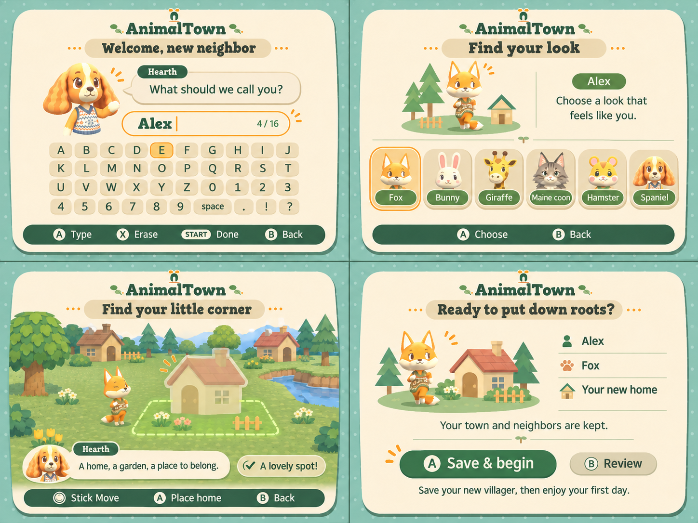

# New-villager onboarding proposal

Approved design reference for the [implemented onboarding flow](onboarding.md),
alongside the existing [portrait picker](villager-picker.md). The deletion PR
introduced this proposal; the following implementation adds the four screens.

## What the series teaches us

| Game | Opening pattern | Useful lesson for AnimalTown |
| --- | --- | --- |
| Animal Crossing / GameCube | A train conversation with Rover introduces the player and character creation. | Make setup feel like meeting someone, not completing an administrative form. |
| Wild World | Kapp'n's taxi ride carries the introductory identity/appearance questions. | Use a welcoming guide and one question at a time. |
| City Folk | Rover's introductory conversation happens on the bus into town. | Keep the arrival short, contextual and connected to the place the player is joining. |
| New Leaf | The train introduction leads into town arrival and guided home-site preview/selection. | Show the actual home footprint and why a location is valid before confirming. |
| New Horizons | Airport setup separates name and direct appearance choices, followed by in-world orientation and tent placement. | Let players choose their appearance directly, then learn the world through a small practical action. |

Sources: [Nookipedia's transportation history](https://nookipedia.com/wiki/Transportation)
documents the train/taxi/bus introductions; [Thonky's New Leaf opening guide](https://www.thonky.com/animal-crossing-new-leaf/starting-the-game)
covers arrival and home preview; [Nintendo's New Horizons setup guide](https://www.nintendo.com/en-gb/Support/Purchases-Subscriptions/Games/How-to-Start-a-New-Game-Animal-Crossing-New-Horizons--1747986.html)
covers direct appearance choice, orientation and additional residents sharing
the existing island. The recommendations below are our design inferences,
not claims that AnimalTown implements Nintendo's onboarding or rules.

## Proposed flow

1. **Welcome and name.** Hearth asks “What should we call you?” A large name
   field and the existing 40-key console keyboard keep the interaction focused.
   Show the 16-character limit, A Type, X Erase, START Done and B Back. Confirm
   the entered name explicitly; do not tie appearance to hidden quiz answers.
2. **Your look.** Six familiar portrait cards directly select Fox, Bunny,
   Giraffe, Maine coon, Hamster or Spaniel, with a larger preview and the picker’s
   honey focus ring. Reuse the actual model-derived portraits. Avoid advertising
   recolors/clothing options the current renderer does not support. Catchphrase
   editing can stay optional instead of blocking the first session.
3. **Your home.** Enter the existing outdoor world and preview the cottage plus
   full garden reserve. Use the established clear, level 15×13 plot rule. Show a
   green valid boundary or a specific blocked-site reason, rather than failing
   after confirmation. Existing homes, plants and landscape remain visible.
   The player moves the proposal and chooses A Place home or B Back.
4. **Review and explicit first save.** Show the chosen name, species and home.
   A **Save & begin** is an explicit persistence action; B Review returns to
   earlier choices. After successful verification, begin the first day with one
   small invitation to visit Hearth/meet a neighbor. Do not hide the first save
   behind a long compulsory chore chain.

These are consecutive screens in one experience, not four competing designs.
The mockup uses the project's existing fox/spaniel render references and palette;
Hearth’s spaniel portrayal is a proposed guide treatment. Other illustrated
species/scene details are concept art: implementation should use the repository's
actual portraits, cottage, terrain and original tree meshes, not rasterize the
whole storyboard into the game.

## First resident and additional residents

An additional resident follows the same personal welcome, look and home steps
inside the already saved town. They never choose a new world layout, rename the
town, replace existing residents or receive a mayor role. A town left empty by
[villager deletion](villager-deletion.md) also keeps its existing landscape and
can welcome a new resident into any slot.

Keep the new resident/home as a draft until Save & begin. Leaving onboarding
should offer Keep editing or Discard this new villager, defaulting to Keep
editing; existing villagers' progress must not be discarded with that draft.
Save/media failure keeps the choices visible with a retry path. Reuse the current
verified-bank storage workflow and check that the displayed town still matches
the mounted card before publishing the new profile.

## Visual and runtime constraints

Match the committed picker: mint dots, oat paper, fern/moss text, honey focus,
terracotta accents, organic rounded shapes, doorway mark and sprout dividers.
Gorditas headings and proportional IPL body text remain readable at 640×480
with television-safe margins. Use GameCube button names and one clear primary
action per view. The two-by-two board depicts four native 4:3 screens.

Reuse bounded 2D portrait pages for name/look/review; no town model renderer is
needed until the home-placement step. Release introductory textures before
loading the outdoor scene. Keep the home preview bounded and share existing
geometry/materials; no new airport, train, transport simulation, terraforming
system, birthday schema or online-account flow is implied by this proposal.
