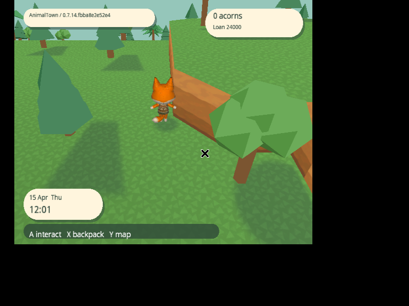
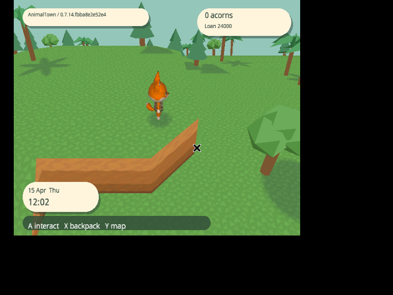
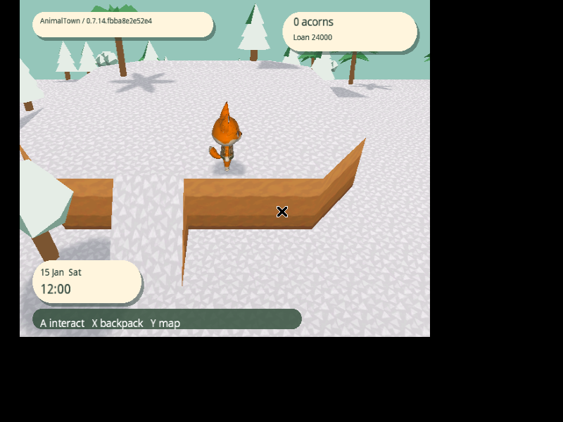
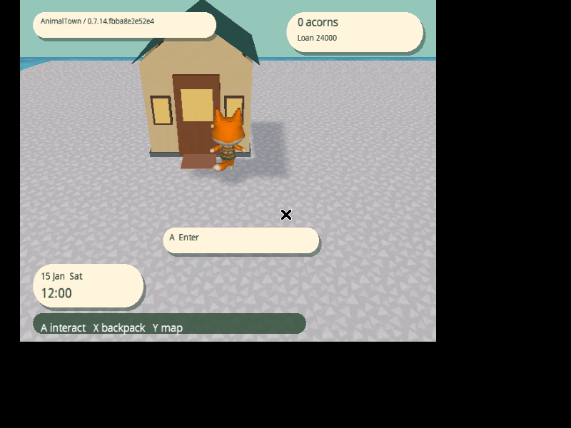

# Immutable terrain and world shadow projection

Validated game: `fbba8e2e52e43c63b52704c1b7880226017f52ee`.
[Release 0.7.14.fbba8e2e52e4](https://github.com/capz/AnimalTown/releases/tag/v0.7.14.fbba8e2e52e4).
[Machine-readable measurements](2026-11-09-immutable-terrain.json).

Town movement draws views into a town-wide geometry archive. Initial loading
bakes the existing floor, water, foam, river banks, cliff walls, diagonal corners,
caps and narrow material lips. All use the original geometry builders, cylinder
row chords, material IDs, world UVs and vertex receiver alpha. Collision and
villager navigation continue to use the shared logical terrain rules.

One scratch section constructs the full camera envelope, including ocean. The
archive stores exact used vertices and indices in an 8 MiB ARAM reservation,
separate from the existing 2 MiB audio reservation. A fixed 1 MiB MEM1 working
cache feeds GX. Native metadata is allocated incrementally; a 64 KiB DMA staging
buffer exists only during loading. The 4 MiB managed heap, 16 MiB native draw
resource budget and 768 resource-handle limit remain unchanged. Scratch arrays
are collected after baking. The native inspection records 3,840,416 bytes of
used archive payload (3,249 parts) and 1,168,384 charged MEM1 buffer bytes,
including the fixed cache and its metadata; the loading staging buffer is freed.

A fixed pool of 256 mesh views selects visible sections. Retained entries stay
pinned; entering sections copy the already-baked bytes from ARAM into free cache
blocks. Terrain movement performs no vertex construction, index generation,
mesh creation or mesh updates. It still performs visibility selection and DMA
cache fills. Those transfers must be profiled; this is not a claim of zero data
movement. Draw lists group by material only when camera selection changes.
Diagnostic forced-recreation/ground-ring controls retain the old builder.

## Shadow projection

Ground texture animation and cylinder movement do not alter logical receiving
coordinates. The outdoor shadow shader independently derives coverage UVs from
raw world-aligned UV0. Each original 8×4 m section fits one 8×8 m shadow page;
mesh views preserve those boundaries even in batched submission. Upper and lower
cliff caps keep independent saved material bindings. Caps receive shadows;
vertical lips and banks retain alpha-zero receiver flags. Water draws outside
the ground shadow scope. Actor movement still updates dynamic shadow coverage;
these updates do not rebuild terrain geometry.

Native buffer holds keep the MEM1 cache alive for all referencing views. Each
pinned record owns its cache blocks until its final view releases it. Retargeting
validates ranges and performs DMA between frames; it preserves the original
payload exactly. Reset rejects live aliases. Ordinary mesh recycling rejects
archive views. Cache exhaustion rejects the new binding without corrupting
published geometry or silently dropping visible sections.

## Verification

Host checks cover all 2,560 archive addresses, shadow-page boundaries, town/ocean
edge visibility against the streaming selector, stationary binding revisions and
allocation-free movement selection. Native fixtures perform 10,000 ARAM binds,
compare exact UV/color/receiver-alpha/index payloads, check dynamic-prefix
trimming, reject active-frame/invalid mutations, and verify pinned-page lifetime.
A separate fixture fills all cache blocks, verifies atomic exhaustion, then frees
and reuses a block. Native tests also pass address/undefined-behavior sanitizers.
Routed validation includes game/rendering checks, shadow union, allocator/mesh
fixtures, persistence and backend integration.

The first all-MEM1 prototype (`44c585768fb3`) fails native startup while appending
the next 64 KiB page after 1,753,088 bytes of archive allocation. A RAM probe
identifies its archive-append exception and 1,072 completed sections. That build
is not validated for play. The final ARAM-backed build completes native startup,
ordinary travel, generated-terrain inspection and saving.

## Native measurements

Dolphin, software OpenGL, DSP-HLE and 1 GiB shared memory. Separate copies of the
same saved town, spring RTC, shadows/material animation enabled, six walking or
running directions of eight NTSC guest seconds each. Warmup, saving and inspector
teleports are excluded by markers. These are single captures per mode/build;
capture overhead remains.

| Instrumented route | Previous c5c388e | Immutable terrain fbba8e2 |
| --- | ---: | ---: |
| Terrain construction stages | 2,376 | 0 |
| Mesh creations / updates / releases | 272 / 234 / 215 | 0 / 0 / 0 |
| Managed allocations | 4,177 | 1,553 |
| Garbage collections | 1 | 0 |
| Selection and cache binding, p95 / max | 2.5 / 2.8 ms | 0.7 / 2.2 ms |
| Terrain preparation, p95 / max | 3.1 / 7.4 ms | 2.6 / 4.0 ms |
| Frame interval, p95 / max | 16.6 / 33.3 ms | 16.6 / 33.3 ms |

Generation, mesh publication and UV/material work register zero throughout the
new marked route (0.1 ms timing resolution). Shadow coverage still updates:
3,231 page updates, with mask work at 1.0 ms p95 / 1.5 ms maximum. Both routes
have zero loading, missing-terrain or recovery frames. DMA fills are included in
the new selection/binding time; no claim of zero geometry transport is made.

| Profiler display off | Previous | Immutable terrain |
| --- | ---: | ---: |
| Mean presentation interval | 16.7801 ms | 16.7341 ms |
| 95th percentile | 16.6833 ms | 16.6833 ms |
| Maximum | 33.3667 ms | 33.3667 ms |
| Intervals spanning two refreshes | 0.5802% | 0.3041% |

Marked windows span 54.9716 and 55.0383 guest seconds. This does not establish
locked 60 FPS. Remaining longer frames require separate investigation.

Post-travel Save now returns to Settings and durably commits complete checksummed
generation 1 → 2 while Dolphin is running. The later projection extension in the
first capture hit an AVI/OpenDML continuation boundary in the old clock reader;
its route and save had already completed. The reader now enters AVIX/movi
continuations during recording. Its full 8,619-frame count matches finalized
ffprobe metadata. Partial-write, unfinished-container, empty-repeat and multi-file
fixtures pass. A second complete projection run passes with the corrected clock.
Both recordings were losslessly compressed with every decoded RGB frame hash
verified before removing the bulky AVI copies.

## Projection views and delivery

These captures show the generated town, without the developer gallery. The
player walks up the original ramp, onto the upper terrace and along the actual
diagonal corner. Tree/villager coverage stays attached to the ground while the
camera scrolls; cap materials and their narrow side border remain aligned.

A separate January 2028 check verifies white winter caps and their narrow side
border, plus tree, villager and house shadows. The source card remains byte-for-byte
unchanged. January 2027 is earlier than the saved April 2027 town: the existing
monotonic saved-month rule correctly retains the saved season in that case.

Clean console/backend CI passes 2,504,000 gameplay/render/texture checks,
323,098 rendering-service checks, backend integration and native fixtures.
Published artifacts include the full 1,459,978,240-byte bootable ISO and direct
88,487,936-byte NKit ISO, with matching clean backend and SHA-256 manifests;
there are no ISO ZIP wrappers. The downloaded image/server hashes and common
commit identities are verified. Later documentation commits do not alter game
code or require another console build.

## Reproduce

Use the Docker setup in the [original report](README.md#reproduction). Replace
the command with `python3 docs/performance/terrain_projection.py IMAGE OUTPUT
--stream-travel --profile-seconds 8 --season spring --dsp-hle`. Copy the original
card into a new output directory first. Add `--no-overlay` for normal-play cadence
or `--save-after-travel` for the explicit durability check. For winter, use
`--season winter --rtc-year 2028` so the RTC is later than the saved town month.

Run `python3 docs/performance/summarize_travel.py OUTPUT` for the marked window;
pass `--capture FILE.mkv` after lossless archival. Run
`python3 docs/performance/check_guest_clock.py` for the incremental clock fixture.

Physical GameCube validation is outstanding.
