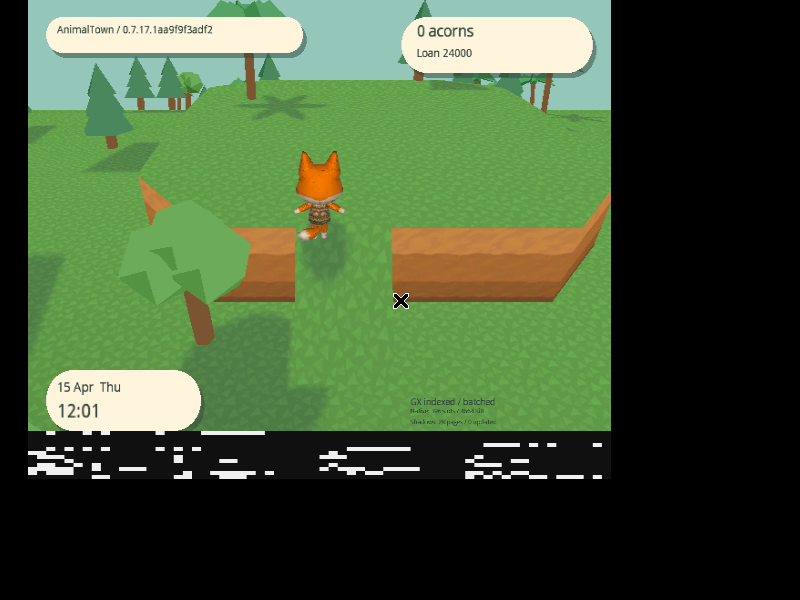
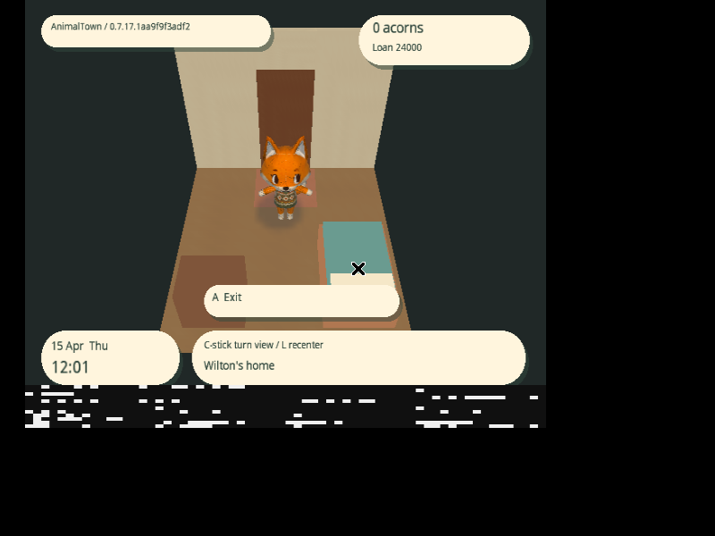
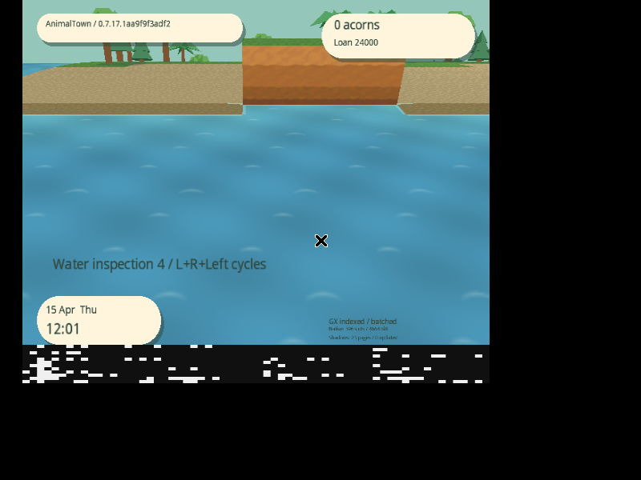

# Viewport animation gating and global backface culling

The previous instrumented capture contains twenty 33.3 ms frames. Their animation
phase takes 5.7–11.5 ms; its usual active-frame median is 3.2 ms. Each contains one
explicit pose-update call, but clip changes and Stop/Play controls were outside
the visibility gate and could also reskin hidden actors. A frame that exceeds
one 16.68 ms NTSC refresh then waits for the following refresh; 33.3 ms includes
that wait. Terrain construction, mesh updates and garbage collection are zero
in those frames. This identifies a phase, not the precise sampling/skinning
function inside each spike, and does not assign causes to uninstrumented frames.

Validated game: `1aa9f9f3adf24ecbb73196fe851773afc051d82d`.
[Release 0.7.17.1aa9f9f3adf2](https://github.com/capz/AnimalTown/releases/tag/v0.7.17.1aa9f9f3adf2).
[Machine-readable results](2026-11-09-visibility-culling.json).

## Shared actor visibility

A fixed seven-actor snapshot resolves the current room, doorway visual position,
actual outdoor or interior camera, cylinder horizon, water-inspection exclusion
and fully opaque doorway fade before evaluating animations. Animation controls
and model submissions consume this same decision. Hidden actors skip native
Play, Stop, speed changes and Update; elapsed hidden time is discarded so it
cannot accumulate into a catch-up pose. Clip changes remain pending until the
actor reappears. NPC gameplay, journeys and door transitions keep running.

The test retains the established conservative animated sphere, including limbs
and ears in all facing directions. Intersecting silhouettes remain visible.
Viewport clipping and depth testing reject the hidden portions of submitted
geometry. This adds no per-triangle CPU occlusion scan or GPU depth readback.
Shadow coverage remains independent from body submission so visible shadows
retain their world projection.

## All 3D backfaces

The generated native mesh and imported-model draw paths enforce GX backface
culling. Mirrored world transforms reverse the culled winding. Imported
material double-sided flags cannot disable this policy, and authored TEV raster
settings are followed by the same enforced cull state. Indexed, direct, material
override and developer UV-filled paths are covered. Overlay passes retain their
existing orthographic winding and material behavior.

All six imported villagers originally used double-sided opaque materials and
mostly glTF counterclockwise faces, whereas generated terrain/buildings use the
game's clockwise GX convention. Cooked DNMD triangle indices are normalized
against the authored outward normals, including mixed winding in one mesh.
Only indices and their section checksum change: source GLBs, vertices, normals,
UVs, weights, joints, clips and pivots stay intact. Conversion is idempotent.
The production native loader verifies all 9,895 villager triangles.

## Validation

Host tests cover actors leaving the viewport between simulation and rendering,
room changes, interpolated doors, opaque fades, viewport edges, reappearance,
no hidden catch-up, and allocation-free selection. Native cull-state tests cover
all material flags, mirrored winding and overlay isolation. Winding fixtures
check mixed faces, unchanged non-index data, idempotence and corrupted checksums.
The normal change router runs the related build, rendering and persistence checks.

Selected host suites pass 2,504,000 gameplay/render/texture checks and 325,110
rendering-service checks. The native production-loader fixture verifies all
9,895 triangles across the six cooked villagers, as well as the generated house.

The focused native scenario uses a separate copy of the regression card, spring
RTC, shadows and material animation enabled. It walks the visible player, moves
the inspector camera to the coast, records two hidden-view markers, returns the
camera, inspects an actual generated ramp and diagonal corners, enters a house,
turns the interior camera through four directions and exits. A separate ordinary
travel route uses six eight-guest-second directions without inspector teleports;
its marked interval excludes warmup and the subsequent explicit save.

Reproduce in the existing Dolphin image (`--shm-size=1g`,
`LIBGL_ALWAYS_SOFTWARE=1`, DSP HLE), copying the same starting card into each
output directory first:

```sh
python3 docs/performance/visibility_culling.py IMAGE.nkit.iso out/visibility-final --stream-travel --profile-seconds 5 --season spring --dsp-hle
python3 docs/performance/guest_travel.py IMAGE.nkit.iso out/visibility-travel --stream-travel --profile-seconds 8 --save-after-travel --season spring --dsp-hle
```

The scenario records lossless AVI. After optional lossless archival, analyze with:

```sh
python3 docs/performance/analyze_visibility.py out/visibility-final --capture out/visibility-final.mkv
python3 docs/performance/summarize_travel.py out/visibility-travel --capture out/visibility-travel.mkv
```

The published full ISO is 1,459,978,240 bytes, SHA-256
`3e6a9953783641a4c820ec9f4e98196e055d67f8e0375848860979c3966ae716`.
The direct NKit ISO is 88,487,936 bytes, SHA-256
`62c6caa27548d9243882a7b6a992f6743df231420c7ca4e78e676a2cae5f9254`.
GitHub asset sizes/digests, downloaded image/backend checksums and clean
same-commit manifests agree. The NKit audit verifies unchanged DOL/apploader,
all disc files and an exact full-image round-trip. Neither ISO has a ZIP wrapper.

The final image boots directly in Dolphin, enters/exits the cottage and retains
the expected villager, furniture and floor faces across four interior camera
directions. Generated ramp/corner geometry and projected tree/villager shadows
remain visible. The focused scenario preserves every starting memory-card byte.
Between the hidden-coast markers, all 134 consecutive checksummed frames have zero native
pose-update calls and a 0.0 ms animation phase. These counters measure explicit
Update calls; the source guard also covers every Play/Stop/speed call.





The ordinary route decodes 3,303 consecutive marked frames. It has zero loading,
missing-terrain or recovery frames; zero terrain construction stages, mesh
creations/updates/releases and garbage collections; and 3,238 active shadow-page
updates. Explicit Save now durably commits complete checksummed generation 1 → 2
and returns to Settings. Both final captures are archived losslessly, with every
decoded RGB frame hash checked before removing the intermediate AVI.

| Same-save instrumented route | Before fbba8e2 | After 1aa9f9f |
| --- | ---: | ---: |
| Animation phase, p95 / max | 6.2 / 11.5 ms | 3.2 / 6.4 ms |
| Explicit native pose updates | 1,446 | 1,444 |
| Frame interval, p95 / max | 16.6 / 33.3 ms | 16.6 / 16.6 ms |
| Terrain preparation, p95 / max | 2.6 / 4.0 ms | 2.6 / 4.1 ms |
| Terrain construction stages | 0 | 0 |
| Mesh creations / updates / releases | 0 / 0 / 0 | 0 / 0 / 0 |

The source guards cover expensive clip controls that the explicit Update counter
does not count. The similar Update totals and reduced animation phase are
consistent with avoiding those hidden controls; this combined culling/visibility
comparison does not isolate individual native functions. The old marked route
contains twenty two-refresh frames; none occurs in this new marked route.
Timings use 0.1 ms guest counters (a normal NTSC interval reports 16.6 ms).
These are single instrumented captures, not worst-case guarantees. No new
profiler-off capture was taken.

Physical GameCube validation remains outstanding. Backface culling is a GX
rasterization optimization: it does not remove the CPU cost of transforming
vertices in a partly visible imported mesh. Conservative actor bounds can retain
an actor hidden by a house; depth testing rejects its covered fragments. These
changes introduce no CPU per-triangle occlusion system and do not establish
locked 60 FPS.
