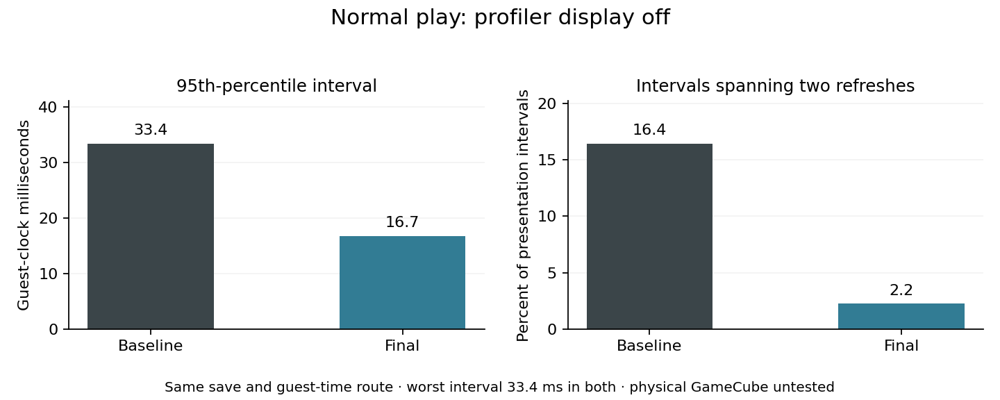
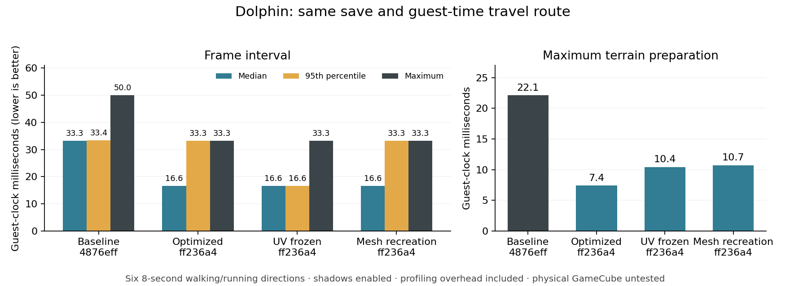

# Streamed-town frame investigation — 2026-11-09

Latest follow-up: [stronger cylinder, seasons, attention and rim controls](../world-debug-controls.md).
Previous: [actor visibility and global backface culling](2026-11-09-visibility-culling.md).
Related: [opt-in debug rain and ocean validation](../debug-weather.md).
Previous: [immutable terrain and world shadow projection](2026-11-09-immutable-terrain.md).
Previous: [row visibility optimization and native measurements](2026-11-09-row-culling.md).
The measurements below document the preceding allocation/save pass.

Final validated game/build: `a53fa6d2e020cd34581ae221df5de5ebf62cc72f`.
[Release: full ISO, direct NKit ISO and matching backend](https://github.com/capz/AnimalTown/releases/tag/v0.7.11.a53fa6d2e020).
Baseline: `4876eff25cb9690fdf7dbb3c3469803108dd4e16`.
The first instrumented optimization pass is `ff236a48a8d34173776cf5fc0f389d5736e65249`.

## Normal play: profiler display off



| Same-save guest-time route | Mean interval | 95th percentile | Maximum | Intervals spanning two refreshes |
| --- | ---: | ---: | ---: | ---: |
| Baseline 4876eff | 19.43 ms | 33.37 ms | 33.37 ms | 16.44% |
| Final a53fa6d | 17.06 ms | 16.68 ms | 33.37 ms | 2.23% |

Both have a 16.68 ms median. This is the relevant comparison for normal play;
the older profiler display itself adds substantial overhead. Occasional two-refresh
intervals remain, and these measurements do not establish locked 60 FPS.
[Machine-readable profiler-off results](2026-11-09-no-overlay.json).

The external measurement counts complete AVI video chunks. Empty repeat chunks
advance guest VI time; nonempty chunks record new presentations. Each case uses
six eight-guest-second walking/running directions from the same copied card,
with spring RTC, shadows and material animation enabled. The windows span
54.84 and 54.97 guest seconds including neutral intervals and screenshot overhead.
AVI timing resolution is one NTSC VI (1001/60 ms), distinct from the internal
0.1 ms counters below. Capture overhead remains; physical hardware is untested.
Finalized AVI metadata matches the incremental parser in both cases. An
instrumented control has exactly 3,110 AVI presentations for 3,110 native
frame-counter increments, independently checking the external method.

## Instrumented native comparison

[Initial instrumented results](2026-11-09-travel.json) and
[final instrumented results](2026-11-09-final-travel.json).



Dolphin, OpenGL software rendering (`LIBGL_ALWAYS_SOFTWARE=1`), DSP-HLE,
1 GiB container shared memory, spring RTC, shadows enabled. Every case starts
from a separate copy of the same regression memory card (SHA-256 in the JSON).
The six full-stick walking/running directions each run for eight **guest** seconds,
followed by one guest second neutral. No teleports occur during the route.
Warmup, menu operations and subsequent save attempts are excluded by their
on-screen frame-counter markers. Profile bars contribute overhead.

| Case | Profiled frames | Median interval | 95th percentile | Maximum interval | Maximum preparation |
| --- | ---: | ---: | ---: | ---: | ---: |
| Baseline | 1,652 | 33.3 ms | 33.4 ms | 50.0 ms | 22.1 ms |
| Optimized | 3,119 | 16.6 ms | 33.3 ms | 33.3 ms | 7.4 ms |
| Optimized, UV/material animation frozen | 3,156 | 16.6 ms | 16.6 ms | 33.3 ms | 10.4 ms |
| Optimized, forced ground mesh recreation | 3,126 | 16.6 ms | 33.3 ms | 33.3 ms | 10.7 ms |
| Final a53fa6d, including save fixes | 3,110 | 16.6 ms | 33.3 ms | 33.3 ms | 7.4 ms |

All five captures have zero loading frames and zero missing-terrain frames.
Baseline invokes coverage recovery once; the four optimized cases invoke it
zero times. These runs have the profiler display enabled. Some measured UI savings are
reductions in instrumentation overhead; use the profiler-off comparison for
normal-play gains. These are emulator guest timings, **not physical GameCube results**,
and do not establish a locked 60 FPS. NPC movement and scheduling mean the
paths are comparable rather than bit-for-bit deterministic. Polling overshoot
is recorded in the JSON (8.008–8.091 seconds per direction).

An earlier, longer wall-clock baseline peaked at 83.4 ms. That is a different
route duration and must not be substituted into this controlled comparison.

## Findings

The previous allocator searched the physical list of live and free objects for
each allocation and walked to the tail when appending. More retained terrain
buffers therefore made unrelated allocations progressively more expensive.
The patched allocator searches only free blocks, appends through a tail pointer,
and preserves tracing/roots, the 4 MiB managed heap and native resource limits.
The frame loop now pumps native callbacks directly instead of allocating a
Task/timer chain every frame. HUD version/mode labels are retained; dynamic
profile labels refresh every 30 frames. Measured UI time falls from a 10.3 ms
median to 1.6 ms, and pacing drops below the 0.1 ms counter resolution.

Terrain publication now updates an existing native indexed mesh when its
allocation can hold the new payload, and retains reusable CPU staging arrays.
Generation uses row-sized steps with separate ground, water and wall publication.
Optimized traversal creates 254 meshes, updates 228 and releases 201; forcing
recreation creates 489, updates 17 and releases 432. Native churn is substantially
lower, but both cases have a 0.4 ms maximum publication cost and similar frame
intervals. Mesh recreation is not the main remaining cost after allocator fixes.

UV/material animation stays below 0.1 ms in all three optimized cases. There
are **zero texture image operations** (creation/update/staging) in those captures.
Scrolling changes UV/material state; it does not reload images or invalidate the
terrain cache. Shadow-page writes are counted separately (3,196 in the normal
optimized route). Freezing animation does not remove the remaining 33.3 ms frames.

The remaining measured work includes selection of terrain/scenery (5.7 ms maximum,
5.3 ms 95th percentile), native shadow masks (1.5 ms maximum), and one garbage
collection per optimized route. These are better next targets than texture scroll.
A larger terrain cache should not be added without rechecking both heap
fragmentation and selection cost.

## Reproduction

Run `guest_travel.py` in the existing `animaltown-dolphin:latest` image with the
same options as `tools/iso-smoke.py`. Use a fresh output directory and copy the
same source card into `OUTPUT/MemoryCardA.USA.raw` before each run:

```sh
docker run --rm --init --shm-size=1g -e LIBGL_ALWAYS_SOFTWARE=1 \
  --mount type=bind,src="$PWD",dst=/work -w /work \
  animaltown-dolphin:latest python3 docs/performance/guest_travel.py \
  IMAGE.nkit.iso OUTPUT --stream-travel --profile-seconds 8 \
  --season spring --dsp-hle
```

Add `--no-overlay` for external AVI presentation cadence with the game profiler
switched off. This cannot be combined with UV/mesh diagnostic controls.
`--save-after-travel` additionally requires a complete new save generation and
return to Settings after the route. Reproduction captures preserve VI markers
and nonempty presentation indices in travel-scenario.json.

Repeat optimized runs with `--freeze-textures` and
`--recreate-terrain-meshes`. The wrapper composes the existing scenario in memory
and refuses to run if its expected source snippets have changed. The underlying
scenario records comparison flags, movement frame markers and actual guest time
in `travel-scenario.json`. Decode captures using `tools/read-frame-profile.py`;
restrict analysis to the marker interval before comparing results.

`avi_guest_clock.py` counts complete AVI video chunks including empty repeated
VI frames. Packet decoder counts omit those repeats and are unsuitable as a
clock. The parser was checked against finalized AVI `nb_frames` for the controlled
captures, plus partial/chunk-alignment/repeated-frame cases. Keep the original
AVI until guest-time validation is complete; a later lossless MKV remux/encode
can preserve pictures while changing container timing metadata.

The diagnostic controls are L+R+Z+D-pad Down (freeze UV/material animation) and
L+R+Z+X (force ground mesh recreation). They default off and are not saved.

## Save validation and heap fragmentation

Native manual-save validation exposed a failure in both measured builds: all
four checksummed payload records are written, but readback fails before the
commit record is published. Host semantic decoding of the same payloads passes.
Dolphin debugging stopped at the first allocation failure: split-save readback
constructs a temporary town and requests a 25,624-byte terrain array while the
largest free block is 21,128 bytes (2,063,120 bytes free in total). It then hits
an unsafe null-message error handler; DSP-HLE audio shutdown masks the second
error behind the saving screen.

Follow-up commit `4aa33f1304bd74bd56c5e8bab224e229721fb4cc` chooses the smallest
fitting free block to preserve large holes and tolerates missing native exception
messages in save recovery. Its focused fragmentation fixture fails under the
preceding first-fit policy and passes under the new policy. Root/GC and core BCL
host checks also pass, but native testing proved that this policy alone did not
resolve saving.

Commit `a53fa6d2e020cd34581ae221df5de5ebf62cc72f` removes the duplicate terrain
arrays from save readback validation. Temporary validation towns compare the live
terrain arrays read-only, hold their own mutable resident/item/building records,
and skip town generation. Current-format/seed guards prevent this path from
being used for migration. Both split and legacy semantic validators still run,
including ranges, terrain modes and placement checks. Exact byte matching now
also covers both record readbacks and the durable commit. Separate helper calls
release their native GC frames before the final readback. Normal loading and
legacy migration retain the owning decode path.

A representative host save allocates 182,944 bytes instead of 285,616, with no
new 25,624-byte terrain arrays. Regression checks enforce a 192 KiB host budget,
reject invalid wallet/position/elevation values, and inject CRC-valid altered
readback at all nine reads. They verify unchanged live state and recovery of one
complete generation, including an already durable commit. Raw live position and
facing floats also retain their original precision during validation.

Fresh native manual saving now passes: player creation, Settings and debug
controls do not write automatically; Save now publishes all four records and the
matching commit, returns with Saved status, and reopening Settings preserves the
card bytes. After the final six-direction profile route, generation 1 advances to
a complete generation 2 and the game again returns with Saved status. A separate reboot loads the newly saved town and opens the backpack, with
telemetry confirming world/backpack scenes and the card SHA-256 unchanged.
CI passes 2,250,160 gameplay/render/texture checks and 323,098 rendering-service
checks, plus backend integration and native fixtures. Physical hardware testing
remains outstanding.
