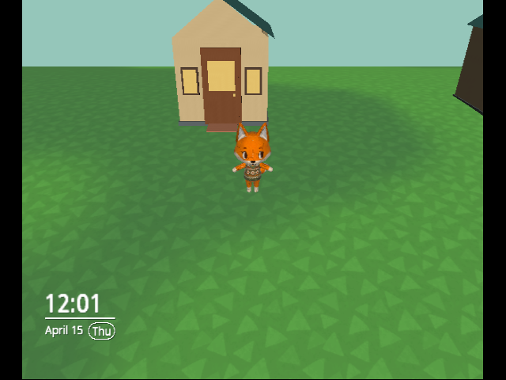
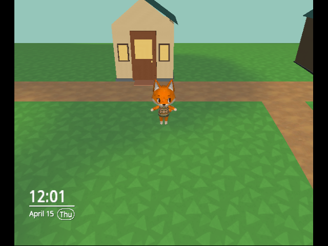
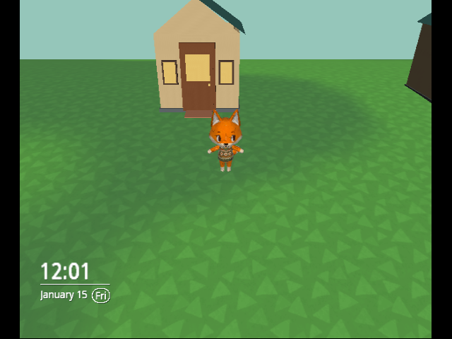
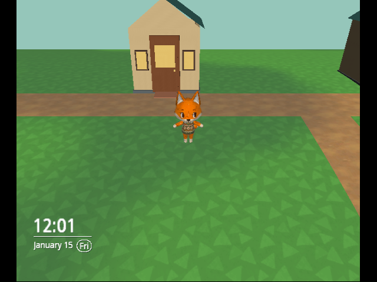

# Town paths: measured costs

Approach B uses one original painted 64×64 dirt tile, without a noise overlay.
The native CMPR page has five mip levels and occupies **2,752 pixel bytes**.
Main lanes have two-metre footprints; home entrance spurs are one metre wide.
Paths replace terrain faces, with complementary grass corners, rather than
adding translucent decals or separate models per tile.

## Framerate and CPU

These are **Dolphin measurements, not physical GameCube timings**. The paired
runs use the same executable (`3baaccb4c2b63845e23d5cb425239964447136e2`), seed 3,
terrain, trees, buildings, save state and camera; the road overlay is either
present or cleared. Native output is 640×480, AA off, Fresnel 100%, runtime
profile 0. Each capture records 240 frames and drops the first five from timing
summaries. AVI recording is disabled. Instrumentation affects absolute timing,
so use these numbers for the paired comparison, not as an uninstrumented FPS claim.

| View | FPS without → with roads | CPU work ms/frame without → with roads |
| --- | ---: | ---: |
| Village, spring, standing | 55.24 → 55.25 | 5.393 → 5.965 |
| Village, spring, walking | 56.35 → 56.79 | 8.272 → 8.993 |
| Village, winter, standing | 55.24 → 55.24 | 5.625 → 5.548 |
| Village, winter, walking | 56.80 → 57.49 | 8.445 → 7.900 |
| Plaza, spring, standing | 55.25 → 55.01 | 6.825 → 6.548 |
| Village with NPCs held indoors, standing | 55.24 → 55.24 | 4.780 → 4.844 |
| Village with NPCs held indoors, walking | 57.73 → 57.26 | 6.685 → 6.750 |

Ordinary NPC movement, model residency and animation make the busy-town CPU
samples vary in both directions. The last two rows hold NPCs indoors with a
long dwell to isolate the road cost: **+0.064 ms standing / +0.065 ms walking**,
about **0.4% of a 16.68 ms frame budget**. FPS differences across these paired
captures stay below 0.7 FPS; they do not establish a speed improvement.
CPU work sums the instrumented simulation, preparation, animation, submission
and UI phases, subtracting blocking GPU/retrace waits. It excludes untimed
housekeeping and should not be read as a hardware CPU-utilization percentage.

## Memory and system pressure

| Resource | Cost / behavior |
| --- | --- |
| Painted texture | **2,752 B / 2.69 KiB**, one owning lease, all seasons and shapes |
| Disc texture file | 2,784 B including its header; no PNG or decoded source RGBA on disc |
| Packed road data | **3,840 B / 3.75 KiB** per town, plus small object/array headers, inside the existing managed heap |
| Used terrain ARAM, seed 3 | 4,272,256 → 4,289,216 B: **+16,960 B / 16.56 KiB** |
| Peak occupied terrain cache, village | 157,696 → 164,864 B standing; 164,864 → 172,032 B walking: **+7 KiB** |
| Peak occupied terrain cache, plaza | 182,272 → 201,728 B: **+19 KiB** |
| Reserved pools | Unchanged: **8 MiB terrain ARAM, 1 MiB terrain MEM1 cache, 4 MiB managed heap, 256 terrain mesh views** |
| Loaded executable text/data/BSS | **+117,056 B / 114.31 KiB** against the local pre-path AA build, including the new code, metadata and capture support |
| Generation, host check | 24 seeds: 262–540 main-lane cells; mean ~3.1 ms, ~105 KiB temporary CLR allocation; no planning during walking |

The executable comparison uses pre-path AA commit
`5066aeeb4f12e647c2be8cd8383934eb6aaed950` with the same SDK
`0.1.0-preview.372.1` and engine `0.1.0-preview.45.1`. Its loaded DOL footprint is
11,853,832 B; the path build is 11,970,888 B. Cold routing, path tessellation and
capture routines compile for size; the residency pump and drawing keep O3.
The persistent road bytes occupy existing heap space, and the geometry occupies
existing reserved pools. The main additional MEM1 reservations are the executable
and the visible texture page. No larger cache or framebuffer is introduced.

The route generator preserves existing obstacles and reports unsafe connections
instead of painting across them. Fourteen anchors across the 24-seed sweep had
no safe two-metre connection. That is generation-time work and is not repeated
per frame. The measured terrain/cache increases pass the design's +256 KiB used
ARAM and +64 KiB occupied-cache gates for this fixture; a hardware sweep over
many towns is still unmeasured.

## Texture pruning

The door capture logged **2,752 → 0 → 2,752 B** for the path source, with read
counts **1 → 2** after returning outdoors. The terrain cache remained allocated
indoors, proving path eviction is independent of its debug setting. A distant,
walkable camera at `(4.5, 86.5)` with no road-bearing section selected/prefetched
reported **zero path bytes**, despite retaining the complete terrain archive.
Walking near roads kept one page resident without re-reading it. Spring and
winter both report the same 2,752-byte page.

Other room assets can change the total native-byte counter; the pruning checks
use source-specific path bytes. The captures show no retained second path page.
The full frame samples, CPU counters, memory counters, asset hashes, DOL hashes
and residency markers are in [measurements.json](measurements.json); per-frame
raw samples are in [frames.csv](frames.csv).

## Screenshots

These are native-size crops of the captured game viewport; no rescaling or
retouching. NPCs can move between the busy-town captures.

| | Before | After |
| --- | --- | --- |
| Spring |  |  |
| Winter |  |  |

## Reproduce

1. Build the console image normally. Keep the default AA option off.
2. Run `dotnet run --project tests/AnimalTown.Checks -c Release -- --path-fixture out/path-fixtures`.
3. Use `tools/profile-card-fixture.py TEMPLATE RECORDS OUTPUT` to create a separate
   disposable card for each `village`, `plaza`, `quiet`, `remote` or `door` fixture.
   Existing output cards are refused; do not use a player's card.
4. In the Dolphin image with `/work` mapped to this checkout and sufficient shared
   memory (`--shm-size=512m`), run
   `python3 tools/path-study.py ISO OUTPUT --dsp-hle --component-cable --season spring`.
   Add `--study-travel`, `--study-door`, or `--study-remote` for those scenarios.
   Repeat matched variants in winter. Run the emulator cases sequentially.

The helper uses the existing AA-study capture controls, with no new game menu.
The quiet fixtures hold NPCs in their own homes; the remote fixture chooses a
walkable camera using the actual terrain selection rules instead of assuming a
coordinate is valid. The game never writes these benchmark results into saves.
