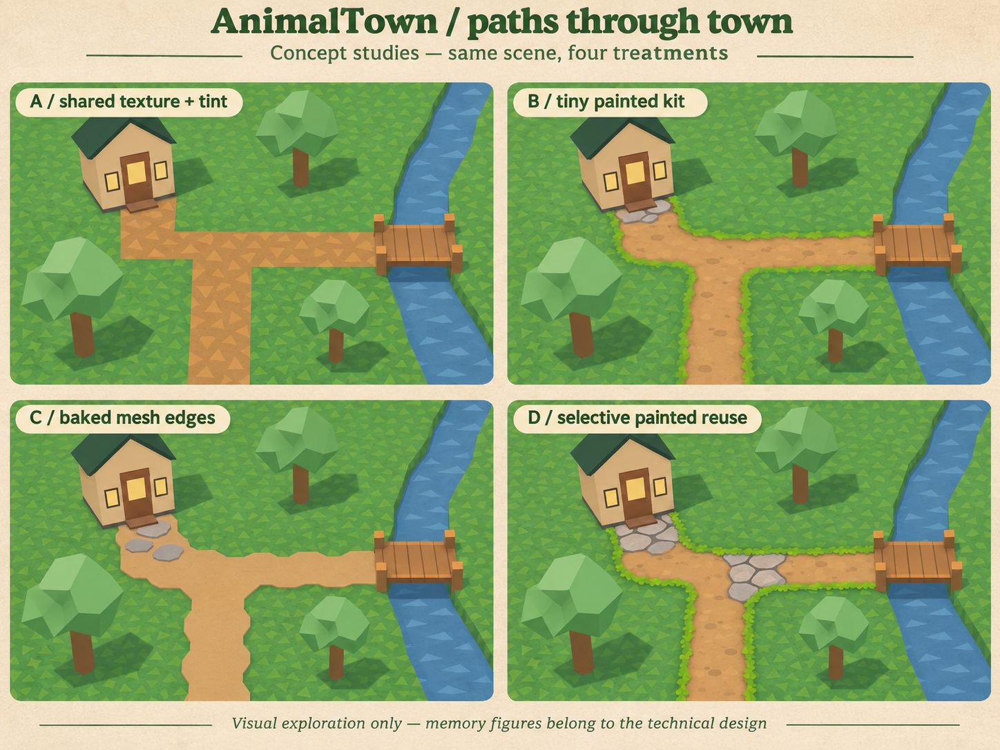

# Roads and paths with bounded texture memory

Status: design proposal, awaiting visual approval. No road renderer, gameplay UI,
save format or active asset manifest is changed by this proposal.

## Recommended direction

Use **shared-texture dirt paths with baked, shaped edges (A + C)** throughout the
town. Add **one small stone treatment (D)** at the plaza and important entrances
only if that visual detail earns its memory cost. Ordinary paths add **zero
texture pixels**. The optional stone page should be **64×64**, cooked offline,
shared across all placements and pruned when it leaves the demand region.



This generated concept sheet compares one invented scene and route. It is art
direction, not an emulator capture or an implemented performance result. It uses
the existing cottage, faceted trees, neutral ground pattern and stone art as
references. Its smoother road edges and small stones still need a native-scale
640×480 review. The bridge illustration is context, not a proposed bridge asset.

## What is already available

- `assets/terrain/terrain.json` enables `neutralFloor`. Its single outdoor image
  supplies grass, dirt, stone and terracotta through material tints. The older
  seasonal transition sources are inactive in this mode.
- `NeutralFloorAssets` cooks that neutral master. `TerrainRenderer` displays a
  64-pixel preview, asynchronously reads the 256-pixel version, rebinds materials
  and explicitly evicts the preview. Current full ground mips stop at 4×4.
- Normal play uses `TerrainArchive`: terrain is baked into an 8 MiB ARAM
  reservation, selected into a fixed 1 MiB MEM1 geometry cache, and drawn through
  256 reusable mesh views. The legacy moving-section builder is a debug path.
- `TextureCache` has a 4 MiB pixel ceiling and 256 source slots, but a normal
  `Release` only drops a reference. Released pages can remain until LRU pressure
  or `TrimUnused`. That is insufficient for aggressive road-page pruning.
- `FloorStrips.At` supports at most 32 rectangular visual patches. These are not
  a road network. `Town` has no independent saved road layer.
- The original stone and terracotta sheets are 768×768 continuous nine-slice
  illustrations. They offer useful art, but not ready-made seamless road tiles,
  concave corners or T/cross junctions.

The current implementation is the authority here. Older
[neutral-ground](neutral-ground.md) and [repeating-floor](generated-trees-repeat-floor.md)
notes describe previous mip counts and sizes. See the
[immutable-terrain evidence](performance/2026-11-09-immutable-terrain.md) for the
current archive model and [cache suspension](aram-terrain-cache.md) for lifetimes.

## Four approaches

| Direction | Art and authoring | Additional resident texture pixels | Main tradeoff |
|---|---|---:|---|
| **A — shared texture + tint** | Use the existing neutral image and dirt/stone/terracotta colours; connect cell-shaped strips. | **0 bytes** | Cheapest initial version; the leaf pattern remains on the path and edges look square. Extra tint materials can split batches. |
| **B — tiny painted road kit** | An artist makes one genuinely seamless 64×64 dirt tile and matching corner/end/junction silhouettes. Bake silhouettes as geometry; do not require a unique image for every shape. | **2,752 bytes** for one CMPR tile; **10,912** if RGB565 is needed. | Better small-scale texture and wear, but introduces a texture, authoring work and a new optional-material binding. A stone tile would be a second page. |
| **C — artist-shaped mesh edges** | Author a small set of original 2 m modules in Blender: straight, bend, end, T and cross. Bake them into terrain; use the neutral image or flat vertex colours. | **0 bytes** | More deliberate silhouettes without texture growth. Added vertices, indices, archive parts and DMA traffic must be bounded. |
| **D — selective painted reuse** | Derive one stone tile and a few silhouette guides from existing stone artwork; use it sparingly at entrances and junctions. Keep dirt on A/C. | **2,752 bytes** for the tested 64×64 stone crop; up to **10,912** for a future RGB565 tile. | Reuses supplied art, but needs seam cleanup and boundary design. A smaller painted area does not shrink its resident texture page. |

B and D are alternatives for richer surfaces, not requirements for the zero-page
design. C can use hand-authored meshes, a compact offline geometry generator, or
artist guides combined with a topology baker. Choose the result by appearance
and measured geometry cost; there is no requirement to solve the art in code.

Other possibilities were considered. A whole-town painted image spends texture
memory on unseen land and complicates edits. Unique textures per road section
scale with town size. A packed atlas of all corners, styles and seasons prevents
individual styles from being pruned and requires careful mip isolation. Runtime
decal or alpha-blended ribbons add overdraw and complicate ground shadows and
depth. None is needed for the proposed first version.

## Offline trials and actual pixel costs

The [reproducible study](concepts/roads/measure-textures.py) invokes the existing
`FloorTexture.Encode` and decodes its output with `TexturePixels`. It measured
the neutral master and 12 existing-art candidates: stone/terracotta ×
spring/fall/winter × 64/128 pixels. Summer inherits spring artwork and is not a
separate candidate. [Full results and source hashes](concepts/roads/texture-study.json).

| Actual encoded input | Native format / mip levels | Resident pixel bytes |
|---|---|---:|
| Current 256×256 neutral master | CMPR / 7 | 43,712 |
| Each tested 64×64 stone or terracotta centre crop | CMPR / 5 | 2,752 |
| Each tested 128×128 stone or terracotta centre crop | CMPR / 6 | 10,944 |
| 64×64 RGB565 fallback, layout bound | RGB565 / 5 | 10,912 |

These include GX block padding and the complete chain down to 4×4, excluding the
32-byte package header. They exclude resource metadata, leases, geometry and
transient source arrays. The 64-pixel crops save 75% of the pixel payload against
128-pixel crops. All 12 pass the encoder's automatic CMPR error policy; that
does **not** establish seamlessness or visual quality at gameplay distance.
The study uses BOX reduction of centre crops, not the production Skia importer.

One page per season held simultaneously would multiply the cost. A 64-pixel
stone page plus a terracotta page costs 5,504 bytes in the measured format;
loading spring/fall/winter copies of both would cost 16,512. The design keeps
only currently demanded art and never makes a coloured copy of the neutral page.

## Appearance and reusable asset brief

Start with a **2 m main lane** joining the plaza, service entrances, bridge
landings and natural ramps. Use **1 m spurs** to house doors where clearance
permits. Let the main route bend around trees and garden boundaries; keep open
meadows between routes. Short stone aprons mark destinations without paving the
whole town. All surfaces remain pedestrian village paths, with no road markings.

Use the existing dirt `#9A805D`, stone `#AAA9A1` and terracotta `#C98769` as starting
colours. Winter changes the surrounding ground through existing seasonal tints;
the road stays legible with muted earth/stone. Snow banks and seasonal edge
details should come from geometry/vertex colour where possible, not four painted
copies of every tile. Reusing tint cannot remove painted snow or flowers from a
source crop; choose a neutral source or explicitly load only one seasonal page.

For C, make a **straight, outer/inner bend, end, T and cross** with identical
boundary sockets, plus one door apron. Reuse rotations instead of distinct
north/east/south/west meshes. Source modules are flat, in metres, +Y up, with
applied transforms and an explicit lane boundary. A target of 8–24 triangles per
2 m module is a starting authoring budget, not a measured runtime total. Large
edge notches should read at 640×480; avoid tiny stones, dense grass fringe or
per-stone objects. Keep Blender source and topology/socket metadata reusable.

For D, start from the supplied **stone-pavement centre**, repaint opposite edges
to join, simplify high-frequency grout, and export one opaque 64×64 top-down PNG.
Keep the original sheets untouched. Use their leafy borders as silhouette
references, not as stretched rectangles around every junction. Deliver a small
reference sheet showing the same straight, bend, T, cross and door apron in
spring and winter. No normal maps, PBR maps or perspective baked into the tile.

## Logical road network

Store roads as an independent, authoritative surface overlay. Do not turn road
cells into `Terrain.Plaza`, `Camp` or a new water/land type to obtain a colour:
those IDs already carry world meaning. Collision, height and water remain owned
by the underlying terrain. A road never grants permission to cross water or a
vertical cliff. Existing bridge decks remain bridge surfaces.

For the initial four IDs (`none`, `dirt`, `stone`, reserved `terracotta`), two
bits per 128×120 cell require **3,840 bytes**, plus version/header/checksum data.
Persist the overlay with the existing town serialization inside the consolidated
card store, not as another physical card file. Older towns decode to an empty
overlay and keep their layout. RLE is optional; choose raw packing when RLE
would expand. Invalid style IDs, dimensions or lengths must fail validation.

At new-town generation, route between stable entrance/bridge/ramp anchors over
walkable land. Build a compact connecting tree, then add one or two useful loops
if land permits. Penalize unnecessary bends and prefer existing shared segments.
Validate the entire requested width, including turn interiors, instead of only
the centreline. Respect buildings, existing trees, gardens, shoreline clearance
and directional ramp traversal. A blocked connection gets a valid detour or an
explicit generation failure; never paint across a river to complete the graph.

Persist the result once. Never regenerate it during movement or a season change.
Existing towns receive no automatic replanning. Player-painted garden paths are
compatible with this layer, but their controls and permissions are a later UI
design. Host-authoritative edits must validate placement and update saved state;
guests must not mutate the overlay independently. There is no movement-speed or
villager-navigation change in the first rendering prototype.

## Terrain integration and geometry limits

1. Resolve the road overlay alongside `FloorStrips.At`, without changing its
   base-terrain matching rules for existing patches. Give the road explicit
   precedence on eligible land; building footprints and bridge decks retain theirs.
2. During the initial archive bake, tessellate road boundaries with the adjacent
   grass into the ground surface. Replace affected faces instead of placing
   nearly coplanar ribbons on top. Subdivide along cylinder rows and ramp changes;
   use the same height samples and seam positions as the terrain.
3. Bake modules into the existing per-section batches, not a model/handle/draw
   call per module. Rotations, endpoint selection and deterministic edge variation
   are bake-time work. Movement continues to select immutable geometry.
4. Preserve raw world-aligned UV0 and receiver alpha used by ground shadows.
   Shared neutral texture needs no new UV convention. A dedicated seamless stone
   tile should use the same world repeat scale. Packed charts would require a
   separate material sampling transform/coordinate while shadows retain UV0;
   the current floor binding does not provide that automatically.
5. Keep material IDs within `FloorStrips.MaximumMaterials` (52), archive part
   kinds within their existing map, and mesh views within 256. New tint materials
   may increase parts even though they share pixels. Vertex-colour batching is
   worth prototyping if that becomes the limiting cost; preserve receiver alpha.

Use a preliminary acceptance ceiling of **+256 KiB used ARAM geometry** and
**+64 KiB peak occupied geometry-cache bytes**, comparing identical towns with
and without roads. These are proposed gates to measure, not observed costs or
increases to the fixed 8 MiB/1 MiB reservations. Include worst-case dense bends
and mixed road/grass sections. If a gate fails, simplify decorative edges or
reduce optional style splits before raising a memory limit. The 256-view gate
must also pass; byte headroom alone is insufficient.

The first prototype has no interactive road edits. Today, changing
`Town.TerrainVersion` invalidates the whole archive; do not describe this as local
patching. Interactive editing needs a separate per-section replacement/lifetime
design before it can avoid rebaking the archive behind a loading transition.

## Aggressive texture pruning contract

The recommended dirt design creates no road texture owner. It borrows the
existing neutral source. For the optional stone treatment:

| Lifetime / condition | Required resident road pages |
|---|---|
| No optional painted style in the expanded view/prefetch region | 0 |
| Stone demanded outdoors | One 64×64 page, reused by every placement |
| Indoors after the outdoor frame retires | 0, independently of the terrain-cache debug option |
| Season/style/town replacement | Old page retired; no unused seasonal cohort retained |
| Failed optional read/allocation | Neutral-tint fallback keeps the road visible |

- Cook the final 64-pixel GX mip chain **offline**. `LoadFloor(fullMipChain:true)`
  can upload that prepared chain without re-encoding it. Source PNGs, large
  transition sheets and intermediate RGBA never belong to the game package for
  this feature. Retain paths, hashes and dimensions, not source pixels.
- Set a **12 KiB resident optional-road pixel cap**, enough for one 64-pixel
  RGB565 fallback. First delivery allows only one painted road style. Additional
  styles need a deliberate budget decision; no automatic cache expansion.
- Derive demand from selected and prefetched terrain sections, not the whole
  town archive. Retain one page across that region to avoid load/evict churn at
  the screen edge. ARAM geometry stores material IDs, never texture ownership.
- Centralize one cache lease per resident road source. Baked sections borrow
  the binding; creating hundreds of section leases would pin it indefinitely.
- After the last demanded use, clear material/effect borrowers and call
  `Release(page, evict:true)` **after EndFrame**. Plain `Release` and eventual
  4 MiB LRU pressure do not meet the contract. Other valid owners must still
  be respected. Do not trim unrelated live resources.
- On replacement, prefer releasing the old optional page before loading its
  successor. Where a reviewed transition needs both, allow **24 KiB temporary
  road pixels** only until the next completed frame; measure staging/metadata
  separately. Loading failure leaves a valid tinted fallback, not a leaked lease.
- Background work returns bytes only. Before upload, validate a town/style/season
  request generation; discard stale completions after travel, reversal or
  disposal. Clear completed tasks and scratch roots. Collection is a cold-load
  cleanup step, not a per-frame pruning mechanism.
- A season change that only changes tint reuses the same source. If painted
  seasonal art is eventually used, retire the old source explicitly. Do not
  infer eviction from the material colour changing.

The existing 4 MiB application-cache ceiling is a safety limit, not a road
allocation target; it also excludes the SDK's separate model texture cache.
Texture pruning does not reclaim the terrain geometry cache, and ARAM geometry
storage does not make a GX texture free in MEM1.

## Approval and implementation sequence

Choose the visual treatment from the sheet before implementing visuals, as
required by the user's mockup-first instruction. The recommended approval is
**A+C dirt with D stone aprons, with stone independently removable**.

After approval, implement a fixed-route comparison in the same saved test town:
A alone, A+C, then optional D. Capture 640×480 views at a door, straight, bend,
T/cross, bridge landing, flat/raised seam and ramp in spring and winter. Record
the exact source commit and compare the same camera and route.

Acceptance must include:

- Native pixel accounting: zero new road pixels for A/C; one measured page for D;
  zero unleased optional-road bytes after indoor/style/town transitions and after
  demand leaves the prefetch band. Count registry-owned native bytes as well as
  source references; a zero reference count alone is not proof of disposal.
- Repeated entrance/exit and season/style changes show bounded peak memory, no
  monotonic growth and no stale asynchronous upload. Include forced read,
  allocation and disposal failures. A visible road retains its tinted fallback.
- Warm travel constructs/uploads no road geometry, performs no road disc reads
  while demand is unchanged, and preserves terrain/shadow seams and object
  occlusion. Profile the new material and DMA costs; no FPS gain is claimed.
- Dense networks satisfy the archive, geometry-cache, material and view ceilings.
  Minified stone and dirt remain readable without shimmering or grid seams.
- Packed overlay round trips, empty old-save migration and failed-save recovery
  preserve the town. Water, cliffs, bridge walkability and building entries stay
  governed by the existing domain rules.

Run targeted validation through `tools/test-changes.ps1` after implementation;
extend routing for newly introduced production paths. The present change is only
documentation, concept art and an offline experiment, so repository policy
requires no console build or component test suites. The 13-sample encoder study
has run successfully. Physical GameCube timing and visual acceptance remain
unmeasured.

Reproduce the study with Python/Pillow and a .NET 8+ SDK:

```sh
python3 docs/concepts/roads/measure-textures.py --dotnet /path/to/dotnet
```
