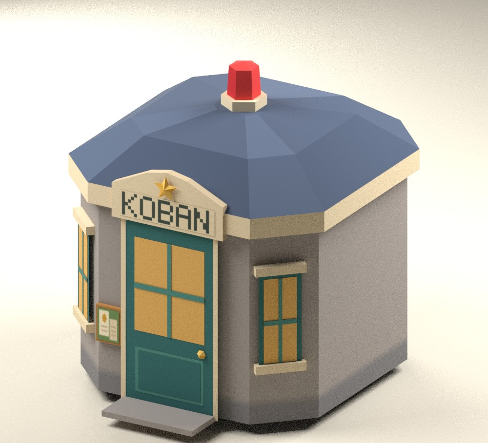
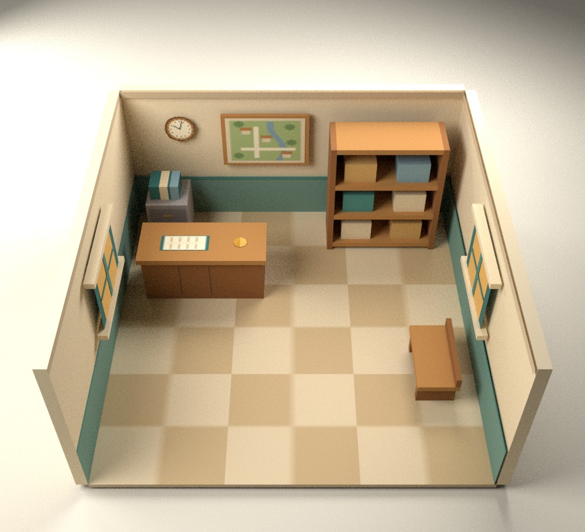

# Koban model previews

These are Blender renders of the committed source GLBs, with the same shared
atlas embedded in each part. They are model inspection images, not Dolphin or
physical GameCube captures. The concept illustration is not a runtime asset.





## Reproduce

From the repository root:

```sh
python tools/generate-koban.py .
blender --background --python tools/generate-koban.py -- --render . docs/screenshots/koban
```

The authoring command requires only Python's standard library. It writes the
original static GLBs, their shared PNG and the two building definitions. It
refuses to reuse stable type 2 if another building owns it, validates each part's
bounds and triangle limit, and checks that furniture vertices fit the declared
collision fixtures. Normal builds cook the committed art without regenerating it.

The previews were produced with Blender 4.3.2, Cycles CPU, 64 samples and no
denoising. Images are 1000 × 909 pixels, JPEG quality 90. The exterior includes the separate door
at its metadata hinge; the interior scales only X/Z from the 4m authoring shell
to the 6m room and omits the front wall for inspection. Preview lighting and
background are not part of the game asset. The images use the 128px source atlas;
console cooking uses 32px for the koban's resident runtime tier. Its deliberately
drawn 5 × 7 sign glyphs align to that 32px atlas grid.

## Geometry and material budget

| Static part | Triangles | Source vertices | Indexed vertices |
| --- | ---: | ---: | ---: |
| Exterior | 215 | 645 | 428 |
| Door | 26 | 78 | 58 |
| Interior floor and fixtures | 226 | 678 | 460 |
| North wall and decorations | 34 | 102 | 61 |
| East wall | 40 | 120 | 80 |
| South wall and doorway | 40 | 120 | 72 |
| West wall | 40 | 120 | 80 |
| **Seven resident parts** | **621** | **1,863** | **1,239** |
| Closed exterior, cooked comparison asset only | 241 | 723 | 486 |

The interior directory also contains a compatible copy of the door source; the
runtime catalog reuses the exterior door. Each source part has one mesh, one
primitive, one material and one opaque embedded 128 × 128 RGB PNG. The atlas is
1,026 bytes, with palette swatches and original sign, ledger, map, clock,
noticeboard and floor-tile artwork. No skins, animations, scene transforms or
runtime text-rendering dependency are needed for the building artwork.

The building cooker now creates indexed imports under `out/derived-buildings`
for all three static kits. It shares only vertices whose position, normal and
UV float bits are identical, then reads the written file back and verifies the
expanded triangle stream, atlas and materials. Authored sources and the closed
exterior's merge inputs keep the unindexed contract. Animated model imports do
not use this step. `building-check` also covers UV/normal seams and signed zero:

```sh
dotnet run --project tools/AnimalTown.Tools -c Release -- building-check .
```

The renderer draws the same exterior and hinged door at every opening angle,
including zero. It does not load the three derived closed exteriors. The cooked
comparison assets remain available for `tests/building-closed-equivalence.py`,
which verifies every expanded 80-byte vertex record after quantized hinge
translation, plus the exact material and texture sections for all three kits:

```sh
python3 tests/building-closed-equivalence.py out/disc
```

Closing a door now retains the existing opening path's two submissions. Total
triangles and authored materials stay unchanged; the extra door submission adds
bounded draw and material-state work. Thirteen visible buildings need at most
26 poses, or 28 with an additional preview, within the existing 32-pose array.
At night, a separate door uses the same nearest-two-light selection anchor as
the existing open-door path. That anchor includes the hinge translation and can
select a different nearby light than the former combined closed model; the
geometry equivalence check does not claim pixel-identical nighttime lighting.
The onboarding preview is outside that building point-light scope.

The exterior collision footprint stays 3 × 3m. Geometry bounds are approximately
`[-0.1125, -0.015, -0.1125]` to `[3.1125, 3.54, 3.58]`, including the roof overhang
and doorstep. The door is 1.1m wide, 2.15m tall and at most 0.13m deep, with its
lower hinge at the local origin. Exterior placement uses hinge `(0.95, 0, 3.02)`
and approach `(1.5, 0, 3.5)`.

### Measured native memory

The production `tests/native-building-assets.c` loader checks cover all
24 cooked parts against the pinned SDK and the 21 resident parts with the
existing `tools/native-building-retained.inc` path applied by
`tools/patch-managed-allocator.py` to an isolated SDK copy. Cooking used
`DolphinDotNet.Assets` 0.1.0-preview.376.1, the exact `build-game.ps1` 128-tier
policy (cottage 64px, shop/koban 32px), two mip levels, compiled GX materials
and the existing clockwise winding conversion.

| Retained kit | Budgeted native bytes |
| --- | ---: |
| Cottage, 7 parts | 225,216 |
| Shop, 7 parts | 190,112 |
| Koban, 7 parts | 152,736 |
| **All resident building kits** | **568,064 (554.75 KiB)** |
| Existing ceiling | 786,432 (768 KiB) |
| **Remaining model-budget space** | **218,368 (213.25 KiB)** |

The previous eight-part kits charged 766,464 bytes. Removing their three closed
models and instances removes 198,400 bytes of budget charges: 65,568 cottage,
84,480 shop and 48,352 koban. Budget charges include shared textures, so that
number is not the physical memory recovery. With all 24 parts simultaneously
resident, releasing only the closed models/instances reduced the host's real
tracked native allocations by 166,528 bytes. Their separately allocated model
and instance structures add another 1,056 bytes on that 64-bit host, for
167,584 bytes of released allocation requests. The remaining shared atlases stay
resident. This measurement excludes libc bookkeeping; actual GameCube free
memory remains a separate emulator/hardware measurement.

These figures include one instance per part on a 64-bit host, whose wider
pointers make the calculation conservative. All parts passed the unchanged
256 KiB model-load and 16 KiB instance budgets. The checks also verify clockwise
GX faces, retention failure atomicity, exact geometry/texture hashes after
compaction, and rejection of package export/unload after retention. The ceiling
and native allocator are unchanged. These checks establish native model budget
and format compatibility; the preview images are not hardware captures.

## Interior interaction layout

These coordinates are actual room metres, matching
`assets/definitions/interiors/koban.json`. Rendered fixture geometry is baked
into the floor mesh. Every fixture is collision kind 0, so the runtime does not
draw a second generic desk or bed over the authored model.

| Fixture | X | Z | Width | Depth | Height |
| --- | ---: | ---: | ---: | ---: | ---: |
| Service counter, ledger and bell | 0.35 | 1.45 | 2.20 | 0.95 | 1.12 |
| Lost-property shelves | 3.65 | 0.30 | 2.00 | 0.80 | 2.35 |
| Filing cabinet and folders | 0.35 | 0.30 | 0.75 | 0.75 | 1.35 |
| Waiting bench | 4.90 | 3.35 | 0.70 | 1.25 | 0.65 |

The counter approach is `(1.45, 2.95)` and shelf approach `(4.65, 1.65)`.
Arrival is `(3, 5.35)`, with a clear central aisle and the existing centred exit.
Shelf bins are decorative scenery, not item records or claimable objects.
Lost-property ownership and claims remain domain/server transactions.
