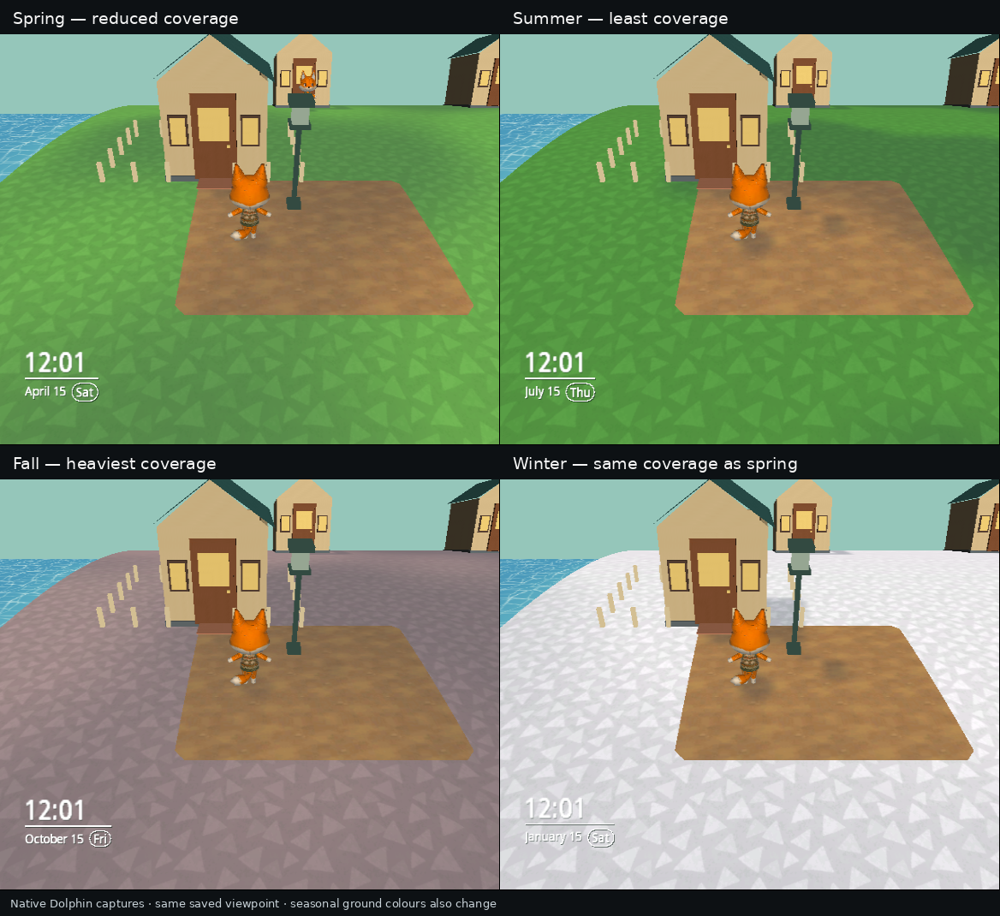

# Seasonal cloud and lamp-post shadow test captures

These native Dolphin captures document the rendering changes merged in
[#104](https://github.com/capz/AnimalTown/pull/104): fall retains heavy cloud
coverage, spring and winter share reduced coverage, and summer has the least.
Lamp posts also cast terrain-clipped base, pole and roof shadows. Overlapping
shadows combine by maximum, so a full-strength cloud can conceal a post shadow.

| Season | Raw native capture | RTC date | Shared mask coverage above 10% of peak |
| --- | --- | --- | ---: |
| Spring | [Spring](spring.png) | 15 April 2028 | 47% |
| Summer | [Summer](summer.png) | 15 July 2027 | 26% |
| Fall | [Fall](fall.png) | 15 October 2027 | 69% |
| Winter | [Winter](winter.png) | 15 January 2028 | 47% |

The percentages describe the shared cloud pattern after seasonal shaping,
before terrain sampling. They do not measure the shaded area in these camera
views. Ground colours also change with the season. Winter retains its larger,
softer, fainter clouds while matching spring's proportional coverage.

The runs booted the published
[`v0.46.0+9d3b24c6b9a5` NKit image](https://github.com/capz/AnimalTown/releases/tag/v0.46.0%2B9d3b24c6b9a5),
commit `9d3b24c6b9a5d1604c0454ce3e9c1792c62c4366`, on 17 November 2026.
They used Dolphin 2503, OpenGL with software Mesa, DSP HLE and disposable cards
containing the same saved viewpoint at noon. Spring/winter use dates later
than the fixture's saved August 2027 month; read-only native-state inspection
confirmed the actual seasonal cloud settings.

The four raw PNGs are unchanged X11 captures. The comparison sheet crops only
the black window margins and adds labels; it does not resize or retouch the
game views. These are emulator results; physical hardware was not tested.

[Release CI](https://github.com/capz/AnimalTown/actions/runs/44089068462) passed
the native build, NKit round-trip, backend integration and selected repository
checks. The native union fixture passed 71,523 checks, and ASan/UBSan passed.
The existing shadow cache remains 522,016 bytes on the host ABI, with no added
draw pass. [validation.json](validation.json) records capture provenance,
image hashes, native settings and validation results.
