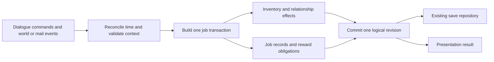

# AnimalTown offline villager job implementation plan

Complete the GameCube-style resident errand loop for AnimalTown's NPC villagers
and all four player-villager profiles. Deliver all twelve repeatable job types,
actual item and world interactions, persistent personal and shared progress,
letters, rewards, and offline cross-town errands through memory-card travel.
One player controls the town at a time; the other player profiles retain their
own belongings, relationships, errands and earned rewards between sessions.

The behavioral baseline is the supplied [job-system specification v1](specs/villager-jobs-v1.md).
The [foundation report](villager-jobs.md) describes the existing implementation.
This plan expands its short roadmap and makes offline travel and NPC migration
required for the final twelve-template milestone. Internet services and
simultaneous network multiplayer are separate work.

All fourteen phases are implemented in [PR 136](https://github.com/capz/AnimalTown/pull/136).
The [delivery report](villager-jobs-offline-implementation.md) records verification,
resource costs, captures and the remaining physical-hardware qualification.

## Scope and parity

NPC villagers request work, give and receive parcels, borrow and refer property,
wear delivered clothing, recognize world objectives, receive letters and provide
the correct rewards. Player villagers accept and complete personal errands,
contribute to shared favors, receive claimant-owned rewards and switch profiles
without taking another player's progress. NPCs do not autonomously consume or
complete a human player's errands.

GameCube-style parity means the full task families and their player-visible
interactions. The supplied specification deliberately improves offer persistence,
target sampling, strict expiry, reward recovery, crash recovery and Unicode mail
grading. Those documented adaptations remain the baseline; implementation must
not quietly restore a source quirk or claim binary compatibility with Nintendo
saves, original dialogue or assets.

Preserve these established AnimalTown choices:

| System | Required host behavior |
| --- | --- |
| Players | Four resident profiles; one active human player |
| NPC population | Current six-resident roster; identities survive slot replacement and moves |
| Pockets | Existing 10/20/30-slot upgrades; maximum 30 |
| Friendship | Existing 0–255 range, with the spec's event deltas |
| Town regions | Logical 20×20 acres, including the partial eastern acres |
| Simulation | Town keeps running behind every gameplay menu and dialogue |
| Saving | Existing card selection and Play without saving behavior |
| Character art | Gameplay textures default to 128×128; every `.dndmodel` character variant is at most 256×256 |
| Presentation | Existing paper panels, typography, controls, voices and reusable item art; new UI needs an approved mockup before implementation |

Finish the opening shop-owner employment sequence as a fixed tutorial, including
the reference's notice-board work, with its own uniform, wages/debt credit and
story progression. It shares safe item, mail and handoff primitives with resident
errands, while keeping its own progression. This plan includes that integration
in addition to the specification's twelve required repeatable templates.

### Starting point

Baseline: [foundation PR 131](https://github.com/capz/AnimalTown/pull/131), source
`f752b0e55ab0174aafab5f1912e944491605db17`. Its build pipeline passed before this
planning update. These are the existing pieces to extend:

* Twelve typed definitions, personality settings and ordinary/retrieval reward
  tables in `Jobs/JobRulesV1.cs`.
* Three independently persisted RNG streams and deterministic selection/money
  helpers.
* NPC cooldown, acre budget and patience state. The actual fixed simulation
  supplies 60 eligible job ticks per second through its 30 Hz update.
* Combined-save schema 13 and shared-town schema 9, with a 164-byte foundation
  extension projected into the incremental NPC runtime record.
* Migration, malformed-data, probability, clock and interrupted-write checks.

At that foundation baseline, the code did not issue complete offers, accept jobs,
bind unique parcels, detect objectives or award job entitlements. The patience-completion API
then needed a conversation-session adapter. The simple requests remained active
until the complete replacement was integrated.

### Required template coverage

| Template | Deadline | Required real interaction | Delivered in phase |
| --- | --- | --- | --- |
| DELIVERY_CLOTHING | 2 days | Take a bound shirt parcel to another NPC; visibly change the recipient's outfit; recipient rewards the owner | 7 |
| DELIVERY_PROPERTY | 2 days | Deliver a bound possession to another local NPC; recipient rewards the owner | 7 |
| RETRIEVAL_BORROWED | 2 days per committed stage | Follow saved borrower referrals, collect the exact object and return it to its owner | 8 |
| FAVOR_FRUIT | 1 day | Hand over the exact requested nonnative fruit | 9 |
| FAVOR_FISH | 3 days | Select and hand over an ordinary fish | 9 |
| FAVOR_INSECT | 3 days, seasonal | Select and hand over an ordinary insect | 9 |
| FAVOR_FLOWERS | 3 days, seasonal | Increase the requester's home-acre flower count by four net plants, then report | 9 |
| FAVOR_BALL | 1 day | An actual world ball collides with the requesting NPC; the credited player reports | 10 |
| FAVOR_SNOWMAN | 1 day, seasonal | Build a new snowman in the correct home acre, retain its exact identity, then report | 10 |
| FAVOR_LETTER | 2 days | Deliver a real letter to the NPC; the local sender explicitly collects the frozen reply | 11 |
| DELIVERY_FOREIGN | 2 days | Carry the player, job and bound parcel into another card's town and deliver to the remembered foreign NPC | 12 |
| DELIVERY_MOVED | 2 days | Follow an actual departed NPC's persistent identity to its new town and deliver the parcel | 12 |

There are two delivery milestones: **the ten local templates** after phase 11,
and **the complete offline system** after phases 12–14. Permanently disabling
the two cross-town templates does not satisfy the final milestone.

## Architecture and ownership

Keep one domain service in `AnimalTown.Domain`. The console supplies validated
conversation commands, dated time, fixed active ticks and sequenced world/mail
events. Thin adapters expose the existing inventory, relationships, catalog,
world, mail and save repository. Rendering reads results and has no authority to
consume an item, advance RNG or issue a reward.

An offer is not an accepted job. A job is not its reward entitlement. A parcel's
item definition is not its unique instance identity. A resident/profile slot is
not a character identity. Keeping these distinctions in the records prevents
reload rerolls, stolen rewards, replacement-NPC targets and duplicated parcels.

## Delivery order

Each phase ends in a reviewable PR, or a small series where domain, assets and
presentation need separate reviews. Update this plan and its acceptance matrix
with actual evidence as phases land. Content authoring can proceed alongside
the domain work after phase 1, with the same contracts and budgets.

Keep intermediate gameplay in reusable development fixtures until the local
replacement is ready for phase 13. Any generation guard controls new offers;
it never deletes accepted jobs or owed rewards. Do not ship a reduced set of
normal templates as the finished system, or change the generation weights to
hide an unfinished type. Save-schema changes need explicit migration and recovery;
switching a feature off is not a way to make a newer save readable by old code.

| Phase | Main dependency | Exit milestone |
| --- | --- | --- |
| 1 | Foundation | Exact scope, adapter contracts, content inventory and budgets agreed in code/docs |
| 2 | 1 | Stable identities survive saves, profile reuse and NPC moves |
| 3 | 2 | Bounded jobs, protected inventory and atomic economic revisions |
| 4 | 3 | Correct deadlines, seasons, offline catch-up and completed-conversation accounting |
| 5 | 1–3 | Real reward content, visible outfits and durable payout/reply infrastructure |
| 6 | 3–5 | Request-driven stored offers and approved conversation/job UI |
| 7 | 5–6 | Complete local clothing/property delivery loop |
| 8 | 7 | Complete multi-borrower retrieval loop |
| 9 | 4–6 | Four complete shared supply/flower favors |
| 10 | 4–6 | Complete physical ball and snowman favors |
| 11 | 4–6 | Real delivered-letter favor and persistent replies |
| 12 | 2–8, 11 | Real two-card travel, NPC migration and both cross-town deliveries |
| 13 | 7–12 | Four-profile integration, tutorial compatibility and safe legacy cutover |
| 14 | 13 | All twelve types validated on the console build and packaged for release |

### Phase 1 Lock parity contracts and resource budgets

Turn the supplied specification into a traceable implementation checklist.
For every generation, cooldown, template, reward, letter and recovery acceptance
case, record the responsible adapter, planned phase and evidence needed. Preserve
the reference source pins already recorded in the specification.

Deliver:

* Contracts for stable identities, item instances, inventory restrictions,
  normal-condition item selectors, dated time, conversation sessions, NPC
  reachability, world evidence, mail delivery, rewards and offline travel.
* An explicit resident/visitor capability table. A visiting player keeps their
  own identity and personal jobs; local-only letter favors require a resident
  sender. Record eligibility for other visitor actions against the pinned
  reference before enabling them, without treating a guest as a resident slot.
* A content audit for furniture, clothing, stationery, flooring, wallpaper,
  native/nonnative fruit, fish, insects, borrowable property and reply text.
  Declare deliberate ordinary/rare-pool aliases in versioned configuration.
* A dependency audit of hard-coded item limits. The current catalog's IDs stop
  at 25; codecs contain that bound, ownership uses a 64-entry array and profile
  payloads have a 2,048-byte read limit. Appending items or records must update
  every affected reader, selector, renderer and test with an explicit migration.
* A save-layout budget. The combined codec currently permits 1 MiB. Four full
  128-letter mailboxes with 1,000 four-byte Unicode scalars per body alone can
  approach 2 MiB, before metadata. A full mail implementation therefore needs a
  versioned body/storage design and revised bounded export budget, rather than
  assuming the foundation's small extension is the finished system's size.
* Reusable scenes with two player profiles initially, all four for final tests,
  NPC homes in suitable different acres, every reward category, full pockets,
  wallet/mailbox boundaries, and two distinct towns on separate cards.

Exit: every required behavior has an owner and a test route; content and storage
gaps have explicit implementation work. Define measured baselines for frame
time, managed/native heap, ARAM, textures, save blocks and physical bytes written.

### Phase 2 Add durable town NPC player and item identities

Mint and persist a town identity independently of its terrain seed. Give player
profiles and NPC instances durable IDs; allocate new identities when a deleted
profile or departed NPC slot is reused. Keep home acre, actor handle, display
name, species and roster index as mutable metadata. Use monotonic local serials
under a town namespace for jobs, offers, evidence, mail and obligations.

Deliver:

* An explicit old-save migration that assigns identities once, then persists
  them without consuming job RNG. Save/readback candidates remain private.
* NPC lookup and profile ownership through identities, including relationships,
  old resident references and the future visiting-player capsule.
* A sparse item-instance binding sidecar for unique job objects. Ordinary items
  keep the compact item-definition representation until they need an identity.
* Persisted personality and clothing-definition identity for each NPC.
* A reachability distinction between asleep/unloaded, temporarily unavailable
  town/card, moved to a known town, and permanently removed.
* Bounded remembered-foreign and last-moved identities with destination metadata;
  real visits/migrations populate them in phase 12.

Exit: saving, renaming, moving homes, profile switching, deleting/recreating a
profile and replacing a roster slot cannot change an existing owner or target.
Counter exhaustion fails before allocation; IDs are never recycled into live or
recoverable obligations. A copied town retains its identity and is detectable
as the same town during travel validation.

### Phase 3 Build bounded job records and atomic item transactions

Implement the full state model before exposing acceptance to the player. Use
compact bounded arrays and derived indexes, not a growing collection of completed
quests or heap objects for every ordinary pocket item.

Deliver:

* Per player: 15 personal delivery records and five retrieval records. For the
  current resident profiles, at most 24 stored offer pairs across four players
  and six NPCs. Budget the later visitor capsule and its offer references
  separately; visiting a town never creates another personal-job allowance.
* One shared favor per requesting NPC, one occupying favor per subtype across
  the town, and 128 reserved reward-obligation slots. Retained completed favors
  continue to occupy the correct keys.
* Versioned payloads for full offers, accepted jobs, chain stages, physical
  evidence, unique item bindings, ordinary/reply entitlements and terminal
  receipts. Rebuild indexes after load and validate all ownership references.
* A single logical transaction that validates a conversation/revision, reserves
  capacity, changes items/relationships, freezes an entitlement and publishes
  one consistent revision. Physical checkpoints use the existing mirrored save
  repository and its publication boundary; card writes are not driven per tick.
* Per-player monotonic command sequences, saved command outcomes while records
  remain live, source event high-water marks and bounded terminal protection.
  Repeated or stale commands cannot pay again after a job record is archived.
* Every inventory mutation routed through binding restrictions: reorder, sell,
  drop, bury, plant, eat, wear, open, gift, mail, storage, shops, lost-and-found,
  profile deletion and travel. An ordinary item with the same definition never
  substitutes for a bound parcel. Debug grants remain ordinary items.
* Atomic cleanup for abandonment, expiry, invalid targets, deletion and corrupt
  bindings. A missing bound object cancels without penalty and is not reminted.
* Save migrations across combined, split and incremental formats. Keep runtime
  counters out of terrain rewrites; give larger ledger/mail records explicit
  format boundaries and space estimates. Unknown rules/content need a recorded
  migration or cancellation, with earned rewards retained through recovery.

Exit: inject failure before, during and after every affected record publication.
Recover a complete old or new job/inventory/wallet/relationship/RNG revision.
Exercise full-capacity rejection, retry, duplicate bindings, duplicate payments
and deletion. Play without saving uses the same logical transactions in memory;
travel later requires durable card participation.

### Phase 4 Complete calendar event ordering and NPC availability

Keep the two clocks separate. The existing fixed active clock governs NPC
cooldowns; dated game time governs accepted-job deadlines and seasons. The town
simulation continues under menus, selectors, mail and dialogue.

Deliver:

* Dated-second precision through the existing calendar adapter. Extend its native
  bridge if needed: the current minute-resolution packed clock cannot verify
  completion at `dueAt` versus `dueAt + 1 second`.
* Deadline intervals of exactly 86,400 game seconds per day, independently of
  the 06:00 town rollover and operating-system daylight-saving transitions.
* Chronological catch-up: process queued mail/world/migration events before
  expiry at the final load time. At event time T, expire deadlines strictly
  earlier than T, apply season closures at/before T, then handle the event.
  Equal timestamps use mail, world-object change, then migration priority.
* Persisted event sequences and a committed time watermark. Reject previously
  unseen older events; known duplicates return their existing result.
* Backwards-clock adjustment of all live timing anchors, affected evidence and
  scheduler/watermark coordinates by the same delta. Preserve RNG and earned
  rewards; recheck seasons against the newly selected calendar date.
* Exact seasonal windows: snowman starts December 25–February 17, 08:00–16:59:59;
  flowers February 25–August 31; insects March 1–November 28. Midnight season
  closure can precede an ordinary deadline. Snowman completion after 17:00 is
  allowed while its accepted job remains valid.
* Real conversation-session accounting: one completed conversation increments
  patience once. Text pages, selector navigation, previews, refused starts and
  repeated commands do not. Preserve the six personality tables and existing
  acre-budget algorithm; split tick batches around actual transitions/resets.
* Conversation priority that permits existing handoffs, reports and earned
  payouts even when fresh work or casual conversation is unavailable.

Exit: prove render-rate independence, real acre changes, same-acre house trips,
all pause contexts, offline catch-up, exact deadlines, leap years, season ends
and backwards adjustments. A shut-down game grants no active cooldown ticks.

### Phase 5 Supply real content outfits and durable rewards

Finish the concrete inventory and economy services needed by every template.
Reuse the existing wallet, item catalog, ownership collection and mailbox.

Deliver:

* Original, usable catalog content for all configured reward categories and
  objective pools. Include nonnative fruit, multiple clothing choices, property
  parcels and stationery; flooring/wallpaper rewards must be applicable in the
  player's home. Missing enabled pools fail development validation visibly.
* Real player/NPC clothing rendering. The current shirt value and work-shirt
  tutorial check do not themselves prove that the rendered outfit changes.
  Prototype every resident species, then use shared geometry and bounded cooked
  clothing atlases/materials. Swap the active outfit through residency rather
  than keeping every clothing variant in RAM. Outfit bindings belong to the
  actor: a player and NPC sharing one species/model may wear different shirts.
  Keep gameplay atlases at 128×128.
* Exact reward-category tables and borrower-count rows using the existing
  helpers. Resolve a concrete item or currency amount once, record it, and apply
  the success relationship effect exactly once. Default MoneyPower remains zero.
* The furniture-only 10% house-candidate branch with a versioned persisted
  candidate cache, ordinary-category fallback, and no removal of actual house
  furniture. Other reward categories and letter presents bypass this branch.
* The worn-clothing reward's captured pre-delivery outfit and specified ordinary
  fallback. Record any content migration fallback once, preserving the category.
* Independent obligations: full pockets keep the same owed item; a full wallet
  accepts what fits and retains the exact remainder. A turn-in may use the slot
  freed by consuming its contribution. Earned rewards survive objective expiry,
  requester departure, retention expiry and reload.
* Claimant-only collection and permanent-unreachability recovery through fixed
  recovery mail or partial currency credit. Temporary unload or an absent card
  is not permanent removal. Full recovery mailboxes retain the obligation.

Exit: every category is reachable with deterministic draws, correctly usable
and presented with project-owned content. Full-capacity retries and reloads
consume no extra RNG and apply no extra item, money or friendship effect.
Capture before/after clothing images for every resident model family.

### Phase 6 Add stored offers and approved player interactions

Generate only when a player explicitly asks for work. Use the supplied priority
order before considering a fresh job; casual previews have no gameplay effects.

Deliver:

* Complete immutable offer payloads: selected subtype, target, requested object,
  fruit and other random decisions. Persist before presenting the offer.
* The 3/4 gate, equal family/subtype draws and one-candidate filtering. Keep the
  two travel-dependent candidates in the roll before filtering while their real
  travel capability is unavailable; do not reroll an invalid candidate.
* Sorted stable-ID target lists, uniform sampling and current-sender home-acre
  exclusion. Sleep and model streaming do not remove legitimate targets.
* Revalidation on acceptance. Full pockets, personal-job slots or obligation
  slots preserve the same offer. Other invalidation removes it and starts the
  specified no-job cooldown, without a replacement roll.
* Atomic explicit acceptance: reserve all capacities, create the exact parcel
  where required, snapshot objective baselines and start the deadline. Merely
  displaying an offer does not start a deadline or occupy a shared favor key.
* Explicit decline applies −3 friendship once to the stored offer; reopening or
  closing the conversation does not repeat it. No daily quota, friendship gate
  or generic success cooldown is added.
* A mockup set for Ask for work, stable offer/Accept/Decline, handoff selectors,
  report/reward choices, job log, failure/capacity feedback and protected items.
  Reuse the existing visual language and assets. Obtain explicit approval before
  implementing each new or materially changed UI flow; domain work continues
  independently while design approval is pending.
* Approved presentation bound to authoritative conversation IDs, revisions and
  allowed actions. Disallow remote turn-ins and wrong-NPC reward collection.

Exit: A/B/X actions, page changes, full-capacity retries and repeated interaction
cannot reroll or accept accidentally. Inspect the actual console screens at its
supported display settings, including long names, all result messages and menus
running over a live town. Author original personality-appropriate dialogue.

### Phase 7 Complete local clothing and property deliveries

Implement the first playable vertical slice: ask, accept, carry, hand over, earn,
collect, save and reload.

Deliver:

* Clothing delivery chooses an eligible shirt other than the requester's outfit;
  property delivery chooses from the original borrowable-property pool.
* Both require a parcel slot on acceptance, have two-day deadlines, and choose a
  different eligible NPC in a different home acre.
* Only the exact owner-bound instance satisfies handoff. Reordering pockets
  works; another player's parcel or ordinary lookalike does not.
* Clothing handoff captures the recipient's old outfit, consumes the parcel and
  visibly equips the new shirt. The recipient awards the clothing reward.
* Property handoff consumes the possession and the recipient awards the property
  reward. Neither delivery requires returning to the sender to report success.
* Ordinary success gives +3 to the appropriate recipient relationship. Explicit
  personal abandonment gives −3; local clothing/property timeout gives −5 once.
  Wrong items, unavailable capacity and world invalidation have no blame penalty.
* Personal job occupancy survives REWARD_OWED and releases only when settled.

Exit: complete both types through real dialogue and inventory with normal and
full pockets/wallets, after a save/load mid-route and with another profile active
between acceptance and delivery. Confirm the actual NPC outfit and exact payout.

### Phase 8 Complete borrowed property retrieval

Deliver:

* Accept without a parcel or free-pocket requirement; reserve the personal
  retrieval record and reward obligation. First borrower counts as borrower one.
* Save each fair stop/continue decision before presenting it. Select onward
  borrowers uniformly from stable eligible IDs, excluding the original owner,
  visited borrowers and the current sender's home acre.
* Limit the chain to two borrowers (one optional redirect), forcing pickup at the second or whenever
  there is no eligible onward candidate. Do not count the final owner as another
  borrower when choosing the reward row.
* At final pickup create the reserved bound object only if a pocket is free.
  A capacity retry preserves the selected branch and stage deadline.
* Refresh the two-day stage deadline only on a committed referral or pickup.
  Looking at dialogue or reopening a selector never refreshes it.
* Return the exact object to its original owner. Apply zero timeout friendship
  while seeking, −2 while returning, and normal success/reward behavior on return.

Exit: deterministic one- and two-borrower routes, saved legacy three-/four-borrower completion, forced dead ends,
home-acre exclusions at each link, full-pocket pickup, duplicate referral
commands and reload between every stage all produce the specified result.

### Phase 9 Complete shared supply and flower favors

Deliver four actual templates with one accepted town-level record per requester
and one occupying key per favor subtype. Another eligible resident profile may
finish an unclaimed favor; only its successful claimant receives the reward.

* Fruit: request one exact configured nonnative fruit; hand over a normal owned
  instance within one day. An item acquired before acceptance can qualify.
* Fish: accept an ordinary fish through the actual selector within three days.
* Insect: the same category interaction with the specified three-day/season
  rules. Expensive catches do not multiply reward weights. Explicitly cancelling
  a committed fish/insect contribution selection applies −1 once; simply closing
  conversation or receiving a reminder does not.
* Flowers: start only with at least four empty plantable cells and at most 20
  mature flowers in the NPC's home acre. Snapshot seedlings plus mature plants;
  require the live total to reach baseline +4 at reporting. Replacements and
  removed plants count correctly. Multiple profiles' planting may contribute;
  first valid reporting resident claims the reward. Keep the plants in place.
  Derive plantable cells from the real planting/collision rules and give actual
  flower states explicit seedling/mature classification instead of inferring
  maturity from a generic ground-item kind alone.
* Cancel the flower objective without penalty if the requester's home acre
  changes. Border cells are counted by logical acre, not apparent proximity.
* Non-letter successes retain requester/subtype occupancy until original dueAt
  +3 days, independently of completion time and when payment becomes possible.
  Earned rewards survive the end of that retention or the season.

Exit: use at least two local profiles in the actual handoff/plant/report flows,
including switching after acceptance, combined contributions, wrong fruit,
pre-owned catches, full reward capacity, retention and seasonal closure.

### Phase 10 Complete physical ball and snowman favors

Add the missing reusable world objects and their authoritative evidence hooks.
These objectives cannot be implemented by an inventory item or proximity check.

Deliver:

* A bounded world-ball population with real movement, collision and NPC contact
  events. A qualifying ball can predate acceptance; neither recent spawning nor
  the active player's last kick is required. Credit the sole active local player
  at the qualifying collision, using the visitor capability rule from phase 1.
* Persist first collision evidence even during a menu or dialogue when the NPC
  cannot start a new conversation. The claimant later reports within the job's
  deadline. Destruction of the ball after that event does not undo the evidence.
* Seasonal snowballs that the player actually rolls/combines into a snowman.
  Persist snowman instance, builder and home acre. Any quality qualifies if the
  snowman was created after acceptance in the requesting NPC's home acre.
* Destroying that exact snowman before reporting clears its evidence/claim and
  returns the objective to active. Another snowman's destruction does not. After
  success, ordinary entitlement retention/recovery protects the earned reward.
* Save bounded live-object state and event cursors. Reuse low-poly assets,
  collision infrastructure and residency; world objects continue progressing
  behind UI with the rest of the town.

Exit: actual collision/combine/destruction tests, event duplicates, menus at
collision time, cross-profile credit, save/load, wrong acres, old snowmen and
season boundaries. Measure worst-case physics and rendering costs in the town.

### Phase 11 Implement real mail and the letter favor

Replace the tutorial's placeholder send/reply path with real mail infrastructure
usable by the tutorial and resident jobs. Keep ordinary mail relationship effects
owned by the mail service so job collection cannot apply them twice.

Deliver:

* An approved composition/recipient/attachment/mailbox UI using existing styles.
  Give every message a durable mail ID, sender, recipient, queued/delivered state,
  due timestamp and an attachment transferred exactly once by mail delivery.
* A versioned compact text/body store within the committed save architecture,
  with envelope indexes and a bounded working text cache. Normalize/grade one
  message at a time; do not keep duplicated decoded bodies for every NPC in RAM.
  Play without saving and card removal must retain required session data; a lazy
  read strategy cannot assume a card remains inserted after loading.
* NFC normalization, Unicode-scalar counting, White_Space/Cc/Cf filtering and
  letter/decimal classification. Verify SDK support early; if absent, use pinned
  compact generated Unicode tables and algorithmic normalization support, not
  an ASCII approximation or a large desktop runtime dependency.
* Enforce at most 1,000 normalized scalars. Quality requires filtered length at
  least five, at least one letter/decimal digit and no four repeated consecutive
  identical letters/digits after filtering. Preserve case sensitivity and the
  specified punctuation/emoji behavior. Display fallbacks must not alter the
  stored text or grading result.
* The exact 17/49-scalar length buckets, quality/gift rank calculation, twelve
  reply ranks and reply-present pools. Author original reply text families.
* Only actual delivery to the requesting NPC within the accepted favor's
  deadline can claim it. Drafts and queued mail cannot. The first qualifying
  resident sender becomes claimant, even when another profile accepted the job
  or a later letter is better. A low-quality first qualifying letter still wins.
* Freeze reply text key, rank and gift at receipt; apply the mail relationship
  delta once. Explicit claimant follow-up inserts the reply immediately if space
  exists. Full mailbox preserves the same owed reply. No ordinary +3 is added
  for collecting it, and no new daily post round is required.
* Letter occupancy ends on reply insertion or now > original dueAt. There is no
  three-day letter retention. A still-owed reply remains collectible by job ID
  after the live favor record releases its slot.

Exit: complete the real compose/send/deliver/follow-up flow; test every rank and
Unicode boundary, gifts, two resident senders, first-letter ownership, full
mailbox, deadline passage and offline catch-up. A letter delivered before its
deadline remains credited when the next game session starts after that deadline.

### Phase 12 Add offline travel NPC migration and cross town errands

Implement GameCube-style card-to-card travel without internet services. This is
a substantial host feature and is required for the two remaining templates.
Split the phase into travel/recovery, NPC migration and errand-integration PRs.

Deliver:

* An approved departure/destination/return/recovery UI. Two distinct supported
  town saves on available cards are validated for identity, revision, catalog,
  writable capacity and transfer compatibility. Continue honoring the player's
  selected save destination; do not silently select another card on an error.
* One bounded visiting-player capsule, separate from the destination's four
  resident slots. It carries the same player identity, appearance, belongings,
  personal jobs, exact parcel bindings, relevant offer/obligation references,
  command sequences and return route.
  Destination residents' inventories, homes and relationships remain intact.
* Explicit home-card, destination-card and capsule ownership for every portable
  record. Enforce the player's single cumulative 15-delivery/five-retrieval
  allowance across towns. Shared favor occupancy stays in its requesting town;
  transferring a claimant's earned entitlement leaves a durable transfer receipt
  there instead of another payable copy. Keep stored offers recoverable at their
  owning town and budget visitor offer storage without unbounded visit history.
* Durable source/destination transfer records with a unique transfer ID,
  prepared revisions, an explicit commit decision and idempotent receipts. Lock
  the source player while away; activation at the destination and return/release
  must be recoverable rather than creating two playable copies.
* A real two-card recovery protocol. A single-card manifest cannot atomically
  write two physical cards. Persist preparation and the canonical handoff
  decision, replay receipts after interruption, and keep uncertain transfers
  locked until the required counterpart is available. Prove this state machine
  before enabling departures; never unlock the source merely because another
  card was removed. Require saving for travel, while local unsaved play remains
  available. Revalidate actual town/card identity on every transfer write.
* Matching logic for copied town saves: identical TownIds are the same town,
  not two travel destinations. Refuse conflicting cloned-town transfers; the
  normal crash-recovery protocol does not merge independently played copies.
* Persist real foreign-resident memory from the visit adapter. A foreign offer
  targets that remembered NPC outside the current town; it is not a random local
  resident and does not require inventing an extra conversation prerequisite.
* NPC move-out/move-in records that preserve the actual NPC ID, personality,
  outfit and necessary remembered relationship data. Support replacing a slot
  within the current six-NPC limit, assign the destination home acre separately,
  update lastMovedAwayNpcId on a real departure, and maintain reachable-town
  metadata across later moves. Accepted jobs keep their original target ID.
* Foreign and moved deliveries use generic property parcels, their distinct
  reward rows, two-day deadlines and the recipient as payer. Enforce each
  subtype's duplicate job/offer restriction. Do not add a 60-day move-age limit.
* Transit and temporary card absence retain accepted work. Proven permanent
  removal cancels unfinished objectives without blame and removes their bound
  object. Already-earned rewards use the existing recovery policy.

Exit: on two real town saves, complete an actual foreign delivery, move a known
NPC into the other town, and complete a moved-resident delivery. Interrupt every
prepare/commit/activate/return write; remove each card, swap slots, fill a card,
retry after restart and verify one authoritative player/item/reward owner.
Migration cannot turn an unrelated replacement NPC into a target.

### Phase 13 Integrate all player profiles and replace legacy requests

Deliver:

* All four resident profiles retain independent offers, personal errands,
  bindings, relationships and owed rewards across save, load and switching.
  Shared favor occupancy/evidence stays at town scope. A different profile's
  conversation never clears the winner's claim, retention or payout.
* Profile deletion disposes of owned jobs, bound objects, pending mail and
  obligations in one transaction, releases unresolvable claims and clears
  exploration cursors. Reusing the slot creates a new identity. Test deleting
  the last resident and deleting while a travel record exists; unresolved travel
  must settle or block deletion safely before any ownership is discarded.
* Complete the fixed opening employment flow using actual outfit, planting,
  delivery, retrieval, introductions and composed/delivered mail where
  applicable, plus a real notice-board posting task. Verify the fixed task
  categories against the pinned reference and record AnimalTown's chosen order
  and established wages/debt amounts as host adaptations, without inventing exact
  original values. Use the tutorial director, not random resident generation.
  Notice-board composition/posting needs its own approved UI, bounded text and
  persisted completion event. Required tutorial progression is not subject to
  random no-job rolls or NPC patience refusal. Completed old tutorials remain
  completed; migrating an in-progress stage must not repeat wages or debt credit.
* A deterministic conversion/retirement policy for old `Villager.Request` records
  and generic tutorial parcels. Never reinterpret an ordinary definition-ID item
  as a new uniquely bound parcel or silently discard an earned reward. Run the
  conversion once under the save-version migration, without job RNG draws.
* Disable the old casual-talk auto-request/immediate-payment loop after the
  complete local replacement is reachable. Keep definitions, selectors, job log,
  conversation priorities and recovery flows consistent with enabled travel.
* Approve and implement any remaining log, reminder, capacity, failure, card and
  recovery UI before enabling the replacement for normal play.

Exit: conduct a multi-session town playthrough using every profile, then travel
and return. Tutorial completion, debt progression and normal social interactions
still work. There is one resident errand system and one effect per transaction.

### Phase 14 Validate the complete system and ship

Run the supplied deterministic acceptance suite plus the actual engine flows.
Domain tests establish rules; console scenarios establish that players can use
the real controls, NPCs, objects, mailboxes, cards and visual results.

Deliver:

* Traceable pass evidence for every generation/cooldown, template, reward/mail,
  timing, migration and recovery acceptance case. Run source-linked GameCube
  rules and the intentional adaptation cases as separate expectations.
* Per-template normal success, rejection, expiry, capacity retry, profile switch,
  mid-stage reload, duplicate event/command, claimant protection and interrupted
  save coverage. Cover maximum simultaneous jobs/offers/obligations.
* Native/AOT smoke tests for the real RNG, reward math, serialization and Unicode
  paths, including methods that were only host-tested or unreachable in the
  original foundation build. Use the pinned SDK and engine packages.
* GameCube/Dolphin scenarios for crowded outdoor play, interiors, menu/dialogue
  backgrounds, flowers, balls/snowmen, shirt changes, maximum mail, catch-up after
  a long absence and two-card transfers. Verify ISO and standalone Depot paths.
* Screenshots or short captures of asking/acceptance, parcel carrying/turn-in,
  clothing before/after, retrieval, each shared world objective, real mail/reply,
  full-capacity recovery and actual cross-town delivery.
* Before/after frame-time and memory reports with representative and maximum
  load: CPU time per subsystem/interaction, frame median and tail latency, main
  heap high-water mark, ARAM, resident texture bytes, save sizes/blocks, physical
  checkpoint writes and time. Separate host/emulator observations from hardware.
* A release migration walkthrough using old real saves, selected-slot saving,
  Play without saving, missing/full/damaged cards and transfer recovery.
* Repository checks through `tools/test-changes.ps1`, affected emulator scenarios,
  and green CI for every merge. Preserve version policy and four-line request
  summaries. Release the same-commit NKit ISO, Depot app ZIP, backend/tools ZIPs
  and `update.json` through the existing release pipeline; keep validation
  captures under the Depot archive's `release/` directory.

Exit: every item in the completion gate below is backed by a passing test or a
recorded real-engine scenario. Unsupported travel, placeholder mail, invisible
clothes or simulated proximity objectives cannot be counted as finished types.

## Memory performance and storage gates

Use a proposed **64 KiB resident budget for core job state and indexes**, excluding
live mail text, transfer snapshots and existing inventory/character data. This
is an engineering target to validate after the phase 1 layout, not a measured
claim. Report the final envelope from actual maximum-capacity allocations.

Keep fixed work bounded by the small NPC/profile set. Ordinary job-clock updates
must allocate no managed memory, scan no full inventory/mail history and perform
no card I/O. Reconciliation work follows indexed due jobs/events; catch-up and
presentation must not cause unbounded per-frame work. Do not write to the card
for every active tick or conversation page.

Budget mail envelopes, UTF-8 bodies, Unicode tables, text working buffers and
travel snapshots separately. Validate both normal and worst-case inputs against
RAM, card capacity and every export/import limit. If the existing format cannot
hold the required limits, change its version and bounded sections explicitly;
do not truncate a letter, erase an obligation or lower a host capacity silently.

Add no character texture allocation per accepted job. Outfit changes use the
existing residency budget; icons and parcel appearances share reusable assets.
Any ball/snowman meshes, outfit atlases or Unicode tables get a measured retained
cost and a clear unload policy. Source asset size is not a substitute for native
resident-byte measurement.

For every functional phase, compare a representative existing-town baseline with
normal and worst-case added work. Investigate sustained frame regressions, large
catch-up spikes, duplicate texture residency or checkpoint stalls before expanding
scope. Establish numeric frame-time limits from the first target-hardware report;
do not invent FPS guarantees from desktop unit tests.

## Final completion gate

The offline job system is complete when all of these are true:

1. All twelve templates can be accepted and completed through the real game,
   including both memory-card cross-town deliveries.
2. NPCs visibly receive clothing and items, refer borrowers, recognize exact
   physical objectives, receive delivered letters and pay the configured rewards.
3. All four player villagers have independent personal ownership and correct
   participation in shared favors. Only the winning claimant collects a reward.
4. Offers, active jobs, exact parcels, stage decisions, evidence, cooldowns,
   retention and earned rewards survive switching profiles, shutdown and reload.
5. Full pockets/wallet/mailbox, missed deadlines, seasons, clock changes, NPC
   relocation/removal, content migration and profile deletion follow the spec.
6. Neither ordinary save interruption nor an interrupted two-card transfer can
   duplicate or lose a committed item/payment or activate two player copies.
   Uncertain transfers recover through their durable decision/receipt records.
7. The town keeps progressing under gameplay UI; only the specified active job
   clock excludes menus, dialogue, loading and offline time.
8. The old simple-request loop has been replaced safely, and the fixed employment
   tutorial, including notice-board work, uses the real shared primitives without
   blocking repeatable jobs or resetting completed tutorials.
9. All new UI has the user's required approved mockups and follows AnimalTown's
   existing design language. Original project-owned art/text are used throughout.
10. The deterministic suite, native/AOT paths, real-engine scenarios, measured
    resource budgets, migrations and same-commit release checks pass.

Completion covers the supplied resident-job contract and the offline travel
needed to use all its templates. Network concurrency, live online visits and
server-owned job commands remain an independent later project.
