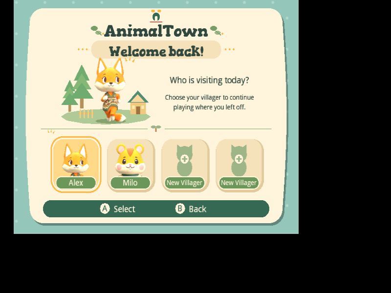

# Graphical villager picker

This implements the supplied “Welcome back!” mockup as native GameCube UI at
640×480. Start opens one cream, rounded panel over the existing drifting mint
dots. The doorway/wordmark and welcome banner sit above the selected resident's
small tree/cottage vignette and “Who is visiting today?” copy. Four horizontal
portrait cards sit below the sprout divider. A honey/cream outline highlights
the selected card; rounded moss tabs show the actual saved names. Unused slots
show a sage silhouette, plus sign and “New Villager”. A selects; B returns.
Z on an occupied card opens a [deletion confirmation](villager-deletion.md).



Left/Right on the D-pad or main stick moves through the four cards and wraps.
Up/Down remain equivalent for existing controls and automation. START confirms.
The active saved profile is initially focused. Browsing and cancelling do not
select/create a profile or write the memory card. A saved resident with a home
continues to gameplay; an unused slot opens [four-step onboarding](onboarding.md)
with an explicit **Save & begin**. Save formats and town ownership are unchanged.

## Artwork and memory

The mockup's sample names/characters are replaced by the current save. Six
transparent 256px original-model renders live in `assets/textures/ui/villagers`.
Species order matches gameplay: fox, bunny, giraffe, Maine coon, hamster and
cocker spaniel. Their existing model textures supply the appearance, including
the same currently rendered clothing. Palette/shirt save fields are preserved;
the picker does not invent visual recolors absent from the gameplay renderer.
No bear species is introduced for the mockup's sample “Milo”.

`BrandAssets` verifies the GLB/PNG SHA-256 provenance and packs each image as a
128 KiB RGB5A3 texture. Its four 128px pages are shared between the card crop and
large preview. Only occupied species load; duplicate species share one texture,
and a completely empty town loads no portraits. Four distinct residents require
at most 512 KiB of portrait image data. The small vignette uses 2D triangles and
rounded shapes, not terrain or building resources. Names/layout are cached; the
frame loop loads no images/models, recomputes no poses and performs no card I/O.
The existing proportional IPL font handles copy/names, with fitted one-line tabs;
unusually wide names abbreviate at a minimum readable scale and appear in full
beside the selected preview.
Gorditas handles the welcome heading. All picker texture leases are released and
unused pages evicted before returning to title or beginning gameplay loading.

Regenerate original-model PNGs only when art changes:

```sh
blender -b -t 2 --python tools/bake-villager-portraits.py -- /path/to/AnimalTown
```

The script uses Blender 4.3.2/Cycles CPU, transparent film, fixed sampling and an
orthographic camera fitted to visible alpha rather than unused rig bounds. It
does not modify the GLBs. Review PNGs and `provenance.json` together. Blender is
an offline art dependency; normal builds/CI use the committed PNGs and SkiaSharp.

## Validation

Run `tools/test-changes.ps1` and build the console normally. The asset cooker
rejects changed provenance, incorrect dimensions and empty/opaque portraits.
`tools/iso-smoke.py DISC OUTPUT --profile-cards` checks the visible card layout,
right/wrap navigation, back-to-title and unchanged committed town data. Use a
disposable four-resident card from `--profile-fixture`/`profile-card-fixture.py`
to inspect species/name differences. `--shared-profiles --profile-slot N` checks
continuing or creating a resident and saving without altering other profiles.
Inspect both occupied and empty cards in Dolphin at native resolution. Physical
GameCube testing remains outstanding.
