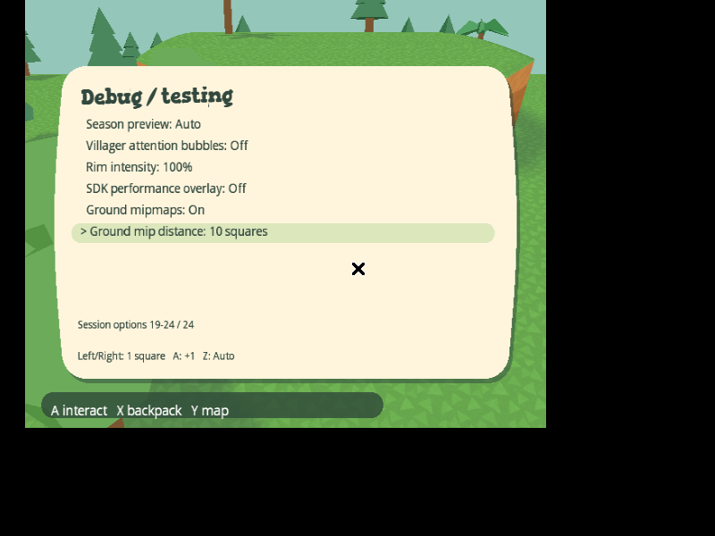
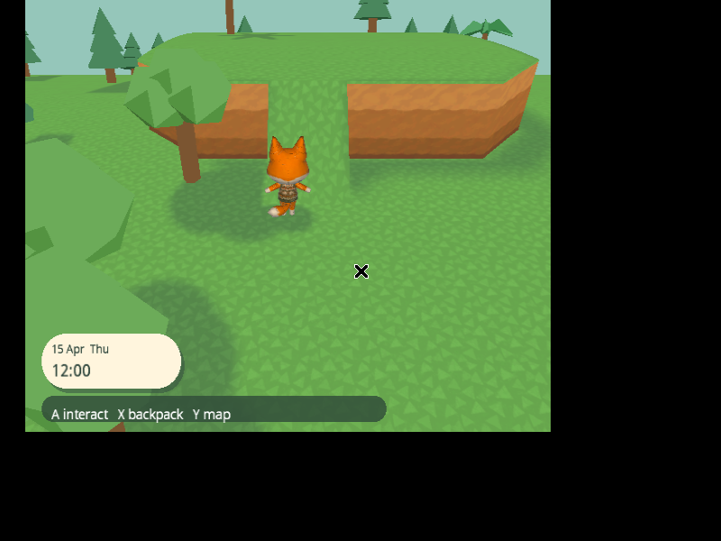
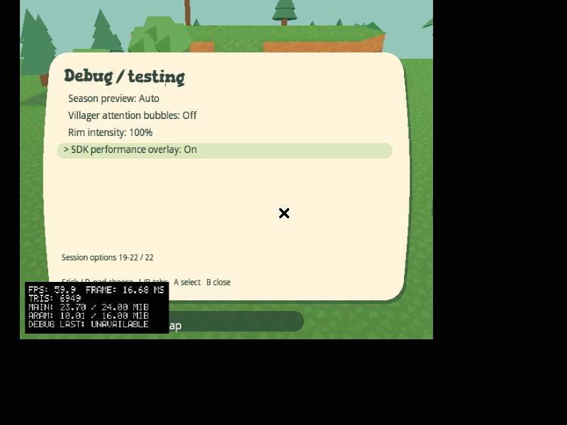
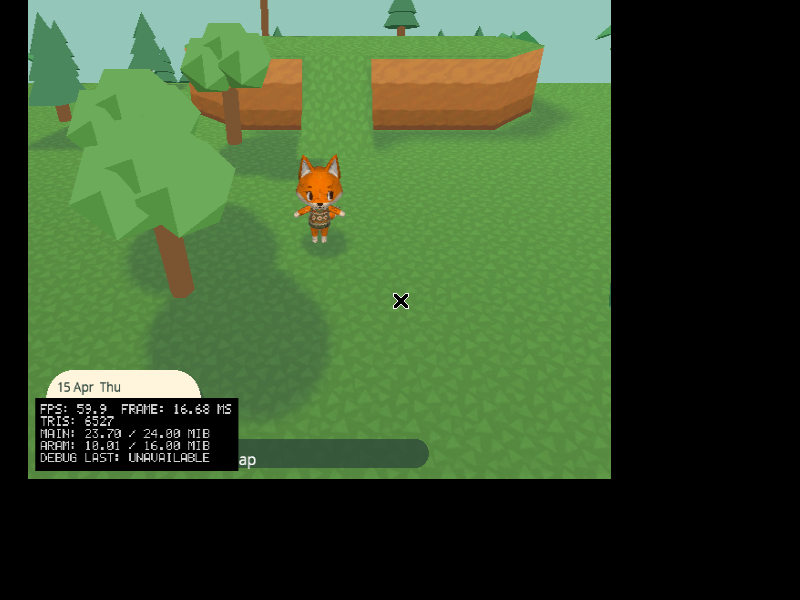
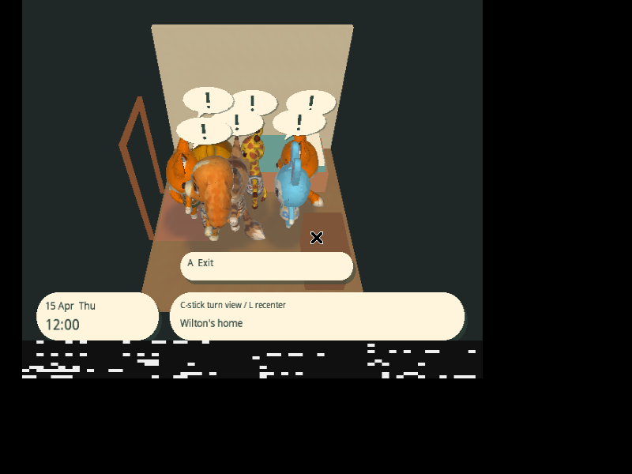
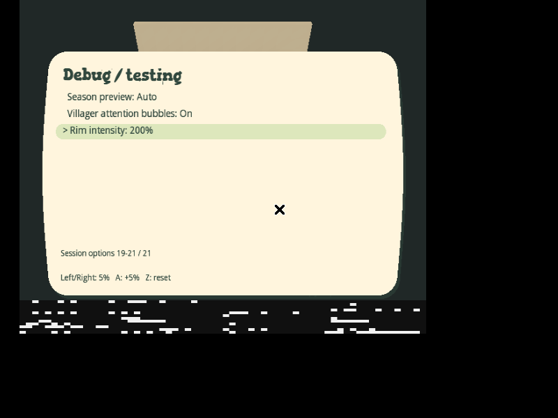
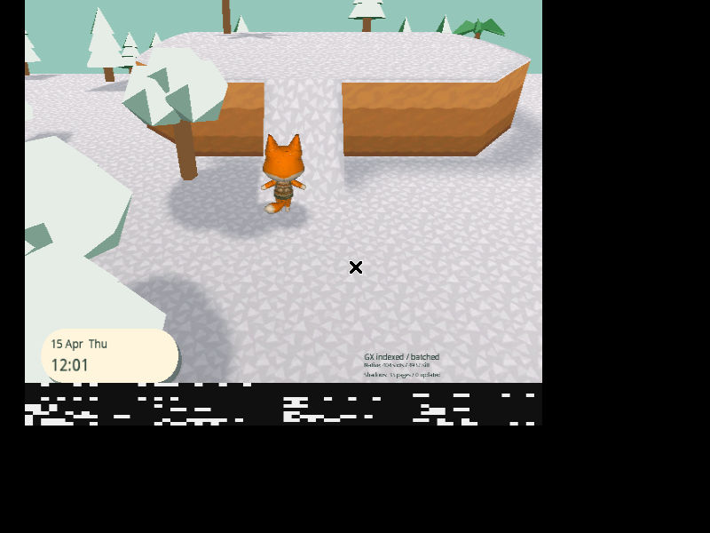

# Stronger cylinder and session rendering controls

World curvature (1/radius) is 8% greater than the previous main build:
`Radius = (360 / 2π) / 1.08`, approximately 53.05 m. Playable dimensions and
logical movement distances, the camera lens/eye offsets, terrain collision and
save layouts are unchanged. Ground, water, trees, actors, shadows and visibility
all use the same shared cylinder projection and rigid scrolling transforms.

Press **Z three times consecutively** to show or hide the debug entries on both
the title and in-game menus. Visibility defaults to hidden and is saved in
console preferences. Then open **START → Settings → Debug / testing**. The last page adds:

- **Season preview:** Auto → spring → summer → fall → winter → Auto. This affects
  outdoor floor/cliff material bindings, water tint and tree foliage. Auto returns
  to the calendar/build configuration. Calendar progression, NPC requests and
  saved terrain/material IDs are untouched. Each explicit season change loads
  its existing assets and rebuilds the cold archive once, behind the loading UI;
  ordinary movement continues reusing the archive afterward.
- **Villager attention bubbles:** Off by default. Forces a visual exclamation
  chat bubble above NPCs in the current room/view, without changing requests,
  dialogue or journeys. A shared depth-tested 3D billboard lets scenery hide it.
  Anchors are derived once from each rig's node heights; indoor camera rotation,
  doorway positions, viewport/horizon culling and opaque fades are respected.
- **SDK performance overlay** shows the SDK panel with FPS, frame time,
  triangles, and main and ARAM memory. It starts off each time the game boots
  and can be toggled from the title or town debug menu. **Performance display**
  controls the separate frame-capture telemetry.
- **Ground mipmaps** uses full and half resolution. Turn it off to sample full
  resolution at every distance.
- **Ground mip switch** starts at four tiles from the player. Left and Right
  select a radius of 1–24 tiles, and X restores the default. The distance follows
  the town grid across slopes and terraces.
- **Ground mip bands** shows full resolution in green and half resolution in
  yellow. The pink line marks the same radius used by the texture sampler.
- **World rim** blends white onto outdoor terrain as its surface turns away
  from the camera. The overlay is transparent when facing the camera head-on
  and reaches 70% opacity at a grazing angle. It starts off for each town session.
- **Obstructed object edges** draws cyan mesh edges where nearer surfaces block
  submitted objects. The renderer uses the completed depth buffer and existing
  visibility checks.
- **Tile visit edges** connects neighboring visited tile centers. Each end takes
  its own color from the traffic count. Blue means 1–9 visits, green 10–34,
  orange 35–99, and red 100 or more. Both tiles must have visits to show a line.

The town toggles and distance changes apply to the active session. The title
menu can save initial preferences for Ground mipmaps, Ground mip switch, and
Ground mip bands.

Ground uses a shared 16 KiB GX distance mask and samples the two levels from
one texture allocation. The 256px CMPR ground payload is 40,960 bytes. The mip
bands overlay creates a palette texture of the same size while enabled. The
world rim and obstructed edges add separate drawing passes when enabled.
Moving the cutoff follows the player without rebuilding terrain sections.

The first outdoor frame uses the 64px preview. The renderer loads the full
256px texture asynchronously, switches between frames and evicts the preview.
Both textures use the same two-level layout and switch distance.

## Optimized defaults

Normal startup already uses immutable ARAM terrain, fixed MEM1 mesh views,
indexed/batched drawing and cached merged object/villager/cliff shadows. Keep
these defaults enabled. Ground mesh recreation and the older ground-ring
comparison remain off; enabling that comparison would select the older rolling
builder. Independent frame-pacing/clear-reuse experiments keep their existing
settings. The 8 MiB terrain ARAM reservation, 1 MiB working cache and native/managed
budgets are unchanged.

## Validation

Host checks cover season overrides independent of calendar/build season,
clamped numerical rim controls and reset, unchanged saves, exact curvature ratio,
full frustum/horizon/streaming coverage, chord-correct projected shadows and
camera-facing icon geometry/bounds. Native rim policy checks cover 0/100/200%
and extreme integer inputs. Clean CI and local checks pass 2,702,371 gameplay/render/texture checks and
324,925 rendering-service checks, plus backend integration and native fixtures.
The shadow chord oracle uses full Y/Z segment distance: projected Z alone folds
near a quarter turn and cannot robustly identify a row chord at this curvature.

## Ground mipmap delivery

Earlier ground mipmap capture from `ec3b83a1f8159aec789d5053187c33219c188584`.
[Release 0.11.8.ec3b83a1f815](https://github.com/capz/AnimalTown/releases/tag/v0.11.8.ec3b83a1f815)
contains the full 1,459,978,240-byte bootable ISO, direct 88,619,008-byte NKit ISO
and matching clean backend. Downloaded checksums and clean identities match;
the NKit audit verifies an exact full-image roundtrip and unchanged boot/files.
[Machine-readable results and image digests](performance/2026-11-09-ground-mipmaps.json).
Clean CI/local validation passes 2,702,415 gameplay/render/texture checks,
324,925 rendering-service checks, backend integration and native/tooling fixtures.
The published texture audit confirms seven CMPR ground levels at 43,712 bytes
and the unchanged two-level, 10,240-byte soil policy.

The published NKit image boots directly in Dolphin. The actual debug menu checks
On/Off, Auto, 1 and 10 squares, X reset and L shoulder tab navigation. An unchanged
foreground grass region has horizontal red-channel edge energy 11,642 in Auto,
13,254 with mips Off, 13,132 at 1 square and 13,254 at 10 squares; reset restores
11,642 exactly. These fixed-scene detail comparisons verify that the sampler
changes take effect. They are not a general image-quality metric. The generated
ramp, cliff material border and tree shadows remain aligned in the inspected view.
Every input memory-card byte is unchanged.



[Base level comparison with mipmaps Off](performance/ground-mip-off.png).

After resetting Auto, a marked movement interval covers 284 consecutive frames,
including 123 moving frames. Terrain build stages, mesh creates/updates/releases,
texture operations, loading/missing/recovery frames and garbage collections are
zero; shadow coverage updates 354 pages. Terrain preparation median/p95/max is
0.8/2.5/4.1 ms. Reported frame intervals are 16.6 ms at 0.1 ms guest resolution.
This short software-rendered Dolphin window, including stationary frames, does
not establish locked 60 FPS or physical hardware timing. Physical GameCube
testing remains outstanding; four pre-existing unused HUD-field warnings remain.

Reproduce in the existing Dolphin container with `--shm-size=1g`,
`LIBGL_ALWAYS_SOFTWARE=1` and a copied card in the output directory:

```sh
python3 docs/performance/ground_mipmaps.py IMAGE.nkit.iso out/ground-mip-native --stream-travel --season spring --dsp-hle
python3 docs/performance/analyze_ground_mips.py out/ground-mip-native --capture out/ground-mip-native/user/Dump/Frames/*.avi
```

## Earlier SDK performance panel delivery

The additional SDK overlay is validated at
`edf96ad36b9c1c8c98242a6f4e6afab641d01f34` in
[release 0.10.8.edf96ad36b9c](https://github.com/capz/AnimalTown/releases/tag/v0.10.8.edf96ad36b9c).
The release contains the full 1,459,978,240-byte bootable ISO and direct
88,586,240-byte NKit ISO, with matching clean backend identity. Downloaded
checksums, the release metadata and exact NKit roundtrip audit agree.
[Machine-readable results](performance/2026-11-09-sdk-performance-overlay.json)
include both image digests.

Dolphin boots the published NKit image and checks the actual menu's Off → On →
Off behavior. FPS/frame time, triangles and main/ARAM memory are visible; moving
changes the displayed triangle count from 6,527 to 6,405. A fixed image region
contains over 11,800 black panel pixels when enabled and zero when hidden; the
Off label is restored exactly. The independent frame-capture option remains Off.
Every input memory-card byte is unchanged. This is a UI/counter check, not a
hardware performance measurement. Local managed suites and the clean release
build pass; physical GameCube testing remains outstanding.




Reproduce using the same Dolphin container settings and a copied card in the
output directory:

```sh
python3 docs/performance/sdk_performance_overlay.py IMAGE.nkit.iso out/sdk-overlay-native --stream-travel --season spring --dsp-hle
python3 docs/performance/sdk_performance_overlay.py --analyze-only out/sdk-overlay-native
```

## Earlier curvature, season, attention and rim captures

Validated game: `b7a19e9a73350ca603049960e652b4d359e71aa3`.
[Release 0.9.8.b7a19e9a7335](https://github.com/capz/AnimalTown/releases/tag/v0.9.8.b7a19e9a7335).
[Machine-readable results](performance/2026-11-09-world-debug-controls.json).

The full bootable ISO is 1,459,978,240 bytes, SHA-256
`346362e62db35191abef902891544a8e19ea364e147f3849947b1e2e1963ebdb`.
The direct NKit ISO is 88,586,240 bytes, SHA-256
`78a3e1238895cf004dff48adde47b81adad4b3ac38ddf8c45f423ed714dbc5ee`.
Downloaded image/backend checksums and clean same-commit manifests match GitHub
asset metadata. The NKit audit verifies an exact full-image roundtrip and
unchanged DOL/apploader/disc files. Neither ISO has a ZIP wrapper.

Dolphin directly boots the published image. The original saved-town copy checks
spring, summer, fall, winter and return to Auto on actual generated cliffs/ramps,
including seasonal foliage and narrow cliff borders. The April date remains
unchanged while winter is previewed. A separately prepared, valid disposable
card places all six NPCs in one room with long dwell timers for stable tests.
Its original source card is preserved. All four indoor camera directions show
the attention billboards correctly. The 0%, 100% and 200% captures have monotonic
brightness over the same static character region; the numerical label and Z
reset are checked separately. Attention paper pixels change from 0 to 8,920 and
back to 0 in the inspected region. Both emulator runs preserve every input-card
byte, including all option changes.




[Return to Auto](performance/debug-season-auto.png).

After returning to Auto, a marked movement interval has 280 consecutive frames,
including 122 with actual player movement. Terrain construction stages, mesh
creations/updates/releases, texture operations, loading/missing/recovery frames
and garbage collections are zero. Cached shadow coverage remains active with
352 page updates. Terrain preparation is 0.8 ms median, 2.5 ms p95 and 4.1 ms
maximum. Frame intervals report 16.6 ms throughout at 0.1 ms guest resolution.
This is one short instrumented window, including stationary frames, not a
locked-60-FPS or physical-hardware guarantee. Both full captures are archived
losslessly with every decoded RGB frame hash verified. Four pre-existing unused
HUD-field managed warnings remain. Physical GameCube testing is outstanding.

Reproduce in the existing Dolphin image with `--shm-size=1g`,
`LIBGL_ALWAYS_SOFTWARE=1` and separate copied cards:

```sh
python3 docs/performance/world_debug_controls.py IMAGE.nkit.iso out/world-debug-outdoor --stream-travel --season spring --dsp-hle
python3 docs/performance/world_debug_controls.py IMAGE.nkit.iso out/world-debug-indoor --stream-travel --indoor-fixture --season spring --dsp-hle
python3 docs/performance/analyze_world_debug.py out/world-debug-outdoor out/world-debug-indoor --capture OUTDOOR.mkv
```

Create the indoor fixture from a **copyable current-schema emulator card** after
building the host building catalog (`out/disc/buildings.bin`). The helper preserves
card allocation/banner metadata and refuses to overwrite its input. The host
codec validates all records/commits, safe NPC positions and fixed record lengths:

```sh
python3 docs/performance/world-debug-fixture/card.py extract SOURCE_CARD.raw out/world-debug-indoor
dotnet run --project docs/performance/world-debug-fixture/Fixture.csproj -- out/world-debug-indoor
python3 docs/performance/world-debug-fixture/card.py write SOURCE_CARD.raw out/world-debug-indoor
```

Only the disposable output card changes: player and six NPCs occupy room 16,
with valid long dwell timers for static comparison. Metadata and source/fixture
digests are in the result JSON. Unsupported card allocation/schema or different
record lengths fail validation rather than rewriting the input.
