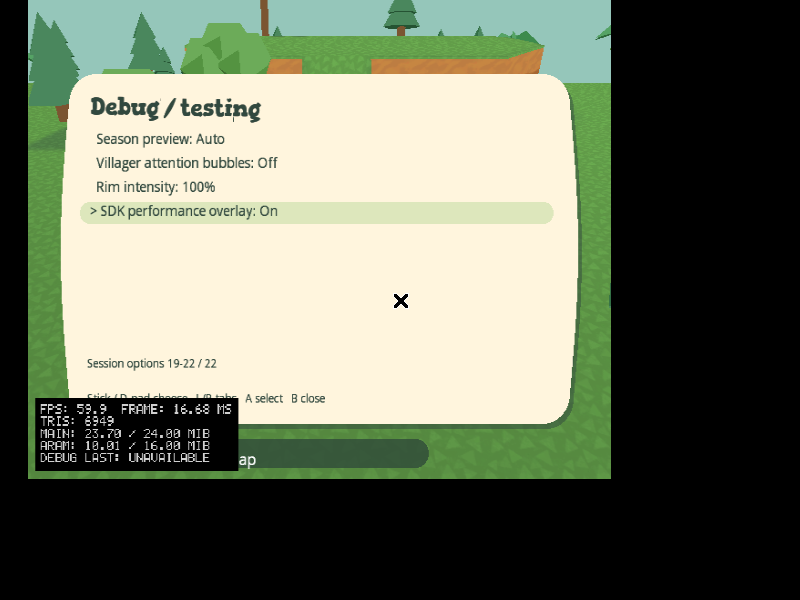
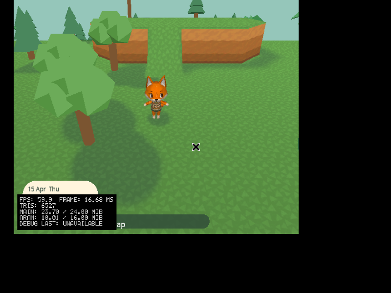
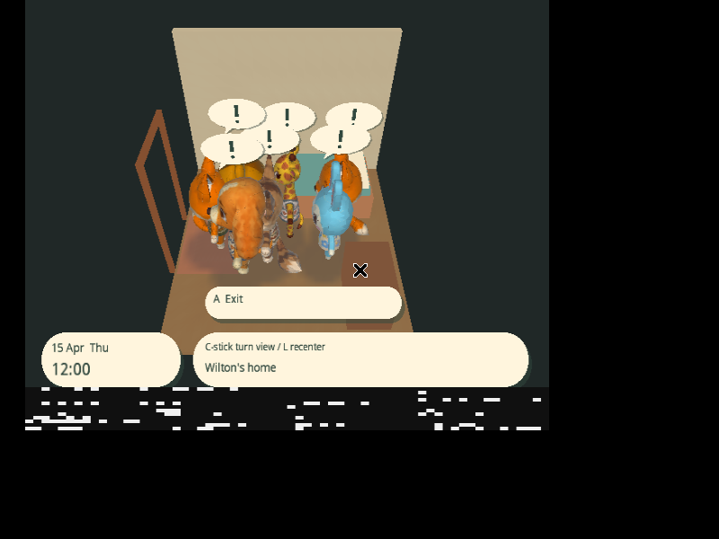
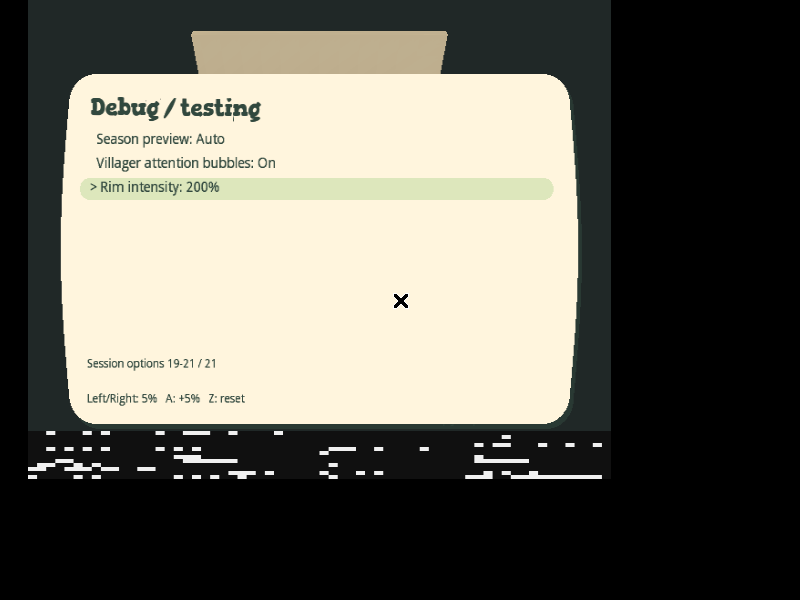
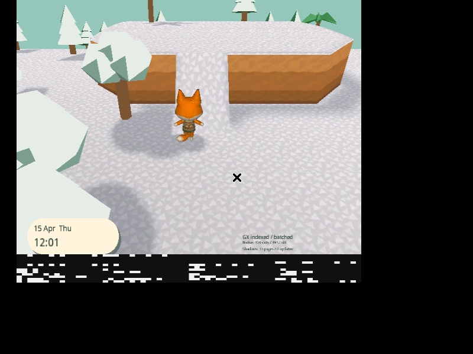

# Stronger cylinder and session rendering controls

World curvature (1/radius) is 8% greater than the previous main build:
`Radius = (360 / 2π) / 1.08`, approximately 53.05 m. Playable dimensions and
logical movement distances, the camera lens/eye offsets, terrain collision and
save layouts are unchanged. Ground, water, trees, actors, shadows and visibility
all use the same shared cylinder projection and rigid scrolling transforms.

Open **START → Settings → Debug / testing**. The last page adds:

- **Season preview:** Auto → spring → summer → fall → winter → Auto. This affects
  outdoor floor/cliff material bindings, water tint and tree foliage. Auto returns
  to the calendar/build configuration. Calendar progression, NPC requests and
  saved terrain/material IDs are untouched. Each explicit season change loads
  its existing assets and rebuilds the cold archive once, behind the loading UI;
  ordinary movement continues reusing the archive afterward.
- **Villager attention bubbles:** Off by default. Forces a visual exclamation
  chat bubble above NPCs in the current room/view, without changing requests,
  dialogue or journeys. A shared depth-tested 3D billboard lets scenery hide it.
  Anchors are derived once from each rig's node heights; indoor camera rotation,
  doorway positions, viewport/horizon culling and opaque fades are respected.
- **Rim intensity:** 0–200%, initially 100% (the previous shader strength).
  Left/right adjust by 5%; A increases and Z resets to 100%. L/R still change
  tabs. The existing Actor rim lighting switch remains a separate enable control.
  At 0% the extra rim TEV stage and normal texture generation are disabled.
- **SDK performance overlay:** Off by default. Toggles the built-in
  `Dolphin.Diagnostics.DebugOverlay.PerformanceVisible` panel used by SDK examples,
  with live FPS/frame time, triangles, main/ARAM memory and available network
  diagnostics. It is independent from the existing Performance display option
  used for AnimalTown frame-capture telemetry. The native panel occupies the
  bottom-left corner; hide it when recording the encoded frame-capture bars.

All rendering previews are session-only. They never write saves automatically and
are not serialized by Save now. The attention icon uses one reusable 44-triangle
mesh and six transforms; no icon animation or per-frame particle allocation is
introduced. Its mesh is prepared between frames on first enable. Rim intensity
changes only the TEV constant color, with one immutable shared lookup texture;
no geometry or texture is regenerated when changing the percentage.

## Optimized defaults

Normal startup already uses immutable ARAM terrain, fixed MEM1 mesh views,
indexed/batched drawing and cached merged object/villager/cliff shadows. Keep
these defaults enabled. Ground mesh recreation and the older ground-ring
comparison remain off; enabling that comparison would select the older rolling
builder. Independent frame-pacing/clear-reuse experiments keep their existing
settings. The 8 MiB terrain ARAM reservation, 1 MiB working cache and native/managed
budgets are unchanged.

## Validation

Host checks cover season overrides independent of calendar/build season,
clamped numerical rim controls and reset, unchanged saves, exact curvature ratio,
full frustum/horizon/streaming coverage, chord-correct projected shadows and
camera-facing icon geometry/bounds. Native rim policy checks cover 0/100/200%
and extreme integer inputs. Clean CI and local checks pass 2,702,371 gameplay/render/texture checks and
324,925 rendering-service checks, plus backend integration and native fixtures.
The shadow chord oracle uses full Y/Z segment distance: projected Z alone folds
near a quarter turn and cannot robustly identify a row chord at this curvature.

## SDK performance panel delivery

The additional SDK overlay is validated at
`edf96ad36b9c1c8c98242a6f4e6afab641d01f34` in
[release 0.10.8.edf96ad36b9c](https://github.com/capz/AnimalTown/releases/tag/v0.10.8.edf96ad36b9c).
The release contains the full 1,459,978,240-byte bootable ISO and direct
88,586,240-byte NKit ISO, with matching clean backend identity. Downloaded
checksums, the release metadata and exact NKit roundtrip audit agree.
[Machine-readable results](performance/2026-11-09-sdk-performance-overlay.json)
include both image digests.

Dolphin boots the published NKit image and checks the actual menu's Off → On →
Off behavior. FPS/frame time, triangles and main/ARAM memory are visible; moving
changes the displayed triangle count from 6,527 to 6,405. A fixed image region
contains over 11,800 black panel pixels when enabled and zero when hidden; the
Off label is restored exactly. The independent frame-capture option remains Off.
Every input memory-card byte is unchanged. This is a UI/counter check, not a
hardware performance measurement. Local managed suites and the clean release
build pass; physical GameCube testing remains outstanding.




Reproduce using the same Dolphin container settings and a copied card in the
output directory:

```sh
python3 docs/performance/sdk_performance_overlay.py IMAGE.nkit.iso out/sdk-overlay-native --stream-travel --season spring --dsp-hle
python3 docs/performance/sdk_performance_overlay.py --analyze-only out/sdk-overlay-native
```

## Earlier curvature, season, attention and rim captures

Validated game: `b7a19e9a73350ca603049960e652b4d359e71aa3`.
[Release 0.9.8.b7a19e9a7335](https://github.com/capz/AnimalTown/releases/tag/v0.9.8.b7a19e9a7335).
[Machine-readable results](performance/2026-11-09-world-debug-controls.json).

The full bootable ISO is 1,459,978,240 bytes, SHA-256
`346362e62db35191abef902891544a8e19ea364e147f3849947b1e2e1963ebdb`.
The direct NKit ISO is 88,586,240 bytes, SHA-256
`78a3e1238895cf004dff48adde47b81adad4b3ac38ddf8c45f423ed714dbc5ee`.
Downloaded image/backend checksums and clean same-commit manifests match GitHub
asset metadata. The NKit audit verifies an exact full-image roundtrip and
unchanged DOL/apploader/disc files. Neither ISO has a ZIP wrapper.

Dolphin directly boots the published image. The original saved-town copy checks
spring, summer, fall, winter and return to Auto on actual generated cliffs/ramps,
including seasonal foliage and narrow cliff borders. The April date remains
unchanged while winter is previewed. A separately prepared, valid disposable
card places all six NPCs in one room with long dwell timers for stable tests.
Its original source card is preserved. All four indoor camera directions show
the attention billboards correctly. The 0%, 100% and 200% captures have monotonic
brightness over the same static character region; the numerical label and Z
reset are checked separately. Attention paper pixels change from 0 to 8,920 and
back to 0 in the inspected region. Both emulator runs preserve every input-card
byte, including all option changes.




[Return to Auto](performance/debug-season-auto.png).

After returning to Auto, a marked movement interval has 280 consecutive frames,
including 122 with actual player movement. Terrain construction stages, mesh
creations/updates/releases, texture operations, loading/missing/recovery frames
and garbage collections are zero. Cached shadow coverage remains active with
352 page updates. Terrain preparation is 0.8 ms median, 2.5 ms p95 and 4.1 ms
maximum. Frame intervals report 16.6 ms throughout at 0.1 ms guest resolution.
This is one short instrumented window, including stationary frames, not a
locked-60-FPS or physical-hardware guarantee. Both full captures are archived
losslessly with every decoded RGB frame hash verified. Four pre-existing unused
HUD-field managed warnings remain. Physical GameCube testing is outstanding.

Reproduce in the existing Dolphin image with `--shm-size=1g`,
`LIBGL_ALWAYS_SOFTWARE=1` and separate copied cards:

```sh
python3 docs/performance/world_debug_controls.py IMAGE.nkit.iso out/world-debug-outdoor --stream-travel --season spring --dsp-hle
python3 docs/performance/world_debug_controls.py IMAGE.nkit.iso out/world-debug-indoor --stream-travel --indoor-fixture --season spring --dsp-hle
python3 docs/performance/analyze_world_debug.py out/world-debug-outdoor out/world-debug-indoor --capture OUTDOOR.mkv
```

Create the indoor fixture from a **copyable current-schema emulator card** after
building the host building catalog (`out/disc/buildings.bin`). The helper preserves
card allocation/banner metadata and refuses to overwrite its input. The host
codec validates all records/commits, safe NPC positions and fixed record lengths:

```sh
python3 docs/performance/world-debug-fixture/card.py extract SOURCE_CARD.raw out/world-debug-indoor
dotnet run --project docs/performance/world-debug-fixture/Fixture.csproj -- out/world-debug-indoor
python3 docs/performance/world-debug-fixture/card.py write SOURCE_CARD.raw out/world-debug-indoor
```

Only the disposable output card changes: player and six NPCs occupy room 16,
with valid long dwell timers for static comparison. Metadata and source/fixture
digests are in the result JSON. Unsupported card allocation/schema or different
record lengths fail validation rather than rewriting the input.
